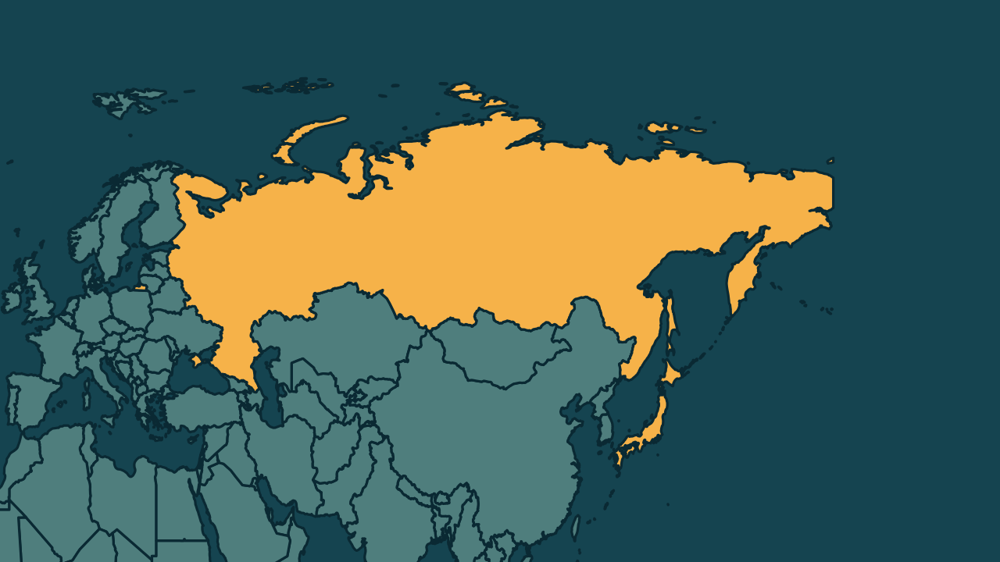

# Japão protesta contra a Rússia após aviões violarem seu espaço aéreo

*Heimdall News, edição internacional. 17 de novembro de 2026*

## A notícia

Dois aviões russos violaram o espaço aéreo do Japão nesta terça-feira, perto da ilha de Okinoshima. O Japão enviou caças para advertir as aeronaves e apresentou um protesto à Rússia. [1][2][3][4]

Segundo o governo japonês, a última violação confirmada por aviões russos foi em setembro de 2024, perto da ilha de Rebun. No mesmo dia, aviões militares russos entraram nas zonas de defesa aérea da Coreia do Sul e de Taiwan. [5][6][7]

Os voos antecedem a ida do presidente russo, Vladimir Putin, à cúpula da Cooperação Econômica Ásia-Pacífico, em Shenzhen, na China. As relações entre Tóquio e Moscou pioraram após a prisão de um jornalista japonês acusado de espionagem. [8][9][10]

## Quem se manifestou

- **Minoru Kihara, japonês, secretário-chefe do Gabinete:** afirmou que a violação é uma grave afronta à soberania do Japão e totalmente inaceitável, e pediu à Rússia que o episódio não se repita. [11][12]
- **Ministério da Defesa de Taiwan, Taiwan:** afirmou que monitorou o percurso dos aviões russos e respondeu de forma adequada. [13][14]
- **Estado-Maior Conjunto da Coreia do Sul, Coreia do Sul:** afirmou que mobilizou caças e que não houve violação do espaço aéreo sul-coreano. [15][16]

## Reação no Brasil

Nenhum posicionamento encontrado.

## Fontes

1. Poder360, [Aviões russos violaram espaço aéreo do Japão, diz governo japonês](https://www.poder360.com.br/poder-internacional/avioes-russos-violaram-espaco-aereo-do-japao-diz-governo-japones/): "2 aviões russos violaram o espaço aéreo do Japão"
2. Revista Oeste, [Japão denuncia violação de seu espaço aéreo por 2 aviões russos](https://revistaoeste.com/mundo/japao-denuncia-violacao-de-seu-espaco-aereo-por-2-avioes-russos/): "As autoridades detectaram as aeronaves perto da ilha de Okinoshima"
3. Estadão, com AFP, [Aviões russos violaram espaço aéreo do Japão, diz Tóquio](https://www.estadao.com.br/internacional/avioes-russos-violaram-espaco-aereo-do-japao-diz-toquio-npr/): "As Forças de Autodefesa do Japão enviaram caças para advertir os aviões"
4. CNN Brasil, [Japão protesta após aeronaves russas invadirem seu espaço aéreo](https://www.cnnbrasil.com.br/internacional/japao-protesta-apos-aeronaves-russas-invadirem-seu-espaco-aereo/): "O Japão apresentou um forte protesto a Moscou nesta terça-feira (17)"
5. Poder360, [Aviões russos violaram espaço aéreo do Japão, diz governo japonês](https://www.poder360.com.br/poder-internacional/avioes-russos-violaram-espaco-aereo-do-japao-diz-governo-japones/): "A última violação confirmada do espaço aéreo japonês por aviões russos ocorreu perto da ilha Rebun, em Hokkaido, em setembro de 2024"
6. G1, com Reuters, [Coreia do Sul envia caças após incursão de aviões russos em sua zona de defesa aérea; Japão relata violação](https://g1.globo.com/mundo/noticia/2026/11/16/coreia-do-sul-envia-cacas-apos-incursao-de-avioes-russos-em-sua-zona-de-defesa-aerea-japao-relata-violacao.ghtml): "várias aeronaves militares russas entraram em sua zona de identificação de defesa aérea nesta terça-feira (17)"
7. CNN Brasil, [Japão protesta após aeronaves russas invadirem seu espaço aéreo](https://www.cnnbrasil.com.br/internacional/japao-protesta-apos-aeronaves-russas-invadirem-seu-espaco-aereo/): "duas aeronaves militares russas entrando na zona de identificação de defesa aérea da ilha pelo nordeste"
8. Poder360, [Aviões russos violaram espaço aéreo do Japão, diz governo japonês](https://www.poder360.com.br/poder-internacional/avioes-russos-violaram-espaco-aereo-do-japao-diz-governo-japones/): "Os relatos de violação do espaço aéreo se dão antes da chegada do presidente russo, Vladimir Putin"
9. Poder360, [Aviões russos violaram espaço aéreo do Japão, diz governo japonês](https://www.poder360.com.br/poder-internacional/avioes-russos-violaram-espaco-aereo-do-japao-diz-governo-japones/): "à cidade de Shenzhen, no sul da China, para a cúpula dos líderes da Apec"
10. Estadão, com AFP, [Aviões russos violaram espaço aéreo do Japão, diz Tóquio](https://www.estadao.com.br/internacional/avioes-russos-violaram-espaco-aereo-do-japao-diz-toquio-npr/): "As relações entre Tóquio e Moscou se deterioraram nas últimas semanas, após a prisão de um jornalista japonês acusado de espionagem"
11. Revista Oeste, [Japão denuncia violação de seu espaço aéreo por 2 aviões russos](https://revistaoeste.com/mundo/japao-denuncia-violacao-de-seu-espaco-aereo-por-2-avioes-russos/): "não é apenas uma grave afronta à soberania do país, mas representa uma ameaça à nossa segurança e é totalmente inaceitável"
12. CNN Brasil, [Japão protesta após aeronaves russas invadirem seu espaço aéreo](https://www.cnnbrasil.com.br/internacional/japao-protesta-apos-aeronaves-russas-invadirem-seu-espaco-aereo/): "Apresentamos um forte protesto à Rússia e pedimos que impeça a repetição do episódio."
13. CNN Brasil, [Japão protesta após aeronaves russas invadirem seu espaço aéreo](https://www.cnnbrasil.com.br/internacional/japao-protesta-apos-aeronaves-russas-invadirem-seu-espaco-aereo/): "utilizou recursos conjuntos de inteligência, vigilância e reconhecimento para monitorar todo o percurso da operação"
14. CNN Brasil, [Japão protesta após aeronaves russas invadirem seu espaço aéreo](https://www.cnnbrasil.com.br/internacional/japao-protesta-apos-aeronaves-russas-invadirem-seu-espaco-aereo/): "“respondeu de forma adequada”, sem fornecer detalhes"
15. G1, com Reuters, [Coreia do Sul envia caças após incursão de aviões russos em sua zona de defesa aérea; Japão relata violação](https://g1.globo.com/mundo/noticia/2026/11/16/coreia-do-sul-envia-cacas-apos-incursao-de-avioes-russos-em-sua-zona-de-defesa-aerea-japao-relata-violacao.ghtml): "mobilizaram caças da Força Aérea"
16. G1, com Reuters, [Coreia do Sul envia caças após incursão de aviões russos em sua zona de defesa aérea; Japão relata violação](https://g1.globo.com/mundo/noticia/2026/11/16/coreia-do-sul-envia-cacas-apos-incursao-de-avioes-russos-em-sua-zona-de-defesa-aerea-japao-relata-violacao.ghtml): "O sobrevoo russo, no entanto, não representou uma violação do espaço aéreo sul-coreano, segundo Seul"
