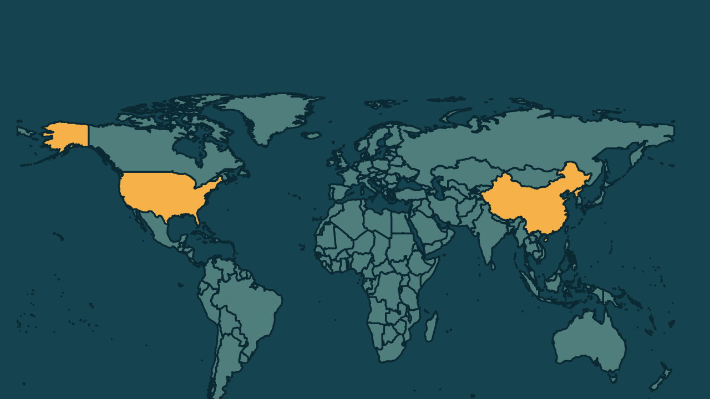

# Trump diz que Kim Jong Un quer ir à China para cúpula com Xi e Putin

*Heimdall News, edição internacional. 17 de novembro de 2026*

## A notícia

O presidente dos Estados Unidos, Donald Trump, disse nesta terça-feira, em Manila, nas Filipinas, que o líder da Coreia do Norte, Kim Jong Un, gostaria de ir à China nesta semana. Horas antes, Pequim afirmou não ter informações sobre um encontro entre os dois. [1][2][3]

Na quinta-feira, dia 19, Trump vai se reunir com Xi Jinping, da China, e Vladimir Putin, da Rússia, em Shenzhen, à margem da cúpula da Cooperação Econômica Ásia-Pacífico. A Coreia do Norte não é membro do fórum. [4][5][6][7]

Trump se reuniu três vezes com Kim no primeiro mandato, sem avanços concretos no desarmamento nuclear. Em agosto, mandou reduzir os exercícios militares conjuntos com a Coreia do Sul. [8][9][10]

## Quem se manifestou

- **Donald Trump, americano, presidente:** afirmou que qualquer encontro com Kim seria na China e dependeria de Xi Jinping. Disse também que vai tratar da Ucrânia, seu assunto favorito. [11][12]
- **Guo Jiakun, chinês, porta-voz das Relações Exteriores:** afirmou que não tinha informações sobre uma possível participação de Kim na cúpula desta semana. [13]
- **Governo da Coreia do Norte, Coreia do Norte:** indicou publicamente que não tem intenção de se reunir com o presidente americano neste momento. [14]

## Reação no Brasil

- **Fernando Brancoli, brasileiro, professor de Relações Internacionais:** avaliou que Trump chega à reunião em busca de uma agenda positiva e que o resultado mais provável são declarações de que algo será feito no futuro. [15][16]

## Fontes

1. Estadão, com AFP, [Trump chega às Filipinas para conversar com aliados na Ásia em 1ª viagem após derrota eleitoral](https://www.estadao.com.br/internacional/trump-chega-as-filipinas-para-conversar-com-aliados-na-asia-em-1-viagem-apos-derrota-eleitoral-npr/): "O presidente dos Estados Unidos, Donald Trump, chegou a Manila, nas Filipinas, nesta terça-feira, 17"
2. CNN Brasil, [Trump diz que Kim Jong Un quer ir à China para reunião com Xi e Putin](https://www.cnnbrasil.com.br/internacional/trump-diz-que-kim-jong-un-quer-ir-a-china-para-reuniao-com-xi-e-putin/): "Questionado por jornalistas se Kim viajaria à China, Trump respondeu: “Ele gostaria, sim."
3. Estadão, com AFP, [Trump chega às Filipinas para conversar com aliados na Ásia em 1ª viagem após derrota eleitoral](https://www.estadao.com.br/internacional/trump-chega-as-filipinas-para-conversar-com-aliados-na-asia-em-1-viagem-apos-derrota-eleitoral-npr/): "Horas antes, Pequim afirmou que não tinha informações sobre um possível encontro entre os dois."
4. Estadão, com AFP, [Trump chega às Filipinas para conversar com aliados na Ásia em 1ª viagem após derrota eleitoral](https://www.estadao.com.br/internacional/trump-chega-as-filipinas-para-conversar-com-aliados-na-asia-em-1-viagem-apos-derrota-eleitoral-npr/): "Na quinta-feira, 19, o republicano terá uma reunião trilateral com os presidentes da China, Xi Jinping, e da Rússia, Vladimir Putin"
5. Estadão, com AFP, [Trump diz que pode se reunir com Kim Jong-un durante viagem à Ásia](https://www.estadao.com.br/internacional/trump-diz-que-pode-se-reunir-com-kim-jong-un-durante-viagem-a-asia-npr/): "à margem da cúpula da Cooperação Econômica Ásia-Pacífico (APEC)"
6. Brasil de Fato, [China confirma trilateral entre Xi, Putin e Trump em Shenzhen, em 19 de novembro](https://www.brasildefato.com.br/2026/11/16/china-confirma-trilateral-entre-xi-putin-e-trump-em-shenzhen-em-19-de-novembro/): "vão se reunir em 19 de novembro, em Shenzhen"
7. CNN Brasil, [Trump diz que Kim Jong Un quer ir à China para reunião com Xi e Putin](https://www.cnnbrasil.com.br/internacional/trump-diz-que-kim-jong-un-quer-ir-a-china-para-reuniao-com-xi-e-putin/): "A Coreia do Norte não é membro da APEC"
8. Folha de S.Paulo, [Trump diz que poderá se reunir com Kim Jong-un durante viagem à China nesta semana](https://www1.folha.uol.com.br/mundo/2026/11/trump-diz-que-podera-se-reunir-com-kim-jong-un-durante-viagem-a-china-nesta-semana.shtml): "Durante seu primeiro mandato, de 2017 a 2021, Trump se reuniu três vezes com Kim Jong-un"
9. Folha de S.Paulo, [Trump diz que poderá se reunir com Kim Jong-un durante viagem à China nesta semana](https://www1.folha.uol.com.br/mundo/2026/11/trump-diz-que-podera-se-reunir-com-kim-jong-un-durante-viagem-a-china-nesta-semana.shtml): "As conversas, porém, não produziram avanços concretos no desarmamento nuclear."
10. Estadão, com AFP, [Trump diz que pode se reunir com Kim Jong-un durante viagem à Ásia](https://www.estadao.com.br/internacional/trump-diz-que-pode-se-reunir-com-kim-jong-un-durante-viagem-a-asia-npr/): "Em agosto, ordenou ao Pentágono que reduzisse os exercícios militares conjuntos com a Coreia do Sul."
11. CNN Brasil, [Trump diz que pode se reunir com Kim Jong Un na China nesta semana](https://www.cnnbrasil.com.br/internacional/trump-afirma-que-pode-se-reunir-com-kim-jong-un-da-coreia-do-norte/): "qualquer encontro aconteceria em território chinês e que a presença do líder norte-coreano dependeria, em última instância, do presidente chinês"
12. CNN Brasil, [Trump diz que discutirá guerra da Ucrânia em reunião com Putin e Xi Jinping](https://www.cnnbrasil.com.br/internacional/trump-diz-que-discutira-guerra-da-ucrania-em-reuniao-com-putin-e-xi-jinping/): "“Falaremos sobre o meu assunto favorito: a Ucrânia”, disse Trump"
13. CNN Brasil, [Trump diz que Kim Jong Un quer ir à China para reunião com Xi e Putin](https://www.cnnbrasil.com.br/internacional/trump-diz-que-kim-jong-un-quer-ir-a-china-para-reuniao-com-xi-e-putin/): "afirmou que não tinha informações sobre uma possível participação de Kim na reunião da APEC nesta semana"
14. CNN Brasil, [Trump diz que pode se reunir com Kim Jong Un na China nesta semana](https://www.cnnbrasil.com.br/internacional/trump-afirma-que-pode-se-reunir-com-kim-jong-un-da-coreia-do-norte/): "indicou publicamente que não tem intenção de se reunir com o presidente americano neste momento"
15. CNN Brasil, [Trump buscará agenda positiva em reunião com Xi e Putin, diz especialista](https://www.cnnbrasil.com.br/internacional/trump-buscara-agenda-positiva-em-reuniao-com-xi-e-putin-diz-especialista/): "Trump chega também na reunião com o objetivo de encontrar uma agenda positiva"
16. CNN Brasil, [Trump buscará agenda positiva em reunião com Xi e Putin, diz especialista](https://www.cnnbrasil.com.br/internacional/trump-buscara-agenda-positiva-em-reuniao-com-xi-e-putin-diz-especialista/): "A melhor das chances, eu diria, são as chamadas declarações que, de alguma maneira, algo no futuro vai ser feito"
