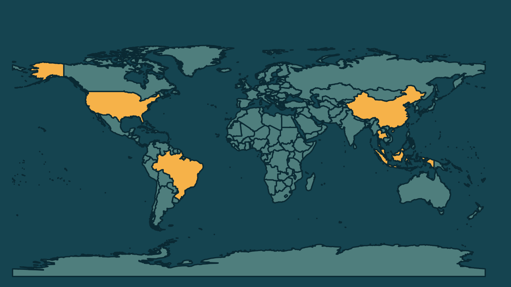

# China promete contramedidas contra regra dos EUA sobre chips

*Heimdall News, edição internacional. 17 de novembro de 2026*

## A notícia

A China afirmou nesta terça-feira que vai adotar contramedidas se os Estados Unidos insistirem na nova regra que exige licença para exportar chips avançados de inteligência artificial ao Brasil, à Indonésia, à Malásia, a Singapura e à Tailândia. [1][2][3]

A norma, publicada na segunda-feira pelo Departamento de Comércio americano, quer impedir que empresas chinesas usem data centers em outros países para treinar modelos com chips vetados à China. Ela veio depois do escândalo que levou Jensen Huang a deixar o comando da Nvidia. [4][5][6][7]

As bolsas reagiram em queda. Na Coreia do Sul, o índice Kospi caiu 2,59%. Na Europa, o setor de tecnologia recuou 3,7%. [8][9]

## Quem se manifestou

- **Ministério do Comércio, China:** afirmou que as medidas contrariam o consenso entre os presidentes dos dois países e disse esperar que Washington volte a negociar. [10][11]
- **Guo Jiakun, chinês, porta-voz das Relações Exteriores:** chamou a regra de exemplo típico de coerção econômica e aplicação extraterritorial da lei e disse que a China tomará as medidas necessárias. [12][13]
- **Departamento de Comércio, Estados Unidos:** afirmou que a norma busca impedir que restrições a tecnologias americanas sensíveis sejam contornadas em data centers de outros países. [14][15]

## Reação no Brasil

- **Álvaro Machado Dias, brasileiro, especialista:** avaliou que o Brasil ainda não é um grande consumidor de chips e afirmou que, no país, empresas de origem americana vão ter muita vantagem sobre empresas puramente nacionais, que precisam das licenças. [16][17][18]

## Fontes

1. Poder360, [China diz que adotará contramedidas após restrição dos EUA a chips](https://www.poder360.com.br/poder-internacional/china-diz-que-adotara-contramedidas-apos-restricao-dos-eua-a-chips/): "A China afirmou nesta 3ª feira (17.nov.2026) que adotará contramedidas caso os Estados Unidos insistam"
2. Folha de S.Paulo, [China diz que restrição de chips dos EUA é exemplo de coerção e promete medidas necessárias](https://c-level.folha.uol.com.br/ia/2026/11/china-diz-que-restricao-de-chips-dos-eua-e-exemplo-de-coercao-e-promete-medidas-necessarias.shtml): "Brasil, Singapura, Tailândia, Malásia e Indonésia também foram incluídos na lista"
3. G1, [China ameaça retaliar contra EUA por restrições a chips de IA que também afetam o Brasil](https://g1.globo.com/tecnologia/noticia/2026/11/17/china-ameaca-retaliar-contra-eua-por-restricoes-a-chips-de-ia-que-tambem-afetam-o-brasil.ghtml): "ameaçou adotar contramedidas caso Washington insista em aplicar a medida"
4. Poder360, [China diz que adotará contramedidas após restrição dos EUA a chips](https://www.poder360.com.br/poder-internacional/china-diz-que-adotara-contramedidas-apos-restricao-dos-eua-a-chips/): "Na 2ª feira (16.nov), o Departamento de Comércio dos EUA publicou medidas para restringir o acesso remoto a semicondutores avançados."
5. Folha de S.Paulo, [China diz que restrição de chips dos EUA é exemplo de coerção e promete medidas necessárias](https://c-level.folha.uol.com.br/ia/2026/11/china-diz-que-restricao-de-chips-dos-eua-e-exemplo-de-coercao-e-promete-medidas-necessarias.shtml): "O objetivo da nova norma do Departamento de Comércio é evitar que empresas chinesas usem sedes no exterior para treinar modelos"
6. Estadão, com AFP, [EUA bloqueiam acesso indireto da China a chips americanos de IA; medida cita Brasil](https://www.estadao.com.br/internacional/eua-bloquear-acesso-indireto-china-chips-americanos-ia-npr/): "uma prática no centro do escândalo que provocou a renúncia do diretor-executivo da Nvidia, Jensen Huang"
7. Revista Oeste, [China promete reagir a restrições dos EUA sobre uso de chips](https://revistaoeste.com/mundo/china-promete-reagir-a-restricoes-dos-eua-sobre-uso-de-chips/): "Washington anunciou na segunda-feira 16 o reforço nos controles."
8. CNN Brasil, [Bolsas da Ásia fecham em baixa após EUA anunciarem restrições à chips](https://www.cnnbrasil.com.br/economia/money/mercado/bolsas-da-asia-fecham-em-baixa-apos-eua-anunciarem-restricoes-a-chips/): "O sul-coreano Kospi liderou as perdas, com queda de 2,59%"
9. CNN Brasil, [Bolsas da Europa caem com novas restrições dos EUA a chips](https://www.cnnbrasil.com.br/economia/money/mercado/bolsas-da-europa-caem-com-novas-restricoes-dos-eua-a-chips/): "O setor tech caiu 3,7%."
10. Poder360, [China diz que adotará contramedidas após restrição dos EUA a chips](https://www.poder360.com.br/poder-internacional/china-diz-que-adotara-contramedidas-apos-restricao-dos-eua-a-chips/): "As medidas dos Estados Unidos contrariam o importante consenso alcançado pelos chefes de Estado dos dois países"
11. Poder360, [China diz que adotará contramedidas após restrição dos EUA a chips](https://www.poder360.com.br/poder-internacional/china-diz-que-adotara-contramedidas-apos-restricao-dos-eua-a-chips/): "A China disse esperar que os Estados Unidos retomem as negociações para resolver as divergências"
12. Revista Oeste, [China promete reagir a restrições dos EUA sobre uso de chips](https://revistaoeste.com/mundo/china-promete-reagir-a-restricoes-dos-eua-sobre-uso-de-chips/): "Trata-se de um exemplo típico de coerção econômica e aplicação extraterritorial da lei"
13. CartaCapital, [China ameaça reagir a novas barreiras dos EUA à exportação de chips](https://www.cartacapital.com.br/mundo/china-ameaca-reagir-a-novas-barreiras-dos-eua-a-exportacao-de-chips/): "Pequim adotará as medidas necessárias para defender seus direitos e interesses legítimos"
14. Metrópoles, [China critica restrições dos EUA para chips de IA e promete reagir](https://www.metropoles.com/mundo/china-critica-restricoes-dos-eua-para-chips-de-ia-e-promete-reagir): "A norma foi elaborada para garantir que as restrições existentes ao acesso a tecnologias americanas sensíveis não sejam contornadas"
15. Metrópoles, [China critica restrições dos EUA para chips de IA e promete reagir](https://www.metropoles.com/mundo/china-critica-restricoes-dos-eua-para-chips-de-ia-e-promete-reagir): "por meio de acordos de computação remota que envolvam centros de dados (data centers) instalados em países terceiros"
16. CNN Brasil, [EUA divulga medida que restringe acesso da China a chips e IA; veja no Prom](https://www.cnnbrasil.com.br/economia/money/inteligencia-artificial/eua-divulga-medida-que-restringe-acesso-da-china-a-chips-e-ia-veja-no-prom/): "Machado avalia que o país ainda não é um grande consumidor de chips"
17. CNN Brasil, [EUA divulga medida que restringe acesso da China a chips e IA; veja no Prom](https://www.cnnbrasil.com.br/economia/money/inteligencia-artificial/eua-divulga-medida-que-restringe-acesso-da-china-a-chips-e-ia-veja-no-prom/): "No próprio Brasil, empresas de origem americana vão ter muita vantagem sobre empresas puramente nacionais"
18. CNN Brasil, [EUA divulga medida que restringe acesso da China a chips e IA; veja no Prom](https://www.cnnbrasil.com.br/economia/money/inteligencia-artificial/eua-divulga-medida-que-restringe-acesso-da-china-a-chips-e-ia-veja-no-prom/): "empresas de origem americana instaladas no Brasil não precisam das mesmas licenças que empresas puramente nacionais"
