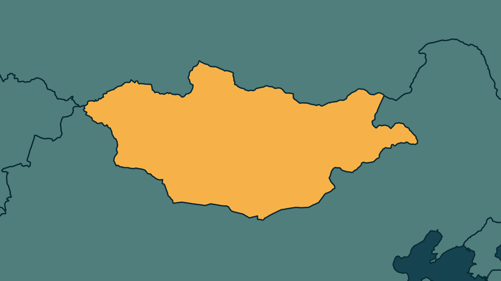

# Presidente da Mongólia anuncia renúncia após acusação de propina

*Heimdall News, edição internacional. 17 de novembro de 2026*

## A notícia

O presidente da Mongólia, Ukhnaa Khurelsukh, anunciou nesta terça-feira que vai deixar o cargo. Ele foi acusado de receber 25 milhões de dólares em propina ligada à construção de uma ferrovia. [1][2]

Segundo a acusação, o contrato foi dado sem concorrência em 2019, quando Khurelsukh era primeiro-ministro. A ferrovia leva carvão do Deserto de Gobi até a fronteira com a China. [3][4][5]

A renúncia ainda precisa ser aceita pelo Parlamento. Se for, o presidente do Parlamento, Sandag Byambatsogt, assume as funções, e uma nova eleição deve ocorrer em até quatro meses. O mandato de Khurelsukh terminaria em 2027. [6][7][8][9]

## Quem se manifestou

- **Ukhnaa Khurelsukh, mongol, presidente:** negou as acusações e disse que deixa o cargo para que a verdade seja estabelecida. Afirmou que nunca roubou do povo nem do Estado. [10][11]
- **Khishgee Nyambaatar, mongol, ex-prefeito de Ulaanbaatar:** acusou Khurelsukh de receber o dinheiro em troca de favorecer a empresa Bodi International na contratação das obras da ferrovia. [12]
- **Partido Democrático, Mongólia:** afirmou que o país se tornou profundamente corrupto e exigiu a renúncia de Khurelsukh, sob pena de um processo de impeachment no Parlamento. [13][14]

## Reação no Brasil

Nenhum posicionamento encontrado.

## Fontes

1. Revista Oeste, [Presidente da Mongólia anuncia saída do cargo em meio a escândalo de corrupção](https://revistaoeste.com/mundo/presidente-da-mongolia-anuncia-saida-do-cargo-em-meio-a-escandalo-de-corrupcao/): "anunciou nesta terça-feira, 17, que deixará o cargo depois de ser acusado de receber US$ 25 milhões em propinas relacionadas à construção de uma ferrovia"
2. Estadão, com AFP, [Presidente da Mongólia renuncia ao cargo](https://www.estadao.com.br/internacional/presidente-da-mongolia-renuncia-ao-cargo-npr/): "anunciou, nesta terça-feira, 17, que vai renunciar ao cargo"
3. Revista Oeste, [Presidente da Mongólia anuncia saída do cargo em meio a escândalo de corrupção](https://revistaoeste.com/mundo/presidente-da-mongolia-anuncia-saida-do-cargo-em-meio-a-escandalo-de-corrupcao/): "A acusação sustenta que o contrato foi concedido sem concorrência pública."
4. Revista Oeste, [Presidente da Mongólia anuncia saída do cargo em meio a escândalo de corrupção](https://revistaoeste.com/mundo/presidente-da-mongolia-anuncia-saida-do-cargo-em-meio-a-escandalo-de-corrupcao/): "em 2019, quando ocupava o cargo de primeiro-ministro"
5. Revista Oeste, [Presidente da Mongólia anuncia saída do cargo em meio a escândalo de corrupção](https://revistaoeste.com/mundo/presidente-da-mongolia-anuncia-saida-do-cargo-em-meio-a-escandalo-de-corrupcao/): "utilizada para transportar carvão da região do Deserto de Gobi até a fronteira com a China"
6. Estadão, com AFP, [Presidente da Mongólia renuncia ao cargo](https://www.estadao.com.br/internacional/presidente-da-mongolia-renuncia-ao-cargo-npr/): "A renúncia de Khurelsukh entrará em vigor assim que for aceita pelo Parlamento"
7. Folha de S.Paulo, [Presidente da Mongólia renuncia após acusações de corrupção](https://www1.folha.uol.com.br/mundo/2026/11/presidente-da-mongolia-renuncia-apos-acusacoes-de-corrupcao.shtml): "o presidente do Parlamento —Sandag Byambatsogt, do MPP— assumirá as funções presidenciais"
8. Folha de S.Paulo, [Presidente da Mongólia renuncia após acusações de corrupção](https://www1.folha.uol.com.br/mundo/2026/11/presidente-da-mongolia-renuncia-apos-acusacoes-de-corrupcao.shtml): "uma eleição presidencial deverá ser realizada no prazo de quatro meses"
9. Revista Oeste, [Presidente da Mongólia anuncia saída do cargo em meio a escândalo de corrupção](https://revistaoeste.com/mundo/presidente-da-mongolia-anuncia-saida-do-cargo-em-meio-a-escandalo-de-corrupcao/): "Seu mandato presidencial, de seis anos, terminaria em 2027."
10. Folha de S.Paulo, [Presidente da Mongólia renuncia após acusações de corrupção](https://www1.folha.uol.com.br/mundo/2026/11/presidente-da-mongolia-renuncia-apos-acusacoes-de-corrupcao.shtml): "Acredito que é do interesse da Justiça que o chefe de Estado renuncie às suas funções e que a verdade seja estabelecida"
11. Revista Oeste, [Presidente da Mongólia anuncia saída do cargo em meio a escândalo de corrupção](https://revistaoeste.com/mundo/presidente-da-mongolia-anuncia-saida-do-cargo-em-meio-a-escandalo-de-corrupcao/): "Nunca roubei do meu povo nem do meu Estado"
12. Revista Oeste, [Presidente da Mongólia anuncia saída do cargo em meio a escândalo de corrupção](https://revistaoeste.com/mundo/presidente-da-mongolia-anuncia-saida-do-cargo-em-meio-a-escandalo-de-corrupcao/): "Khurelsukh teria recebido o dinheiro em troca de favorecer a empresa Bodi International na contratação de obras ferroviárias"
13. Folha de S.Paulo, [Presidente da Mongólia renuncia após acusações de corrupção](https://www1.folha.uol.com.br/mundo/2026/11/presidente-da-mongolia-renuncia-apos-acusacoes-de-corrupcao.shtml): "este país se tornou profundamente corrupto"
14. Folha de S.Paulo, [Presidente da Mongólia renuncia após acusações de corrupção](https://www1.folha.uol.com.br/mundo/2026/11/presidente-da-mongolia-renuncia-apos-acusacoes-de-corrupcao.shtml): "exigindo que ele renunciasse, sob pena de enfrentar um processo de impeachment no Parlamento"
