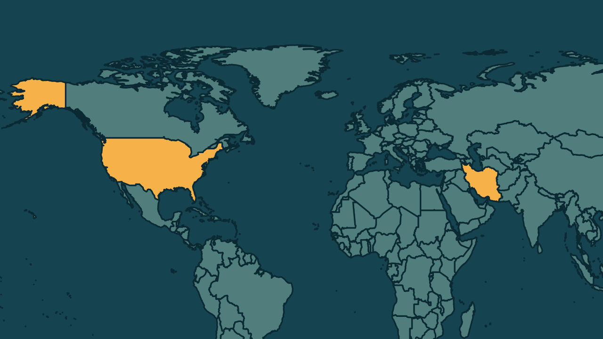

# Estados Unidos bombardeiam base de mísseis do Irã no Estreito de Ormuz

*Heimdall News, edição internacional. 17 de novembro de 2026*

## A notícia

Caças dos Estados Unidos bombardearam nesta terça-feira uma base de lançamento de mísseis do Irã na ilha de Qeshm, no Estreito de Ormuz, segundo uma autoridade militar americana. A imprensa iraniana relatou explosões na ilha, sem danos. [1][2][3][4]

Depois de ações parecidas na sexta e no domingo, o Irã reivindicou nesta terça um ataque com drones contra um radar americano na base de Sheikh Isa, no Bahrein. O Bahrein disse ter interceptado o ataque. [5][6][7][8]

A guerra começou em 28 de fevereiro, e os confrontos entre os dois países estavam suspensos desde setembro. Um terceiro porta-aviões americano já opera no Oriente Médio. [9][10][11]

## Quem se manifestou

- **Forças Armadas dos Estados Unidos, Estados Unidos:** afirmaram, por meio de uma autoridade anônima, que agiram em legítima defesa. [12]
- **Guarda Revolucionária Islâmica, Irã:** afirmou que o ataque no Bahrein respondeu a violações do espaço aéreo iraniano por drones americanos. [13]
- **Donald Trump, americano, presidente:** afirmou que manterá o bloqueio naval ao Irã, que continua a interferir na navegação em Ormuz. [14][15]
- **Majed Al Ansari, catariano, porta-voz:** afirmou que as conversas com o Irã buscam reduzir a distância entre as propostas das partes. [16]

## Reação no Brasil

- **Luiz Inácio Lula da Silva, brasileiro, presidente:** afirmou, em conversa com o primeiro-ministro da Espanha divulgada nesta terça, que a guerra com o Irã não tem explicação e que Trump não sabia do Estreito de Ormuz. [17][18][19]

## Fontes

1. Estadão, com AFP, [Caças dos EUA atacam base iraniana de mísseis em ilha no Estreito de Ormuz](https://www.estadao.com.br/internacional/cacas-dos-eua-atacaram-base-iraniana-de-misseis-na-ilha-de-qeshm-npr/): "atacaram uma base de mísseis iraniana na Ilha de Qeshm, no Estreito de Ormuz, na terça-feira, 17"
2. CNN Brasil, [EUA fazem ataques contra local de lançamento de mísseis do Irã, diz fonte](https://www.cnnbrasil.com.br/internacional/eua-fazem-ataques-contra-local-de-lancamento-de-misseis-do-ira-diz-fonte/): "segundo uma autoridade militar americana"
3. CNN Brasil, [Irã atacou sistema de radar dos EUA em meio a negociações com mediadores](https://www.cnnbrasil.com.br/internacional/ira-atacou-sistema-de-radar-dos-eua-em-meio-a-negociacoes-com-mediadores/): "a mídia iraniana relatou uma explosão na ilha de Qeshm, no Estreito de Ormuz"
4. CartaCapital, [Caças dos EUA atacam base iraniana em ilha no Estreito de Ormuz](https://www.cartacapital.com.br/mundo/cacas-dos-eua-atacaram-base-iraniana-em-ilha-no-estreito-de-ormuz/): "houve “cinco ou seis explosões” na ilha de Qeshm nesta terça-feira, sem causar danos"
5. Estadão, com AFP, [Caças dos EUA atacam base iraniana de mísseis em ilha no Estreito de Ormuz](https://www.estadao.com.br/internacional/cacas-dos-eua-atacaram-base-iraniana-de-misseis-na-ilha-de-qeshm-npr/): "Na sexta-feira, 13, a Guarda Revolucionária também reivindicou um ataque contra sistemas de radar dos Estados Unidos no país"
6. Estadão, com AFP, [Caças dos EUA atacam base iraniana de mísseis em ilha no Estreito de Ormuz](https://www.estadao.com.br/internacional/cacas-dos-eua-atacaram-base-iraniana-de-misseis-na-ilha-de-qeshm-npr/): "No domingo, 15, a força iraniana voltou a anunciar uma ofensiva contra sistemas de radar americanos no Bahrein"
7. Estadão, com AFP, [Caças dos EUA atacam base iraniana de mísseis em ilha no Estreito de Ormuz](https://www.estadao.com.br/internacional/cacas-dos-eua-atacaram-base-iraniana-de-misseis-na-ilha-de-qeshm-npr/): "o alvo foi um sistema de radar operado por militares americanos na base aérea de Sheikh Isa"
8. CNN Brasil, [Irã atacou sistema de radar dos EUA em meio a negociações com mediadores](https://www.cnnbrasil.com.br/internacional/ira-atacou-sistema-de-radar-dos-eua-em-meio-a-negociacoes-com-mediadores/): "informou que interceptou o ataque e que não houve relatos de vítimas ou danos"
9. CartaCapital, [Caças dos EUA atacam base iraniana em ilha no Estreito de Ormuz](https://www.cartacapital.com.br/mundo/cacas-dos-eua-atacaram-base-iraniana-em-ilha-no-estreito-de-ormuz/): "desencadeada pelos bombardeios americanos e israelenses contra o Irã em 28 de fevereiro"
10. CartaCapital, [Caças dos EUA atacam base iraniana em ilha no Estreito de Ormuz](https://www.cartacapital.com.br/mundo/cacas-dos-eua-atacaram-base-iraniana-em-ilha-no-estreito-de-ormuz/): "Os confrontos entre Estados Unidos e Irã estão suspensos desde setembro"
11. CartaCapital, [Caças dos EUA atacam base iraniana em ilha no Estreito de Ormuz](https://www.cartacapital.com.br/mundo/cacas-dos-eua-atacaram-base-iraniana-em-ilha-no-estreito-de-ormuz/): "um terceiro porta-aviões já estava operacional no Oriente Médio"
12. Estadão, com AFP, [Caças dos EUA atacam base iraniana de mísseis em ilha no Estreito de Ormuz](https://www.estadao.com.br/internacional/cacas-dos-eua-atacaram-base-iraniana-de-misseis-na-ilha-de-qeshm-npr/): "na Ilha de Qeshm em legítima defesa"
13. Estadão, com AFP, [Caças dos EUA atacam base iraniana de mísseis em ilha no Estreito de Ormuz](https://www.estadao.com.br/internacional/cacas-dos-eua-atacaram-base-iraniana-de-misseis-na-ilha-de-qeshm-npr/): "a ofensiva foi uma resposta a repetidas violações do espaço aéreo iraniano por drones do Exército dos Estados Unidos"
14. CNN Brasil, [Irã atacou sistema de radar dos EUA em meio a negociações com mediadores](https://www.cnnbrasil.com.br/internacional/ira-atacou-sistema-de-radar-dos-eua-em-meio-a-negociacoes-com-mediadores/): "Trump também afirmou que manterá o bloqueio naval americano ao Irã"
15. CNN Brasil, [Irã atacou sistema de radar dos EUA em meio a negociações com mediadores](https://www.cnnbrasil.com.br/internacional/ira-atacou-sistema-de-radar-dos-eua-em-meio-a-negociacoes-com-mediadores/): "o país continuar a interferir na navegação no Estreito de Ormuz"
16. CNN Brasil, [Irã atacou sistema de radar dos EUA em meio a negociações com mediadores](https://www.cnnbrasil.com.br/internacional/ira-atacou-sistema-de-radar-dos-eua-em-meio-a-negociacoes-com-mediadores/): "reduzir a distância entre as propostas apresentadas pelas partes"
17. Gazeta do Povo, [Lula critica o Escudo das Américas e o alinhamento aos EUA e acusa Trump de “inventar” guerra contra o Irã](https://www.gazetadopovo.com.br/mundo/lula-critica-o-escudo-das-americas-e-o-alinhamento-aos-eua-e-acusa-trump-de-inventar-guerra-contra-o-ira/): "durante uma conversa com o primeiro-ministro da Espanha, o socialista Pedro Sánchez, divulgada nesta terça-feira (17)"
18. Gazeta do Povo, [Lula critica o Escudo das Américas e o alinhamento aos EUA e acusa Trump de “inventar” guerra contra o Irã](https://www.gazetadopovo.com.br/mundo/lula-critica-o-escudo-das-americas-e-o-alinhamento-aos-eua-e-acusa-trump-de-inventar-guerra-contra-o-ira/): "Essa guerra com o Irã não existe explicação"
19. Gazeta do Povo, [Lula critica o Escudo das Américas e o alinhamento aos EUA e acusa Trump de “inventar” guerra contra o Irã](https://www.gazetadopovo.com.br/mundo/lula-critica-o-escudo-das-americas-e-o-alinhamento-aos-eua-e-acusa-trump-de-inventar-guerra-contra-o-ira/): "Ele não sabia do Estreito de Ormuz"
