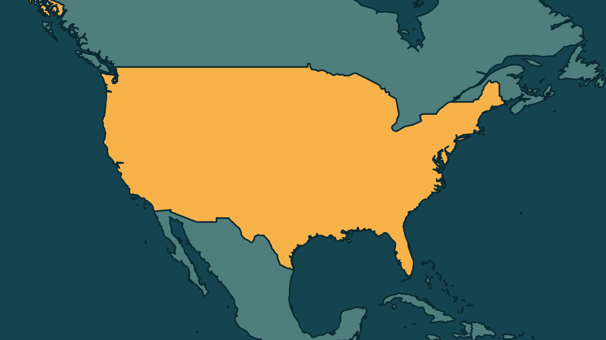

# Vitória no Alasca dá aos democratas 56 cadeiras no Senado dos EUA

*Heimdall News, edição internacional. 18 de novembro de 2026*

## A notícia

A democrata Mary Peltola venceu a eleição para o Senado dos Estados Unidos pelo Alasca, em resultado confirmado nesta terça-feira. Ela derrotou o republicano Dan Sullivan, que tentava a reeleição. [1]

Era a última disputa em aberto. Os democratas passam a ter 56 das 100 cadeiras, contra 44 dos republicanos, e tomaram nove cadeiras do partido adversário, o maior número desde 1958. [2][3][4]

A campanha teve acusações de que a equipe de Peltola recrutou um candidato independente com o mesmo nome do senador, o que ela nega. O Departamento de Justiça abriu uma investigação criminal. [5][6][7]

## Quem se manifestou

- **Mary Peltola, americana, senadora eleita:** chamou de corrupção flagrante a ação do Departamento de Justiça para barrar a certificação do resultado. [8][9]
- **Chuck Schumer, americano, líder democrata no Senado:** afirmou que 56 cadeiras eram um resultado inimaginável poucos meses atrás. [10]
- **Donald Trump, americano, presidente:** pediu que Peltola fosse processada e sugeriu que os votos do candidato independente fossem contados para o senador republicano. [11][12]
- **Todd Blanche, americano, procurador-geral:** classificou como fraude o suposto recrutamento do candidato com o mesmo nome do senador. [13]

## Reação no Brasil

Nenhum posicionamento encontrado.

## Fontes

1. CartaCapital, [Candidata Indígena vence no Alasca e consolida vitória democrata no Senado](https://www.cartacapital.com.br/mundo/candidata-indigena-vence-no-alasca-e-consolida-vitoria-democrata-no-senado/): "A democrata Mary Peltola derrotou o republicano Dan Sullivan, que tentava a reeleição, em resultado confirmado nesta terça-feira 17"
2. Folha de S.Paulo, [Mary Peltola vence no Alasca e amplia maioria democrata no Senado dos EUA](https://www1.folha.uol.com.br/mundo/2026/11/mary-peltola-vence-no-alasca-e-amplia-maioria-democrata-no-senado-dos-eua.shtml): "Esta era a última disputa em aberto no Senado nas eleições de 2026"
3. CartaCapital, [Candidata Indígena vence no Alasca e consolida vitória democrata no Senado](https://www.cartacapital.com.br/mundo/candidata-indigena-vence-no-alasca-e-consolida-vitoria-democrata-no-senado/): "o partido passa a controlar 56 das 100 cadeiras da Casa, contra 44 dos republicanos"
4. Poder360, [Após vitória no Alasca, democratas ampliam maioria no Senado dos EUA](https://www.poder360.com.br/poder-internacional/apos-vitoria-no-alasca-democratas-ampliam-maioria-no-senado-dos-eua/): "os democratas conquistaram 9 cadeiras no Senado antes ocupadas pelo partido adversário, o maior número desde 1958"
5. G1, [Democrata vence no Alasca e amplia maioria do partido no Senado dos EUA](https://g1.globo.com/mundo/noticia/2026/11/18/democrata-vence-no-alasca-e-amplia-maioria-do-partido-no-senado-dos-eua.ghtml): "superando acusações de que integrantes de sua campanha ajudaram a recrutar um candidato com o mesmo nome do atual senador"
6. G1, [Democrata vence no Alasca e amplia maioria do partido no Senado dos EUA](https://g1.globo.com/mundo/noticia/2026/11/18/democrata-vence-no-alasca-e-amplia-maioria-do-partido-no-senado-dos-eua.ghtml): "Peltola negou qualquer envolvimento."
7. CNN Brasil, [Democratas ampliam maioria no Senado dos EUA após vitória no Alasca](https://www.cnnbrasil.com.br/internacional/democratas-ampliam-maioria-no-senado-dos-eua-apos-vitoria-no-alasca/): "O Departamento de Justiça dos Estados Unidos também abriu uma investigação criminal"
8. G1, [Democrata vence no Alasca e amplia maioria do partido no Senado dos EUA](https://g1.globo.com/mundo/noticia/2026/11/18/democrata-vence-no-alasca-e-amplia-maioria-do-partido-no-senado-dos-eua.ghtml): "A ação buscava impedir a certificação do resultado caso o senador em exercício perdesse"
9. G1, [Democrata vence no Alasca e amplia maioria do partido no Senado dos EUA](https://g1.globo.com/mundo/noticia/2026/11/18/democrata-vence-no-alasca-e-amplia-maioria-do-partido-no-senado-dos-eua.ghtml): "Peltola classificou o processo como “corrupção flagrante”"
10. Estadão, com AP, [Democratas tomam nove cadeiras dos Republicanos no Senado dos EUA, a maior virada em quase 70 anos](https://www.estadao.com.br/internacional/democratas-tomam-nove-cadeiras-dos-republicanos-no-senado-dos-eua-a-maior-virada-em-quase-70-anos-npr/): "Cinquenta e seis cadeiras era um resultado inimaginável há poucos meses"
11. G1, [Democrata vence no Alasca e amplia maioria do partido no Senado dos EUA](https://g1.globo.com/mundo/noticia/2026/11/18/democrata-vence-no-alasca-e-amplia-maioria-do-partido-no-senado-dos-eua.ghtml): "Trump pediu que Peltola fosse processada"
12. Gazeta do Povo, [Democrata suspeita de manobra para confundir eleitores conquista última cadeira no Senado dos EUA](https://www.gazetadopovo.com.br/mundo/democrata-suspeita-manobra-confundir-eleitores-conquista-ultima-cadeira-senado-eua/): "Trump chegou a sugerir que os votos para o candidato “falso” deveriam ser contados para o republicano"
13. CNN Brasil, [Democratas ampliam maioria no Senado dos EUA após vitória no Alasca](https://www.cnnbrasil.com.br/internacional/democratas-ampliam-maioria-no-senado-dos-eua-apos-vitoria-no-alasca/): "classificou a suposta iniciativa de recrutamento como “fraude”"
