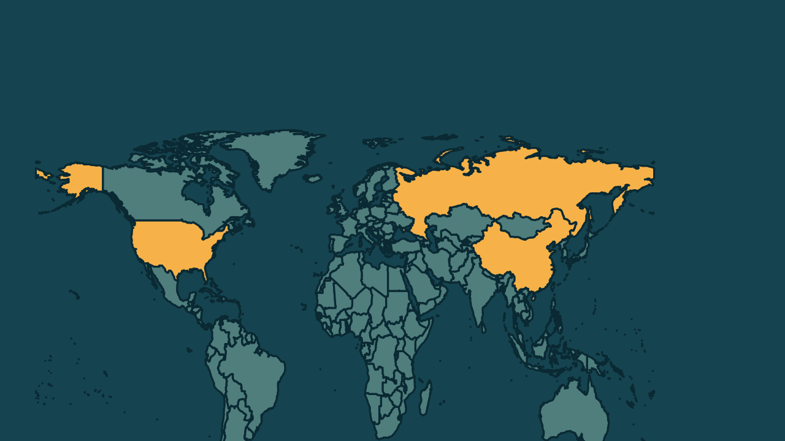

# Trump chega à China e cumprimenta Putin na véspera da reunião com Xi

*Heimdall News, edição internacional. 18 de novembro de 2026*

## A notícia

O presidente dos Estados Unidos, Donald Trump, chegou nesta quarta-feira a Shenzhen, na China, e foi recebido no aeroporto por Xi Jinping. Num jantar da cúpula da Cooperação Econômica Ásia-Pacífico, Trump e o presidente da Rússia, Vladimir Putin, apertaram as mãos diante de Xi. Foi o primeiro encontro dos dois desde agosto de 2025. [1][2][3][4][5]

Mais cedo, Xi e Putin passaram mais de duas horas reunidos. [6]

A reunião a três é na quinta-feira, dia 19. Washington quer tratar da guerra no Irã e de um novo acordo de armas nucleares que inclua a China, que tem cerca de 620 ogivas, contra mais de 5 mil de cada um dos outros dois. [7][8][9][10]

## Quem se manifestou

- **Xi Jinping, chinês, presidente:** defendeu, ao receber Trump, relações baseadas em estabilidade e respeito mútuo, além do livre comércio. [11][12]
- **Vladimir Putin, russo, presidente:** disse esperar grandes benefícios da reunião e pediu diálogo em vez de ultimatos. Afirmou que as sanções ocidentais fracassaram. [13][14][15]
- **Olivia Wales, americana, porta-voz da Casa Branca:** afirmou que Trump vai tratar da redução das armas nucleares, cuja proliferação considera muito perigosa. [16][17]
- **Mark Carney, canadense, primeiro-ministro:** advertiu que as medidas contra a Rússia aumentarão se a guerra continuar. [18]

## Reação no Brasil

- **Luiz Inácio Lula da Silva, brasileiro, presidente:** sugeriu em agosto que Trump convidasse Xi e Putin para uma conversa e disse que o mundo precisa de paz, não de guerra. Segundo o primeiro-ministro do Canadá, a ideia da reunião foi de Lula. [19][20][21]

## Fontes

1. Gazeta do Povo, [Trump cumprimenta Putin e Xi em evento antes de cúpula trilateral](https://www.gazetadopovo.com.br/mundo/trump-cumprimenta-putin-xi-evento-antes-cupula-trilateral/): "O presidente dos Estados Unidos, Donald Trump, chegou nesta quarta-feira (18) à cidade de Shenzhen, na China"
2. CNN Brasil, com Reuters, [Xi quebra protocolo ao receber Trump em aeroporto na China antes de reunião](https://www.cnnbrasil.com.br/internacional/trump-xi-aeroporto-shenzhen/): "O líder chinês Xi Jinping se reuniu com o presidente Donald Trump no aeroporto de Shenzhen"
3. Poder360, com Reuters, [Trump, Putin e Xi se reúnem em jantar na China antes de cúpula](https://www.poder360.com.br/poder-internacional/trump-putin-e-xi-se-reunem-em-jantar-na-china-antes-de-cupula/): "participaram nesta 4ª feira (18.nov.2026) de um jantar em Shenzhen, na China, durante a cúpula da Apec"
4. Poder360, com Reuters, [Trump, Putin e Xi se reúnem em jantar na China antes de cúpula](https://www.poder360.com.br/poder-internacional/trump-putin-e-xi-se-reunem-em-jantar-na-china-antes-de-cupula/): "Trump e Putin apertaram as mãos diante de Xi antes da fotografia oficial"
5. Poder360, com Reuters, [Trump, Putin e Xi se reúnem em jantar na China antes de cúpula](https://www.poder360.com.br/poder-internacional/trump-putin-e-xi-se-reunem-em-jantar-na-china-antes-de-cupula/): "Foi o 1º encontro presencial entre os presidentes norte-americano e russo desde a reunião no Alasca, em agosto de 2025"
6. CartaCapital, [Putin e Xi se reúnem antes de cúpula trilateral histórica com Trump](https://www.cartacapital.com.br/mundo/putin-e-xi-se-reunem-antes-de-cupula-trilateral-historica-com-trump/): "Os presidentes passaram mais de duas horas reunidos."
7. Folha de S.Paulo, [O que Trump, Xi e Putin discutirão em encontro inédito na China](https://www1.folha.uol.com.br/mundo/2026/11/o-que-trump-xi-e-putin-discutirao-em-encontro-inedito-na-china.shtml): "Donald Trump, Xi Jinping e Vladimir Putin têm encontro marcado esta quinta-feira (19) em Shenzhen"
8. Folha de S.Paulo, [O que Trump, Xi e Putin discutirão em encontro inédito na China](https://www1.folha.uol.com.br/mundo/2026/11/o-que-trump-xi-e-putin-discutirao-em-encontro-inedito-na-china.shtml): "Washington diz que quer tratar de dois assuntos. O primeiro é a guerra no Irã."
9. Folha de S.Paulo, [O que Trump, Xi e Putin discutirão em encontro inédito na China](https://www1.folha.uol.com.br/mundo/2026/11/o-que-trump-xi-e-putin-discutirao-em-encontro-inedito-na-china.shtml): "O republicano se recusa a prorrogar o acordo porque quer um novo que inclua a China."
10. Folha de S.Paulo, [O que Trump, Xi e Putin discutirão em encontro inédito na China](https://www1.folha.uol.com.br/mundo/2026/11/o-que-trump-xi-e-putin-discutirao-em-encontro-inedito-na-china.shtml): "a China tem cerca de 620 ogivas contra mais de 5.000 de cada um dos outros dois países"
11. Poder360, com Reuters, [Trump, Putin e Xi se reúnem em jantar na China antes de cúpula](https://www.poder360.com.br/poder-internacional/trump-putin-e-xi-se-reunem-em-jantar-na-china-antes-de-cupula/): "o presidente chinês defendeu relações bilaterais baseadas em estabilidade e respeito mútuo"
12. Poder360, com Reuters, [Trump, Putin e Xi se reúnem em jantar na China antes de cúpula](https://www.poder360.com.br/poder-internacional/trump-putin-e-xi-se-reunem-em-jantar-na-china-antes-de-cupula/): "Durante a Apec, Xi defendeu o livre-comércio"
13. CNN Brasil, [Putin diz esperar benefícios de reunião inédita com Trump e Xi Jinping](https://www.cnnbrasil.com.br/internacional/putin-diz-esperar-beneficios-de-reuniao-inedita-com-trump-e-xi-jinping/): "espero grandes benefícios potenciais da próxima reunião trilateral"
14. CartaCapital, [Putin e Xi se reúnem antes de cúpula trilateral histórica com Trump](https://www.cartacapital.com.br/mundo/putin-e-xi-se-reunem-antes-de-cupula-trilateral-historica-com-trump/): "e diálogo em vez de ultimatos”, declarou o presidente russo"
15. CartaCapital, [Putin e Xi se reúnem antes de cúpula trilateral histórica com Trump](https://www.cartacapital.com.br/mundo/putin-e-xi-se-reunem-antes-de-cupula-trilateral-historica-com-trump/): "Ele afirmou que as sanções ocidentais impostas à Rússia pela guerra na Ucrânia fracassaram"
16. Estadão, [Reunião entre Trump, Xi e Putin foi sugerida por Lula, diz premiê do Canadá](https://www.estadao.com.br/internacional/reuniao-trump-xi-putin-foi-sugerida-por-lula-diz-premie-canada-npr/): "entre os tópicos que serão abordados por Trump está “a redução das armas nucleares no mundo”"
17. Estadão, [Reunião entre Trump, Xi e Putin foi sugerida por Lula, diz premiê do Canadá](https://www.estadao.com.br/internacional/reuniao-trump-xi-putin-foi-sugerida-por-lula-diz-premie-canada-npr/): "Essa proliferação, acredita o presidente Trump, é muito perigosa"
18. CartaCapital, [Putin e Xi se reúnem antes de cúpula trilateral histórica com Trump](https://www.cartacapital.com.br/mundo/putin-e-xi-se-reunem-antes-de-cupula-trilateral-historica-com-trump/): "que as medidas contra a Rússia “serão intensificadas” se a guerra prosseguir"
19. Estadão, [Reunião entre Trump, Xi e Putin foi sugerida por Lula, diz premiê do Canadá](https://www.estadao.com.br/internacional/reuniao-trump-xi-putin-foi-sugerida-por-lula-diz-premie-canada-npr/): "Em agosto, Lula já havia sugerido que Trump aproveitasse a Assembleia-Geral da ONU"
20. Estadão, [Reunião entre Trump, Xi e Putin foi sugerida por Lula, diz premiê do Canadá](https://www.estadao.com.br/internacional/reuniao-trump-xi-putin-foi-sugerida-por-lula-diz-premie-canada-npr/): "O mundo está precisando de paz, não está precisando de guerra"
21. Estadão, [Reunião entre Trump, Xi e Putin foi sugerida por Lula, diz premiê do Canadá](https://www.estadao.com.br/internacional/reuniao-trump-xi-putin-foi-sugerida-por-lula-diz-premie-canada-npr/): "foi uma sugestão do presidente brasileiro, Luiz Inácio Lula da Silva"
