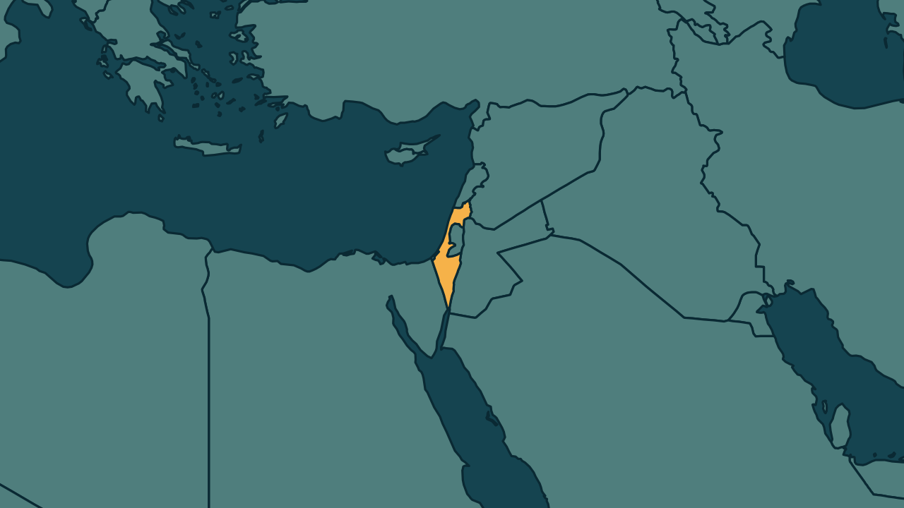

# Oposição a Netanyahu elege presidente do Parlamento de Israel

*Heimdall News, edição internacional. 18 de novembro de 2026*

## A notícia

O Parlamento de Israel elegeu na terça-feira Matan Kahana, aliado do opositor Gadi Eisenkot, para presidir a Casa. Ele teve 66 dos 120 votos, com o apoio de partidos árabes. O candidato do Likud, partido do primeiro-ministro Benjamin Netanyahu, teve 52. [1][2][3][4]

O presidente do Parlamento define quais projetos vão a votação. A oposição quer revogar mudanças no Judiciário aprovadas no governo Netanyahu e criar uma investigação independente sobre o ataque do Hamas de 7 de outubro de 2023. [5][6][7]

Netanyahu perdeu a maioria na eleição de outubro e segue como primeiro-ministro interino. Eisenkot foi encarregado de formar um governo e tem até o início de dezembro. [8][9][10][11]

## Quem se manifestou

- **Matan Kahana, israelense, presidente do Parlamento:** disse que pretende ser o presidente de todos os cidadãos de Israel. [12]
- **Benjamin Netanyahu, israelense, primeiro-ministro:** reconheceu a derrota do aliado e voltou a defender um governo de união nacional. [13][14]
- **Gadi Eisenkot, israelense, ex-chefe das Forças Armadas:** afirmou que a eleição reflete a maioria absoluta que votou por uma mudança. [15]
- **Yousef Jabareen, israelense, presidente da Lista Conjunta:** disse que o partido continuará sendo uma rede de segurança para quem busca substituir Netanyahu. [16]

## Reação no Brasil

Nenhum posicionamento encontrado.

## Fontes

1. Metrópoles, [Oposição a Netanyahu conquista presidência do Parlamento de Israel](https://www.metropoles.com/mundo/oposicao-a-netanyahu-conquista-presidencia-do-parlamento-de-israel): "O Parlamento de Israel elegeu, nesta terça-feira (17/11), Matan Kahana como novo presidente da Casa."
2. G1, [Aliado do principal rival de Netanyahu é eleito presidente do Parlamento de Israel](https://g1.globo.com/mundo/noticia/2026/11/17/aliado-de-eisenkot-e-eleito-presidente-do-parlamento-de-israel.ghtml): "Matan Kahana, aliado de Gadi Eisenkot, como presidente do órgão legislativo"
3. Estadão, com AFP, [Aliado de Eisenkot é eleito presidente do parlamento de Israel, em revés para Netanyahu](https://www.estadao.com.br/internacional/aliado-eisenkot-eleito-presidente-parlamento-israel-npr/): "foi eleito com 66 dos 120 votos do parlamento, graças ao apoio dos partidos árabe-israelenses"
4. Estadão, com AFP, [Aliado de Eisenkot é eleito presidente do parlamento de Israel, em revés para Netanyahu](https://www.estadao.com.br/internacional/aliado-eisenkot-eleito-presidente-parlamento-israel-npr/): "Já o candidato do partido Likud, de Netanyahu, obteve 52 votos."
5. Poder360, com Reuters, [Parlamento de Israel elege opositor de Netanyahu para presidência](https://www.poder360.com.br/poder-internacional/parlamento-de-israel-elege-opositor-de-netanyahu-para-presidencia/): "o presidente do Knesset tem poder para definir quais projetos serão submetidos à votação"
6. Poder360, com Reuters, [Parlamento de Israel elege opositor de Netanyahu para presidência](https://www.poder360.com.br/poder-internacional/parlamento-de-israel-elege-opositor-de-netanyahu-para-presidencia/): "a revogação de mudanças no Judiciário aprovadas durante o governo Netanyahu"
7. Poder360, com Reuters, [Parlamento de Israel elege opositor de Netanyahu para presidência](https://www.poder360.com.br/poder-internacional/parlamento-de-israel-elege-opositor-de-netanyahu-para-presidencia/): "a abertura de uma investigação independente sobre o ataque do Hamas a Israel em 7 de outubro de 2023"
8. Poder360, com Reuters, [Parlamento de Israel elege opositor de Netanyahu para presidência](https://www.poder360.com.br/poder-internacional/parlamento-de-israel-elege-opositor-de-netanyahu-para-presidencia/): "que retiraram a maioria parlamentar de Netanyahu"
9. Poder360, com Reuters, [Parlamento de Israel elege opositor de Netanyahu para presidência](https://www.poder360.com.br/poder-internacional/parlamento-de-israel-elege-opositor-de-netanyahu-para-presidencia/): "Netanyahu permanece como primeiro-ministro interino."
10. Poder360, com Reuters, [Parlamento de Israel elege opositor de Netanyahu para presidência](https://www.poder360.com.br/poder-internacional/parlamento-de-israel-elege-opositor-de-netanyahu-para-presidencia/): "encarregou Gadi Eisenkot, líder do Yashar e principal adversário de Netanyahu, de formar um governo."
11. G1, [Aliado do principal rival de Netanyahu é eleito presidente do Parlamento de Israel](https://g1.globo.com/mundo/noticia/2026/11/17/aliado-de-eisenkot-e-eleito-presidente-do-parlamento-de-israel.ghtml): "O candidato tem até o início de dezembro para tentar formar um governo."
12. Folha de S.Paulo, [Parlamento de Israel elege opositor de Netanyahu para comandar o Legislativo](https://www1.folha.uol.com.br/mundo/2026/11/parlamento-de-israel-elege-opositor-de-netayahu-para-comandar-o-legislativo.shtml): "O Knesset de Israel é a casa de todos os cidadãos do Estado de Israel, e pretendo ser o presidente de todos"
13. Estadão, [Netanyahu admite derrota na disputa pela presidência do Parlamento](https://www.estadao.com.br/internacional/netanyahu-admite-derrota-na-disputa-pela-presidencia-do-parlamento-e-pede-uniao-npr/): "reconheceu a derrota de seu aliado na disputa pela presidência da Knesset"
14. Estadão, [Netanyahu admite derrota na disputa pela presidência do Parlamento](https://www.estadao.com.br/internacional/netanyahu-admite-derrota-na-disputa-pela-presidencia-do-parlamento-e-pede-uniao-npr/): "voltou a defender a formação de um governo de união nacional"
15. Gazeta do Povo, [Oposição chega à presidência do Parlamento de Israel, sinalizando que Netanyahu pode deixar poder](https://www.gazetadopovo.com.br/mundo/oposicao-chega-presidencia-parlamento-israel/): "passo democrático adequado, que reflete a maioria absoluta que votou por uma mudança"
16. Gazeta do Povo, [Oposição chega à presidência do Parlamento de Israel, sinalizando que Netanyahu pode deixar poder](https://www.gazetadopovo.com.br/mundo/oposicao-chega-presidencia-parlamento-israel/): "continuará servindo como uma “rede de segurança” para quem busca substituir o governo Netanyahu"
