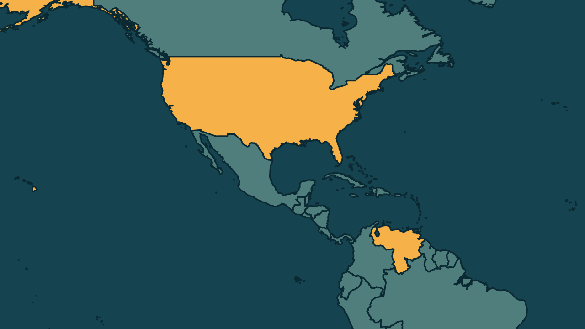

# Estados Unidos e Venezuela anunciam acordo de cooperação militar

*Heimdall News, edição internacional. 18 de novembro de 2026*

## A notícia

O secretário de Defesa dos Estados Unidos, Pete Hegseth, anunciou nesta quarta-feira, em Caracas, um acordo de cooperação militar com a Venezuela. Ele se reuniu com a presidente interina, Delcy Rodríguez. É a autoridade americana mais alta a visitar o país desde a captura de Nicolás Maduro, em janeiro. [1][2][3][4]

O acordo prevê treinamento de militares venezuelanos, troca de inteligência e modernização das Forças Armadas. A cooperação militar entre os dois países tinha sido encerrada em 2005. [5][6]

Depois da captura, Donald Trump anunciou que os Estados Unidos controlariam a venda do petróleo venezuelano. O prazo autorizado pela Justiça para Delcy Rodríguez terminou em julho, e não há data para eleição. [7][8][9]

## Quem se manifestou

- **Pete Hegseth, americano, secretário de Defesa:** afirmou que o acordo restabelece a parceria de defesa e que a Venezuela passou de ameaça regional a parceiro de segurança. Disse que a parceria exige reformas e o fim das redes narcoterroristas no país. [10][11][12]
- **Delcy Rodríguez, venezuelana, presidente interina:** disse que o acordo vai reforçar a capacitação, o equipamento e o acesso a novas tecnologias das Forças Armadas, para enfrentar ameaças comuns. Chamou de histórico o acordo de energia com os Estados Unidos. [13][14][15]

## Reação no Brasil

Nenhum posicionamento encontrado.

## Fontes

1. Metrópoles, [Chefe do Pentágono anuncia acordo militar entre EUA e Venezuela](https://www.metropoles.com/mundo/chefe-do-pentagono-anuncia-acordo-militar-entre-eua-e-venezuela): "anunciou, nesta quarta-feira (18/11), um acordo de cooperação militar entre Washington e Caracas"
2. G1, [EUA e Venezuela assinam acordo militar durante visita do chefe do Pentágono a Caracas](https://g1.globo.com/mundo/noticia/2026/11/18/secretario-de-guerra-dos-eua-visita-venezuela-e-diz-que-pretende-ampliar-parceria-militar-entre-os-paises.ghtml): "Hegseth está na Venezuela e se reuniu com a presidente interina do país, Delcy Rodríguez."
3. Estadão, com AFP, [Em visita surpresa à Venezuela, Hegseth anuncia acordo de cooperação militar entre o país e os EUA](https://www.estadao.com.br/internacional/em-visita-surpresa-a-venezuela-hegseth-anuncia-acordo-de-cooperacao-militar-entre-o-pais-e-os-eua-npr/): "tornando-se o funcionário americano de mais alto escalão a visitar o país desde que as forças dos Estados Unidos depuseram Nicolás Maduro"
4. Estadão, com AFP, [Em visita surpresa à Venezuela, Hegseth anuncia acordo de cooperação militar entre o país e os EUA](https://www.estadao.com.br/internacional/em-visita-surpresa-a-venezuela-hegseth-anuncia-acordo-de-cooperacao-militar-entre-o-pais-e-os-eua-npr/): "Em 3 de janeiro, os Estados Unidos capturaram Maduro e sua esposa"
5. Gazeta do Povo, com AP, [EUA anunciam acordo militar que prevê treinamento e troca de inteligência com a Venezuela](https://www.gazetadopovo.com.br/mundo/eua-anunciam-acordo-militar-que-preve-treinamento-e-troca-de-inteligencia-com-a-venezuela/): "incluindo treinamento de soldados venezuelanos por americanos, troca de informações de inteligência e apoio à modernização das Forças Armadas do país sul-americano"
6. Gazeta do Povo, com AP, [EUA anunciam acordo militar que prevê treinamento e troca de inteligência com a Venezuela](https://www.gazetadopovo.com.br/mundo/eua-anunciam-acordo-militar-que-preve-treinamento-e-troca-de-inteligencia-com-a-venezuela/): "A cooperação militar entre Washington e Caracas havia sido encerrada em 2005"
7. Estadão, com AFP, [Em visita surpresa à Venezuela, Hegseth anuncia acordo de cooperação militar entre o país e os EUA](https://www.estadao.com.br/internacional/em-visita-surpresa-a-venezuela-hegseth-anuncia-acordo-de-cooperacao-militar-entre-o-pais-e-os-eua-npr/): "anunciou, em seguida, que seu governo passaria a controlar a exploração e a venda do petróleo venezuelano"
8. G1, [EUA e Venezuela assinam acordo militar durante visita do chefe do Pentágono a Caracas](https://g1.globo.com/mundo/noticia/2026/11/18/secretario-de-guerra-dos-eua-visita-venezuela-e-diz-que-pretende-ampliar-parceria-militar-entre-os-paises.ghtml): "O período de mandato autorizado pela Justiça venezuelana terminou em julho, mas ela continua exercendo a chefia de Estado."
9. G1, [EUA e Venezuela assinam acordo militar durante visita do chefe do Pentágono a Caracas](https://g1.globo.com/mundo/noticia/2026/11/18/secretario-de-guerra-dos-eua-visita-venezuela-e-diz-que-pretende-ampliar-parceria-militar-entre-os-paises.ghtml): "A ausência de uma data para a próxima eleição presidencial"
10. Metrópoles, [Chefe do Pentágono anuncia acordo militar entre EUA e Venezuela](https://www.metropoles.com/mundo/chefe-do-pentagono-anuncia-acordo-militar-entre-eua-e-venezuela): "Consideramos isso um restabelecimento da nossa parceria de defesa"
11. G1, [EUA e Venezuela assinam acordo militar durante visita do chefe do Pentágono a Caracas](https://g1.globo.com/mundo/noticia/2026/11/18/secretario-de-guerra-dos-eua-visita-venezuela-e-diz-que-pretende-ampliar-parceria-militar-entre-os-paises.ghtml): "passou de ameaça regional mais agressiva a um parceiro de segurança cooperativo"
12. Folha de S.Paulo, [Hegseth vai a Caracas, e EUA e Venezuela anunciam acordo militar](https://www1.folha.uol.com.br/mundo/2026/11/hegseth-vai-a-caracas-e-eua-e-venezuela-anunciam-acordo-militar.shtml): "Ela requer a remoção e erradicação de qualquer rede narcoterrorista usurpando território dentro da Venezuela hoje, mas também requer reformas"
13. CartaCapital, [Chefe do Pentágono anuncia acordo de cooperação militar com a Venezuela](https://www.cartacapital.com.br/mundo/chefe-do-pentagono-anuncia-acordo-de-cooperacao-militar-com-a-venezuela/): "o acordo visa reforçar a capacitação, o equipamento operacional e o acesso a novas tecnologias"
14. G1, [EUA e Venezuela assinam acordo militar durante visita do chefe do Pentágono a Caracas](https://g1.globo.com/mundo/noticia/2026/11/18/secretario-de-guerra-dos-eua-visita-venezuela-e-diz-que-pretende-ampliar-parceria-militar-entre-os-paises.ghtml): "possamos enfrentar ameaças comuns"
15. Folha de S.Paulo, [Hegseth vai a Caracas, e EUA e Venezuela anunciam acordo militar](https://www1.folha.uol.com.br/mundo/2026/11/hegseth-vai-a-caracas-e-eua-e-venezuela-anunciam-acordo-militar.shtml): "Delcy relembrou o acordo energético, que chamou de histórico"
