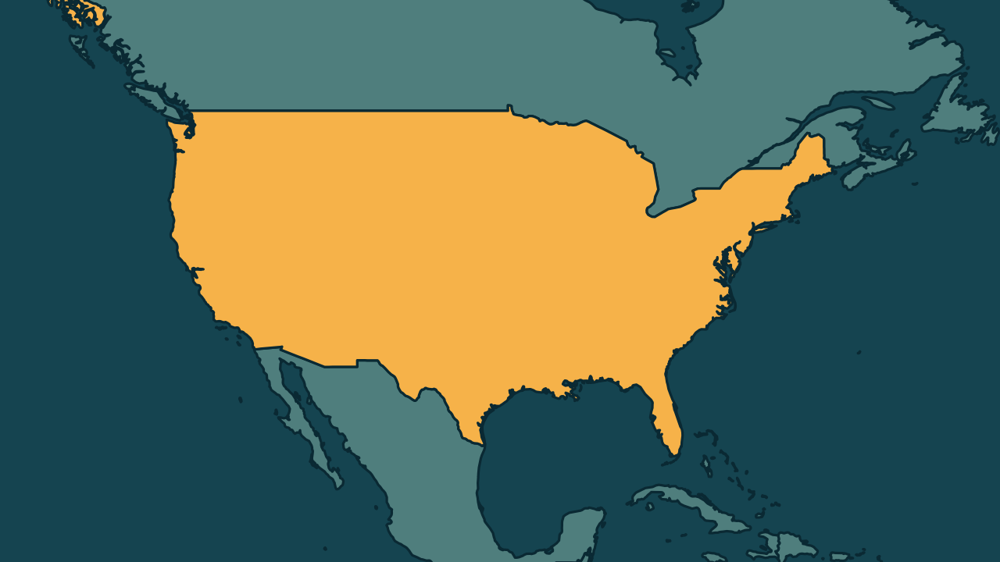

# Democratas escolhem Jeffries para presidir a Câmara dos Estados Unidos

*Heimdall News, edição internacional. 18 de novembro de 2026*

## A notícia

Os democratas da Câmara dos Representantes dos Estados Unidos escolheram nesta quarta-feira o deputado Hakeem Jeffries, de Nova York, para presidir a Casa a partir de 2027. Ele pode se tornar o primeiro negro no cargo. [1][2][3]

A votação secreta teve 251 votos a favor, 11 contra e 2 abstenções, segundo um participante. Um pequeno grupo de progressistas recém-eleitos cobrava compromissos sobre saúde universal e a venda de armas para Israel. [4][5][6][7]

A escolha ainda passa pelo plenário em 3 de janeiro, quando começa o novo Congresso, de maioria democrata. São 435 deputados, e bastam 218 votos. [8][9][10]

## Quem se manifestou

- **Hakeem Jeffries, americano, líder democrata na Câmara:** prometeu investigações aprofundadas sobre o presidente Donald Trump e disse que o partido deve combater o extremismo do movimento de Trump, não a si mesmo. [11][12]
- **Jim Clyburn, americano, deputado:** afirmou que Jeffries está interessado em avanços, não em manchetes. [13]
- **Steny Hoyer, americano, deputado:** disse que os democratas vão eleger o primeiro afro-americano a presidir a Câmara. [14]
- **Alexandria Ocasio-Cortez, americana, deputada:** declarou apoio e elogiou o compromisso de garantir assistência médica a todos. [15][16]

## Reação no Brasil

Nenhum posicionamento encontrado.

## Fontes

1. Folha de S.Paulo, [Hakeem Jeffries é escolhido pelos democratas e deve se tornar 1º negro presidente da Câmara dos Estados Unidos](https://www1.folha.uol.com.br/mundo/2026/11/hakeem-jeffries-e-escolhido-pelos-democratas-e-deve-se-tornar-1o-negro-presidente-da-camara-dos-estados-unidos.shtml): "Os democratas da Câmara dos Representantes dos Estados Unidos indicaram, nesta quarta-feira (18), o deputado Hakeem Jeffries, de Nova York, para presidir a Casa."
2. CNN Brasil, [Câmara dos EUA deve ter 1° presidente negro após escolha dos democratas](https://www.cnnbrasil.com.br/internacional/camara-dos-eua-deve-ter-1-presidente-negro-apos-escolha-dos-democratas/): "para presidir a Câmara dos Representantes dos Estados Unidos a partir de 2027"
3. CNN Brasil, [Câmara dos EUA deve ter 1° presidente negro após escolha dos democratas](https://www.cnnbrasil.com.br/internacional/camara-dos-eua-deve-ter-1-presidente-negro-apos-escolha-dos-democratas/): "Isso deve fazer dele o primeiro presidente negro dessa Casa Legislativa na história dos EUA."
4. Folha de S.Paulo, [Hakeem Jeffries é escolhido pelos democratas e deve se tornar 1º negro presidente da Câmara dos Estados Unidos](https://www1.folha.uol.com.br/mundo/2026/11/hakeem-jeffries-e-escolhido-pelos-democratas-e-deve-se-tornar-1o-negro-presidente-da-camara-dos-estados-unidos.shtml): "O resultado foi de 251 votos a favor e 11 contra, com 2 abstenções"
5. Folha de S.Paulo, [Hakeem Jeffries é escolhido pelos democratas e deve se tornar 1º negro presidente da Câmara dos Estados Unidos](https://www1.folha.uol.com.br/mundo/2026/11/hakeem-jeffries-e-escolhido-pelos-democratas-e-deve-se-tornar-1o-negro-presidente-da-camara-dos-estados-unidos.shtml): "segundo uma pessoa que participou da sessão confidencial"
6. CNN Brasil, [Câmara dos EUA deve ter 1° presidente negro após escolha dos democratas](https://www.cnnbrasil.com.br/internacional/camara-dos-eua-deve-ter-1-presidente-negro-apos-escolha-dos-democratas/): "Um pequeno grupo de socialistas democratas recém-eleitos havia se recusado a declarar apoio público a Jeffries"
7. CNN Brasil, [Câmara dos EUA deve ter 1° presidente negro após escolha dos democratas](https://www.cnnbrasil.com.br/internacional/camara-dos-eua-deve-ter-1-presidente-negro-apos-escolha-dos-democratas/): "exigindo concessões como a votação a favor do “Medicare for All” (sistema de saúde universal) ou a proibição da venda de armas para Israel"
8. Estadão, [Hakeem Jeffries é indicado pelos democratas e pode se tornar o 1° presidente negro da Câmara dos EUA](https://www.estadao.com.br/internacional/hakeem-jeffries-e-indicado-pelos-democratas-e-pode-se-tornar-1-presidente-negro-da-camara-dos-eua-npr/): "Ele ainda precisará vencer uma votação formal de toda a Câmara no dia 3 de janeiro"
9. G1, [Novo líder dos democratas na Câmara dos EUA promete investigar Trump](https://g1.globo.com/mundo/noticia/2026/11/18/novo-lider-dos-democratas-no-congresso-dos-eua-promete-investigar-trump.ghtml): "deverá ser ratificado pela maioria dos 435 integrantes da Casa, que estará então sob controle dos democratas"
10. Folha de S.Paulo, [Hakeem Jeffries é escolhido pelos democratas e deve se tornar 1º negro presidente da Câmara dos Estados Unidos](https://www1.folha.uol.com.br/mundo/2026/11/hakeem-jeffries-e-escolhido-pelos-democratas-e-deve-se-tornar-1o-negro-presidente-da-camara-dos-estados-unidos.shtml): "são 435 membros no total, o que significa que bastam 218 votos"
11. G1, [Novo líder dos democratas na Câmara dos EUA promete investigar Trump](https://g1.globo.com/mundo/noticia/2026/11/18/novo-lider-dos-democratas-no-congresso-dos-eua-promete-investigar-trump.ghtml): "prometeu nesta quarta-feira (18) realizar investigações aprofundadas sobre o presidente Donald Trump"
12. CNN Brasil, [Câmara dos EUA deve ter 1° presidente negro após escolha dos democratas](https://www.cnnbrasil.com.br/internacional/camara-dos-eua-deve-ter-1-presidente-negro-apos-escolha-dos-democratas/): "Nosso trabalho é combater o extremismo do movimento MAGA, não uns aos outros"
13. CNN Brasil, [Câmara dos EUA deve ter 1° presidente negro após escolha dos democratas](https://www.cnnbrasil.com.br/internacional/camara-dos-eua-deve-ter-1-presidente-negro-apos-escolha-dos-democratas/): "Hakeem está interessado em avanços, não em manchetes"
14. Folha de S.Paulo, [Hakeem Jeffries é escolhido pelos democratas e deve se tornar 1º negro presidente da Câmara dos Estados Unidos](https://www1.folha.uol.com.br/mundo/2026/11/hakeem-jeffries-e-escolhido-pelos-democratas-e-deve-se-tornar-1o-negro-presidente-da-camara-dos-estados-unidos.shtml): "Agora vamos eleger o primeiro afro-americano para presidir a Câmara."
15. CartaCapital, [Novo líder dos democratas no Congresso dos EUA promete investigar Trump](https://www.cartacapital.com.br/mundo/novo-lider-dos-democratas-no-congresso-dos-eua-promete-investigar-trump/): "declarou seu apoio a Jeffries"
16. CartaCapital, [Novo líder dos democratas no Congresso dos EUA promete investigar Trump](https://www.cartacapital.com.br/mundo/novo-lider-dos-democratas-no-congresso-dos-eua-promete-investigar-trump/): "um compromisso de garantir assistência médica a todos os americanos"
