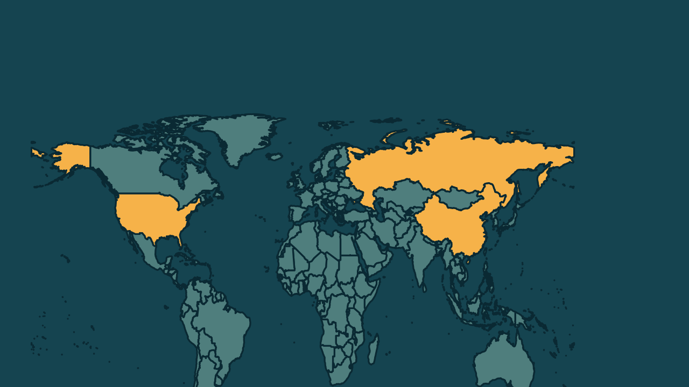

# Xi defende o fim das armas nucleares em reunião com Trump e Putin

*Heimdall News, edição internacional. 19 de novembro de 2026*

## A notícia

Os presidentes da China, Xi Jinping, dos Estados Unidos, Donald Trump, e da Rússia, Vladimir Putin, fizeram nesta quinta-feira, em Shenzhen, na China, a primeira reunião a três da história. O encontro durou cerca de 80 minutos. [1][2]

A pauta incluiu o controle de arsenais nucleares, a guerra na Ucrânia e o conflito com o Irã. Juntos, os três países concentram cerca de 90% das ogivas nucleares do mundo. [3][4]

Não houve anúncio de acordo sobre desarmamento. Desde fevereiro, com o fim do tratado New START, nenhum acordo limita os arsenais estratégicos dos Estados Unidos e da Rússia. [5][6]

## Quem se manifestou

- **Xi Jinping, chinês, presidente:** afirmou, segundo a agência oficial chinesa Xinhua, que as armas nucleares devem ser completamente proibidas e destruídas. [7][8][9]
- **Donald Trump, americano, presidente:** afirmou que os três países estão numa posição única para discutir a redução das armas nucleares, mas que é muito difícil abrir mão delas. [10][11]
- **Vladimir Putin, russo, presidente:** afirmou que os três países têm responsabilidade conjunta na manutenção da paz e da segurança. [12]

## Reação no Brasil

Nenhum posicionamento encontrado.

## Fontes

1. Estadão, [Xi diz que armas nucleares devem ser proibidas e destruídas durante reunião com Trump e Putin](https://www.estadao.com.br/internacional/xi-diz-que-armas-nucleares-devem-ser-proibidas-e-destruidas-durante-reuniao-com-trump-e-putin-npr/): "em Shenzhen, no sul chinês"
2. Estadão, [Xi diz que armas nucleares devem ser proibidas e destruídas durante reunião com Trump e Putin](https://www.estadao.com.br/internacional/xi-diz-que-armas-nucleares-devem-ser-proibidas-e-destruidas-durante-reuniao-com-trump-e-putin-npr/): "foi o primeiro do tipo na história e durou cerca de 80 minutos"
3. Estadão, [Xi diz que armas nucleares devem ser proibidas e destruídas durante reunião com Trump e Putin](https://www.estadao.com.br/internacional/xi-diz-que-armas-nucleares-devem-ser-proibidas-e-destruidas-durante-reuniao-com-trump-e-putin-npr/): "incluindo o controle de arsenais nucleares, a guerra na Ucrânia e o conflito envolvendo o Irã"
4. CNN Brasil, [“Será difícil abrir mão de armas nucleares”, diz Trump diante de Putin e Xi](https://www.cnnbrasil.com.br/internacional/sera-dificil-abrir-mao-de-armas-nucleares-diz-trump-diante-de-putin-e-xi/): "concentram cerca de 90% das ogivas nucleares existentes"
5. CartaCapital, [Putin, Trump e XI Jinping encerram primeira reunião trilateral sem anunciar acordos](https://www.cartacapital.com.br/mundo/putin-trump-e-xi-jinping-encerram-primeira-reuniao-trilateral-sem-anunciar-acordos/): "Não houve anúncio de acordos ou compromissos concretos ao fim da reunião."
6. Estadão, [Xi diz que armas nucleares devem ser proibidas e destruídas durante reunião com Trump e Putin](https://www.estadao.com.br/internacional/xi-diz-que-armas-nucleares-devem-ser-proibidas-e-destruidas-durante-reuniao-com-trump-e-putin-npr/): "o fim, em fevereiro deste ano, do tratado New START, último acordo que estabelecia limites"
7. CNN Brasil, [Xi defende mundo livre de armas nucleares em reunião com Trump e Putin](https://www.cnnbrasil.com.br/internacional/xi-defende-mundo-livre-de-armas-nucleares-em-reuniao-com-trump-e-putin/): "As armas nucleares devem ser completamente proibidas e destruídas"
8. CNN Brasil, [Xi defende mundo livre de armas nucleares em reunião com Trump e Putin](https://www.cnnbrasil.com.br/internacional/xi-defende-mundo-livre-de-armas-nucleares-em-reuniao-com-trump-e-putin/): "Uma guerra nuclear não pode ser vencida e nunca deve ser travada, afirmou Xi, segundo a agência oficial de notícias chinesa Xinhua"
9. CartaCapital, [Putin, Trump e XI Jinping encerram primeira reunião trilateral sem anunciar acordos](https://www.cartacapital.com.br/mundo/putin-trump-e-xi-jinping-encerram-primeira-reuniao-trilateral-sem-anunciar-acordos/): "defendeu que elas sejam “completamente proibidas e totalmente destruídas”"
10. G1, [Xi Jinping diz que armas nucleares 'devem ser completamente proibidas e destruídas'](https://g1.globo.com/mundo/noticia/2026/11/19/xi-jinping-defende-mundo-livre-de-armas-nucleares.ghtml): "estamos em uma posição única para discutir como reduzir o número de armas nucleares no mundo"
11. G1, [Xi Jinping diz que armas nucleares 'devem ser completamente proibidas e destruídas'](https://g1.globo.com/mundo/noticia/2026/11/19/xi-jinping-defende-mundo-livre-de-armas-nucleares.ghtml): "é muito difícil abrir mão delas quando se é líder de um país"
12. G1, [Xi Jinping diz que armas nucleares 'devem ser completamente proibidas e destruídas'](https://g1.globo.com/mundo/noticia/2026/11/19/xi-jinping-defende-mundo-livre-de-armas-nucleares.ghtml): "Nossos três estados têm responsabilidade conjunta na manutenção da paz e da segurança"
