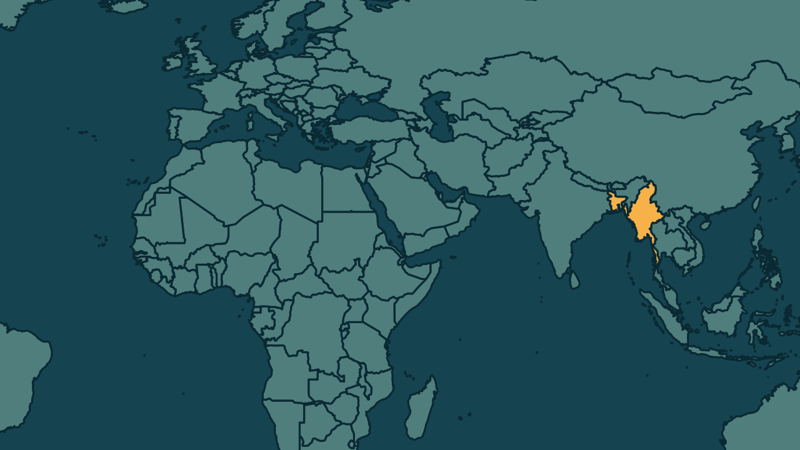

# Corte da ONU conclui que Mianmar cometeu genocídio contra rohingyas

*Heimdall News, edição internacional. 19 de novembro de 2026*

## A notícia

A Corte Internacional de Justiça, principal tribunal das Nações Unidas, concluiu nesta quinta-feira, em Haia, que Mianmar cometeu genocídio contra a minoria muçulmana rohingya na ofensiva militar de 2017. A decisão dos 15 juízes teve 9 votos a 6. O caso foi aberto pela Gâmbia em 2019. [1][2][3][4][5]

Segundo a corte, as forças de segurança mataram cerca de 10 mil rohingyas, e mais de 700 mil fugiram para Bangladesh. É a primeira vez que o tribunal responsabiliza um Estado por genocídio. [6][7][8]

A corte mandou Mianmar indenizar as vítimas e permitir o retorno dos deslocados. A sentença não admite recurso, mas o tribunal não tem poder para executar as próprias decisões. [9][10][11]

## Quem se manifestou

- **Governo de Mianmar, Mianmar:** rejeitou as acusações no processo e disse que as operações militares responderam a ataques de um grupo armado rohingya. Não havia comentado a sentença. [12][13]
- **Governo da Gâmbia, Gâmbia:** afirmou, pelo ministro da Justiça, que a sentença é uma vitória para a comunidade. [14]
- **Mike Waltz, americano, embaixador na ONU:** afirmou, no mês passado, que a corte tentava reduzir a exigência para uma decisão de genocídio, o que poderia ser usado contra soldados americanos. [15][16]

## Reação no Brasil

Nenhum posicionamento encontrado.

## Fontes

1. Gazeta do Povo, [Tribunal da ONU conclui que Mianmar cometeu genocídio contra minoria muçulmana](https://www.gazetadopovo.com.br/mundo/tribunal-onu-conclui-mianmar-cometeu-genocidio-minoria-muculmana/): "declarou nesta quinta-feira (19) Mianmar responsável por cometer genocídio contra a minoria muçulmana rohingya durante a ofensiva militar de 2017"
2. Folha de S.Paulo, [Tribunal da ONU conclui que Mianmar cometeu genocídio contra minoria muçulmana; 10 mil foram assassinados](https://www1.folha.uol.com.br/mundo/2026/11/tribunal-da-onu-conclui-que-mianmar-cometeu-genocidio-contra-minoria-muculmana-10-mil-foram-assassinados.shtml): "Com sede em Haia, na Holanda, a CIJ"
3. Folha de S.Paulo, [Tribunal da ONU conclui que Mianmar cometeu genocídio contra minoria muçulmana; 10 mil foram assassinados](https://www1.folha.uol.com.br/mundo/2026/11/tribunal-da-onu-conclui-que-mianmar-cometeu-genocidio-contra-minoria-muculmana-10-mil-foram-assassinados.shtml): "Os 15 magistrados entenderam que houve a intenção de eliminar um grupo étnico e religioso."
4. CNN Brasil, [Corte da ONU conclui que Mianmar cometeu genocídio contra minoria étnica](https://www.cnnbrasil.com.br/internacional/corte-da-onu-conclui-que-mianmar-cometeu-genocidio-contra-minoria-etnica/): "A sentença foi aprovada por nove votos a seis"
5. Gazeta do Povo, [Tribunal da ONU conclui que Mianmar cometeu genocídio contra minoria muçulmana](https://www.gazetadopovo.com.br/mundo/tribunal-onu-conclui-mianmar-cometeu-genocidio-minoria-muculmana/): "Gâmbia apresentou a ação perante a CIJ em 2019"
6. Folha de S.Paulo, [Tribunal da ONU conclui que Mianmar cometeu genocídio contra minoria muçulmana; 10 mil foram assassinados](https://www1.folha.uol.com.br/mundo/2026/11/tribunal-da-onu-conclui-que-mianmar-cometeu-genocidio-contra-minoria-muculmana-10-mil-foram-assassinados.shtml): "No total, as forças de Myanmar mataram cerca de 10 mil rohingyas, segundo Iwasawa."
7. Gazeta do Povo, [Tribunal da ONU conclui que Mianmar cometeu genocídio contra minoria muçulmana](https://www.gazetadopovo.com.br/mundo/tribunal-onu-conclui-mianmar-cometeu-genocidio-minoria-muculmana/): "A ofensiva de 2017 provocou a fuga de mais de 700 mil rohingyas para Bangladesh"
8. Folha de S.Paulo, [Tribunal da ONU conclui que Mianmar cometeu genocídio contra minoria muçulmana; 10 mil foram assassinados](https://www1.folha.uol.com.br/mundo/2026/11/tribunal-da-onu-conclui-que-mianmar-cometeu-genocidio-contra-minoria-muculmana-10-mil-foram-assassinados.shtml): "É também a primeira vez que a CIJ responsabiliza um Estado por esse crime."
9. Gazeta do Povo, [Tribunal da ONU conclui que Mianmar cometeu genocídio contra minoria muçulmana](https://www.gazetadopovo.com.br/mundo/tribunal-onu-conclui-mianmar-cometeu-genocidio-minoria-muculmana/): "ordenou investigar os responsáveis, indenizar as vítimas e facilitar o retorno dos deslocados"
10. Gazeta do Povo, [Tribunal da ONU conclui que Mianmar cometeu genocídio contra minoria muçulmana](https://www.gazetadopovo.com.br/mundo/tribunal-onu-conclui-mianmar-cometeu-genocidio-minoria-muculmana/): "A sentença é definitiva e sem possibilidade de recurso."
11. CNN Brasil, [Corte da ONU conclui que Mianmar cometeu genocídio contra minoria étnica](https://www.cnnbrasil.com.br/internacional/corte-da-onu-conclui-que-mianmar-cometeu-genocidio-contra-minoria-etnica/): "não tem poder para executar suas próprias determinações"
12. Gazeta do Povo, [Tribunal da ONU conclui que Mianmar cometeu genocídio contra minoria muçulmana](https://www.gazetadopovo.com.br/mundo/tribunal-onu-conclui-mianmar-cometeu-genocidio-minoria-muculmana/): "Mianmar rejeitou as acusações e sustentou que as operações militares de 2016 e 2017 responderam a ataques do Exército de Salvação Rohingya de Arakan"
13. Folha de S.Paulo, [Tribunal da ONU conclui que Mianmar cometeu genocídio contra minoria muçulmana; 10 mil foram assassinados](https://www1.folha.uol.com.br/mundo/2026/11/tribunal-da-onu-conclui-que-mianmar-cometeu-genocidio-contra-minoria-muculmana-10-mil-foram-assassinados.shtml): "O governo de Mianmar não havia se manifestado sobre a decisão."
14. G1, [Mianmar cometeu genocídio contra os muçulmanos rohingya, diz ONU](https://g1.globo.com/mundo/noticia/2026/11/19/myanmar-tinha-intencao-de-destruir-a-populacao-rohingya-diz-onu.ghtml): "O ministro da Justiça da Gâmbia disse que a sentença é "uma vitória para a comunidade""
15. CNN Brasil, [Corte da ONU conclui que Mianmar cometeu genocídio contra minoria étnica](https://www.cnnbrasil.com.br/internacional/corte-da-onu-conclui-que-mianmar-cometeu-genocidio-contra-minoria-etnica/): "acusou a CIJ de tentar reduzir o nível de exigência para uma decisão de genocídio no caso de Mianmar"
16. CNN Brasil, [Corte da ONU conclui que Mianmar cometeu genocídio contra minoria étnica](https://www.cnnbrasil.com.br/internacional/corte-da-onu-conclui-que-mianmar-cometeu-genocidio-contra-minoria-etnica/): "isso poderia potencialmente ser “instrumentalizado” contra soldados americanos"
