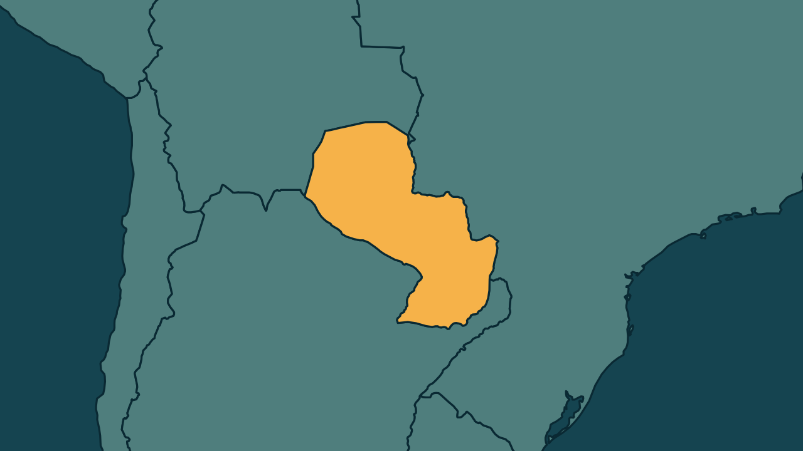

# Paraguai demite diretor de Itaipu por depósitos no Ueno Bank

*Heimdall News, edição internacional. 19 de novembro de 2026*

## A notícia

O presidente do Paraguai, Pedro Alliana, demitiu na quarta-feira o diretor paraguaio de Itaipu, a hidrelétrica compartilhada com o Brasil. Justo Zacarías autorizou depósitos da usina no Ueno Bank, banco que sofreu intervenção do Banco Central paraguaio no dia 3. [1][2][3][4]

Os depósitos somam cerca de 182 milhões de dólares. Segundo a imprensa paraguaia, uma regra de Itaipu exige que o banco tenha 5 anos de mercado no país, e o Ueno virou banco em dezembro de 2023. [5][6][7][8]

Zacarías é investigado, mas não foi acusado formalmente. O novo diretor é o engenheiro Hugo Osvaldo Zárate, e a nomeação deve passar pelo Senado. [9][10][11]

## Quem se manifestou

- **Pedro Alliana, paraguaio, presidente:** afirmou que Zárate conhece profundamente a instituição e o encarregou de trabalhar com transparência. [12][13]
- **Justo Zacarías, paraguaio, diretor de Itaipu:** afirmou que não descumpriu nenhuma norma interna e que sai com o dever cumprido. Argumentou que o Ueno já atuava antes como financeira. [14][15][16]
- **José Luis Schreiner, paraguaio, presidente do Banco Central:** afirmou que as perdas com a quebra do Ueno Bank podem chegar a cerca de 1 bilhão de dólares no pior cenário. [17]

## Reação no Brasil

Nenhum posicionamento encontrado.

## Fontes

1. G1, [Presidente do Paraguai demite diretor de Itaipu após polêmica sobre depósitos de quase R$ 1 bilhão no Ueno Bank](https://g1.globo.com/economia/noticia/2026/11/19/paraguai-itaipu-ueno-presidente.ghtml): "O presidente do Paraguai, Pedro Alliana, demitiu nesta quarta-feira (18) o diretor paraguaio da usina de Itaipu, Justo Zacarías"
2. G1, [Presidente do Paraguai demite diretor de Itaipu após polêmica sobre depósitos de quase R$ 1 bilhão no Ueno Bank](https://g1.globo.com/economia/noticia/2026/11/19/paraguai-itaipu-ueno-presidente.ghtml): "Itaipu, hidrelétrica compartilhada entre Brasil e Paraguai"
3. G1, [Presidente do Paraguai demite diretor de Itaipu após polêmica sobre depósitos de quase R$ 1 bilhão no Ueno Bank](https://g1.globo.com/economia/noticia/2026/11/19/paraguai-itaipu-ueno-presidente.ghtml): "A polêmica envolve dois depósitos feitos por Itaipu no Ueno Bank e autorizados por Zacarías."
4. G1, [Presidente do Paraguai demite diretor de Itaipu após polêmica sobre depósitos de quase R$ 1 bilhão no Ueno Bank](https://g1.globo.com/economia/noticia/2026/11/19/paraguai-itaipu-ueno-presidente.ghtml): "O banco digital sofreu intervenção do Banco Central paraguaio no último dia 3"
5. Metrópoles, [Depósitos no Ueno Bank: presidente do Paraguai demite diretor de Itaipu](https://www.metropoles.com/mundo/depositos-no-ueno-bank-presidente-do-paraguai-demite-diretor-de-itaipu): "Os dois valores somados equivalem a aproximadamente US$ 182,18 milhões."
6. G1, [Presidente do Paraguai demite diretor de Itaipu após polêmica sobre depósitos de quase R$ 1 bilhão no Ueno Bank](https://g1.globo.com/economia/noticia/2026/11/19/paraguai-itaipu-ueno-presidente.ghtml): "Segundo documentos divulgados pela imprensa paraguaia, o regulamento exige que as instituições financeiras escolhidas"
7. G1, [Presidente do Paraguai demite diretor de Itaipu após polêmica sobre depósitos de quase R$ 1 bilhão no Ueno Bank](https://g1.globo.com/economia/noticia/2026/11/19/paraguai-itaipu-ueno-presidente.ghtml): "tenham pelo menos cinco anos de experiência no mercado do país"
8. G1, [Presidente do Paraguai demite diretor de Itaipu após polêmica sobre depósitos de quase R$ 1 bilhão no Ueno Bank](https://g1.globo.com/economia/noticia/2026/11/19/paraguai-itaipu-ueno-presidente.ghtml): "O Ueno começou a operar como banco em dezembro de 2023"
9. Folha de S.Paulo, [Presidente do Paraguai destitui diretor de Itaipu após crise do Ueno Bank](https://c-level.folha.uol.com.br/negocios/2026/11/presidente-do-paraguai-destitui-diretor-de-itaipu-apos-crise-do-ueno-bank.shtml): "A Justiça paraguaia investiga Zacarías em um dos casos relacionados ao escândalo bancário, mas ele não foi acusado formalmente."
10. Folha de S.Paulo, [Presidente do Paraguai destitui diretor de Itaipu após crise do Ueno Bank](https://c-level.folha.uol.com.br/negocios/2026/11/presidente-do-paraguai-destitui-diretor-de-itaipu-apos-crise-do-ueno-bank.shtml): "nomeação do engenheiro Hugo Osvaldo Zárate como novo diretor-geral paraguaio da Itaipu Binacional"
11. Gazeta do Povo, [Paraguai destitui diretor de Itaipu por escândalo do Ueno Bank](https://www.gazetadopovo.com.br/mundo/paraguai-destitui-diretor-itaipu-escandalo-ueno-bank/): "deverá ser aprovada pelo Senado"
12. Gazeta do Povo, [Paraguai destitui diretor de Itaipu por escândalo do Ueno Bank](https://www.gazetadopovo.com.br/mundo/paraguai-destitui-diretor-itaipu-escandalo-ueno-bank/): "É um profissional que conhece profundamente a instituição"
13. Gazeta do Povo, [Paraguai destitui diretor de Itaipu por escândalo do Ueno Bank](https://www.gazetadopovo.com.br/mundo/paraguai-destitui-diretor-itaipu-escandalo-ueno-bank/): "encarrego-o de trabalhar com transparência"
14. G1, [Presidente do Paraguai demite diretor de Itaipu após polêmica sobre depósitos de quase R$ 1 bilhão no Ueno Bank](https://g1.globo.com/economia/noticia/2026/11/19/paraguai-itaipu-ueno-presidente.ghtml): "Em carta pública divulgada antes de deixar o cargo, Zacarías afirmou que não descumpriu "nenhuma norma interna""
15. G1, [Presidente do Paraguai demite diretor de Itaipu após polêmica sobre depósitos de quase R$ 1 bilhão no Ueno Bank](https://g1.globo.com/economia/noticia/2026/11/19/paraguai-itaipu-ueno-presidente.ghtml): "se retirava "com o dever cumprido""
16. G1, [Presidente do Paraguai demite diretor de Itaipu após polêmica sobre depósitos de quase R$ 1 bilhão no Ueno Bank](https://g1.globo.com/economia/noticia/2026/11/19/paraguai-itaipu-ueno-presidente.ghtml): "Zacarías, porém, argumentou que a instituição já atuava anteriormente como financeira."
17. Folha de S.Paulo, [Perdas do Ueno Bank se aproximam de US$ 1 bilhão, estima BC do Paraguai](https://c-level.folha.uol.com.br/financas/2026/11/perdas-do-ueno-bank-se-aproximam-de-us-1-bilhao-estima-bc-do-paraguai.shtml): "as perdas causadas pela quebra do Ueno Bank podem chegar a cerca de US$ 1 bilhão (R$ 5,8 bilhões), no pior cenário"
