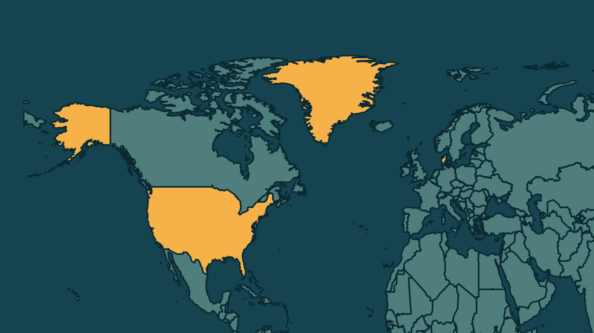

# Dinamarca ratifica acordo militar com Estados Unidos sobre Groenlândia

*Heimdall News, edição internacional. 19 de novembro de 2026*

## A notícia

O Parlamento da Dinamarca ratificou nesta quinta-feira, por 109 votos a zero, o acordo de segurança com os Estados Unidos e a Groenlândia, assinado em setembro. O Parlamento groenlandês já o havia aprovado no início do mês. [1][2][3]

O texto amplia o tratado de defesa de 1951 e permite duas novas bases americanas na ilha. Também proíbe que atores de fora da União Europeia e da Organização do Tratado do Atlântico Norte controlem setores estratégicos. [4][5][6]

O acordo veio depois que o presidente Donald Trump ameaçou assumir o controle da Groenlândia, território autônomo dinamarquês, e reafirma a soberania da Dinamarca sobre a ilha. [7][8]

## Quem se manifestou

- **Marco Rubio, americano, secretário de Estado:** afirmou que o acordo moderniza a parceria de defesa e reforça a segurança dos aliados na Organização do Tratado do Atlântico Norte. [9][10]
- **Jeppe Bruus, dinamarquês, ministro da Defesa:** disse esperar que os Estados Unidos sejam mais concretos sobre os objetivos das duas novas bases previstas. [11][12]
- **Naaja Nathanielsen, groenlandesa, parlamentar:** afirmou que as pressões de Trump aumentaram a desconfiança dos groenlandeses no governo americano e disse esperar que o acordo abra caminho para o diálogo. [13][14]

## Reação no Brasil

Nenhum posicionamento encontrado.

## Fontes

1. Estadão, com AFP, [Dinamarca ratifica acordo de segurança com EUA e Groenlândia](https://www.estadao.com.br/internacional/dinamarca-ratifica-acordo-de-seguranca-com-eua-e-groenlandia-npr/): "O Parlamento da Dinamarca ratificou, nesta quinta-feira, 19, o acordo de segurança assinado em setembro com os Estados Unidos e a Groenlândia"
2. G1, [Dinamarca aprova acordo militar com EUA e Groenlândia para reforçar segurança no Ártico](https://g1.globo.com/mundo/noticia/2026/11/19/parlamentares-da-dinamarca-aprovam-acordo-de-seguranca-com-a-groenlandia-e-os-eua.ghtml): "A proposta foi aprovada por 109 votos a zero no Parlamento dinamarquês."
3. G1, [Dinamarca aprova acordo militar com EUA e Groenlândia para reforçar segurança no Ártico](https://g1.globo.com/mundo/noticia/2026/11/19/parlamentares-da-dinamarca-aprovam-acordo-de-seguranca-com-a-groenlandia-e-os-eua.ghtml): "já havia sido aprovado sem oposição pelo Parlamento da Groenlândia no início deste mês"
4. G1, [Dinamarca aprova acordo militar com EUA e Groenlândia para reforçar segurança no Ártico](https://g1.globo.com/mundo/noticia/2026/11/19/parlamentares-da-dinamarca-aprovam-acordo-de-seguranca-com-a-groenlandia-e-os-eua.ghtml): "O acordo amplia os termos de um tratado de defesa firmado em 1951."
5. Estadão, com AFP, [Dinamarca ratifica acordo de segurança com EUA e Groenlândia](https://www.estadao.com.br/internacional/dinamarca-ratifica-acordo-de-seguranca-com-eua-e-groenlandia-npr/): "O texto permite a construção de duas novas bases americanas no sul e no leste da Groenlândia"
6. Estadão, com AFP, [Dinamarca ratifica acordo de segurança com EUA e Groenlândia](https://www.estadao.com.br/internacional/dinamarca-ratifica-acordo-de-seguranca-com-eua-e-groenlandia-npr/): "proíbe que qualquer ator alheio à União Europeia e à Organização do Tratado do Atlântico Norte (Otan) exerça controle sobre setores estratégicos"
7. Folha de S.Paulo, [Parlamento da Dinamarca ratifica acordo de segurança com EUA sobre Groenlândia](https://www1.folha.uol.com.br/mundo/2026/11/parlamento-da-dinamarca-ratifica-acordo-de-seguranca-com-eua-sobre-groenlandia.shtml): "após o presidente americano, Donald Trump, ameaçar assumir o controle do território autônomo dinamarquês"
8. Folha de S.Paulo, [Parlamento da Dinamarca ratifica acordo de segurança com EUA sobre Groenlândia](https://www1.folha.uol.com.br/mundo/2026/11/parlamento-da-dinamarca-ratifica-acordo-de-seguranca-com-eua-sobre-groenlandia.shtml): "reafirma a soberania dinamarquesa sobre o território"
9. Folha de S.Paulo, [Parlamento da Dinamarca ratifica acordo de segurança com EUA sobre Groenlândia](https://www1.folha.uol.com.br/mundo/2026/11/parlamento-da-dinamarca-ratifica-acordo-de-seguranca-com-eua-sobre-groenlandia.shtml): "Este acordo moderniza a parceria de defesa entre EUA, Dinamarca e Groenlândia"
10. Folha de S.Paulo, [Parlamento da Dinamarca ratifica acordo de segurança com EUA sobre Groenlândia](https://www1.folha.uol.com.br/mundo/2026/11/parlamento-da-dinamarca-ratifica-acordo-de-seguranca-com-eua-sobre-groenlandia.shtml): "reforça a segurança nacional e de nossos aliados na Otan"
11. Folha de S.Paulo, [Parlamento da Dinamarca ratifica acordo de segurança com EUA sobre Groenlândia](https://www1.folha.uol.com.br/mundo/2026/11/parlamento-da-dinamarca-ratifica-acordo-de-seguranca-com-eua-sobre-groenlandia.shtml): "O documento prevê ainda planos para a construção de duas novas bases militares americanas na ilha"
12. Folha de S.Paulo, [Parlamento da Dinamarca ratifica acordo de segurança com EUA sobre Groenlândia](https://www1.folha.uol.com.br/mundo/2026/11/parlamento-da-dinamarca-ratifica-acordo-de-seguranca-com-eua-sobre-groenlandia.shtml): "Espero que os EUA agora também comecem a ser mais concretos sobre os objetivos"
13. Folha de S.Paulo, [Parlamento da Dinamarca ratifica acordo de segurança com EUA sobre Groenlândia](https://www1.folha.uol.com.br/mundo/2026/11/parlamento-da-dinamarca-ratifica-acordo-de-seguranca-com-eua-sobre-groenlandia.shtml): "afirmou que as pressões de Trump aumentaram a desconfiança da população local em relação ao governo americano"
14. Folha de S.Paulo, [Parlamento da Dinamarca ratifica acordo de segurança com EUA sobre Groenlândia](https://www1.folha.uol.com.br/mundo/2026/11/parlamento-da-dinamarca-ratifica-acordo-de-seguranca-com-eua-sobre-groenlandia.shtml): "Ela afirmou esperar que o acordo abra caminho para diálogo."
