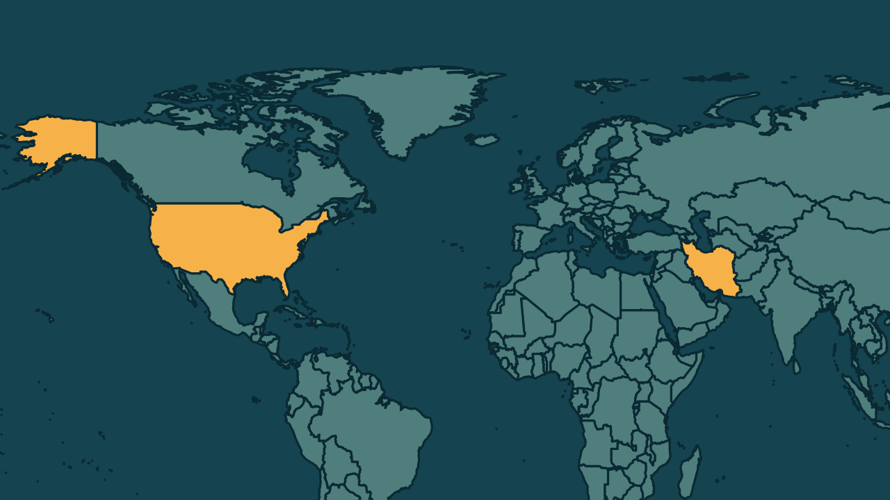

# Trump deixa para 2027 decisão sobre novos ataques ao Irã

*Heimdall News, edição internacional. 19 de novembro de 2026*

## A notícia

O presidente dos Estados Unidos, Donald Trump, disse nesta quinta-feira, na volta da China, que só vai decidir no começo de 2027 se retoma os ataques militares contra o Irã. [1][2]

Segundo autoridades americanas e israelenses ouvidas sob anonimato, Israel pressiona os Estados Unidos por uma campanha de ataques aéreos de 4 a 7 dias contra o Irã. [3][4][5]

No mesmo dia, o Senado americano rejeitou, por 51 votos a 48, uma resolução que obrigava Trump a encerrar a guerra ou pedir a aprovação do Congresso para continuar o conflito. [6][7]

## Quem se manifestou

- **Donald Trump, americano, presidente:** afirmou que não está com pressa de decidir sobre o Irã e que vai ver o que acontece depois do início do ano. [8]
- **Ministério das Relações Exteriores, Irã:** rejeitou as declarações e afirmou que as acusações americanas buscam provocar medo e justificar novas operações militares. [9][10]
- **Tim Kaine, americano, senador:** afirmou que o resultado das eleições refletiu a insatisfação dos americanos com a guerra e com o aumento dos preços. [11]

## Reação no Brasil

Nenhum posicionamento encontrado.

## Fontes

1. Gazeta do Povo, [Trump adia decisão sobre novos ataques contra o Irã para 2027](https://www.gazetadopovo.com.br/mundo/trump-adia-decisao-sobre-novos-ataques-contra-o-ira-para-2027/): "afirmou nesta quinta-feira (19) que pretende deixar para 2027 uma decisão sobre a possibilidade de realizar novos ataques militares contra o Irã"
2. Gazeta do Povo, [Trump adia decisão sobre novos ataques contra o Irã para 2027](https://www.gazetadopovo.com.br/mundo/trump-adia-decisao-sobre-novos-ataques-contra-o-ira-para-2027/): "A declaração foi dada durante seu retorno da China"
3. Estadão, [Trump avalia novos ataques ao Irã em meio a pressão de Israel por medidas](https://www.estadao.com.br/internacional/trump-avalia-novos-ataques-ao-ira-em-meio-a-pressao-de-israel-por-medidas/): "uma campanha de ataques aéreos de quatro a sete dias contra o Irã"
4. Estadão, [Trump avalia novos ataques ao Irã em meio a pressão de Israel por medidas](https://www.estadao.com.br/internacional/trump-avalia-novos-ataques-ao-ira-em-meio-a-pressao-de-israel-por-medidas/): "Os funcionários falaram sob condição de anonimato"
5. Estadão, [Trump avalia novos ataques ao Irã em meio a pressão de Israel por medidas](https://www.estadao.com.br/internacional/trump-avalia-novos-ataques-ao-ira-em-meio-a-pressao-de-israel-por-medidas/): "disseram autoridades americanas e israelenses informadas sobre as discussões"
6. Folha de S.Paulo, [Apesar de dizer o contrário, Trump avalia retomar ataques ao Irã sob pressão de Netanyahu, diz site](https://www1.folha.uol.com.br/mundo/2026/11/apesar-de-dizer-o-contrario-trump-avalia-retomar-ataques-ao-ira-sob-pressao-de-netanyahu-diz-site.shtml): "O Senado rejeitou, por 51 votos a 48"
7. Folha de S.Paulo, [Apesar de dizer o contrário, Trump avalia retomar ataques ao Irã sob pressão de Netanyahu, diz site](https://www1.folha.uol.com.br/mundo/2026/11/apesar-de-dizer-o-contrario-trump-avalia-retomar-ataques-ao-ira-sob-pressao-de-netanyahu-diz-site.shtml): "um projeto de lei que determinava que o Trump encerrasse a guerra no Irã ou obtivesse a aprovação do Congresso para dar continuidade ao conflito"
8. Gazeta do Povo, [Trump adia decisão sobre novos ataques contra o Irã para 2027](https://www.gazetadopovo.com.br/mundo/trump-adia-decisao-sobre-novos-ataques-contra-o-ira-para-2027/): "Não estou com pressa de tomar nenhuma decisão sobre o Irã. Veremos o que acontece depois do início do ano"
9. Gazeta do Povo, [Trump adia decisão sobre novos ataques contra o Irã para 2027](https://www.gazetadopovo.com.br/mundo/trump-adia-decisao-sobre-novos-ataques-contra-o-ira-para-2027/): "O Ministério das Relações Exteriores do Irã rejeitou as declarações"
10. Gazeta do Povo, [Trump adia decisão sobre novos ataques contra o Irã para 2027](https://www.gazetadopovo.com.br/mundo/trump-adia-decisao-sobre-novos-ataques-contra-o-ira-para-2027/): "as acusações americanas têm como objetivo provocar medo e justificar novas operações militares contra o país"
11. Folha de S.Paulo, [Apesar de dizer o contrário, Trump avalia retomar ataques ao Irã sob pressão de Netanyahu, diz site](https://www1.folha.uol.com.br/mundo/2026/11/apesar-de-dizer-o-contrario-trump-avalia-retomar-ataques-ao-ira-sob-pressao-de-netanyahu-diz-site.shtml): "afirmou que o resultado das eleições refletiu a insatisfação dos americanos com a guerra e com o aumento dos preços"
