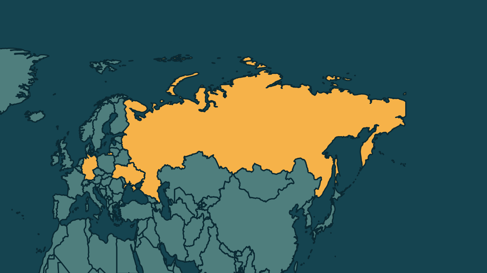

# Líderes europeus rejeitam paz na Ucrânia decidida sem a Europa

*Heimdall News, edição internacional. 20 de novembro de 2026*

## A notícia

Líderes europeus reunidos em Berlim nesta quinta-feira alertaram contra qualquer decisão sobre a paz na Ucrânia tomada sem eles, depois da reunião de Donald Trump, Vladimir Putin e Xi Jinping na China. [1][2]

O encontro da Coalizão dos Dispostos reuniu representantes de cerca de 40 países que apoiam a Ucrânia. O presidente americano participou por telefone. [3][4]

Os participantes se comprometeram a manter em 2027 a ajuda militar à Ucrânia pelo menos no nível de 2026, e o Reino Unido anunciou um pacote de 260 milhões de libras, com mais de mil drones de longo alcance. [5][6]

## Quem se manifestou

- **Friedrich Merz, alemão, chanceler:** afirmou que um formato como o de Yalta não trará paz e que a Europa não será dividida. [7][8]
- **Donald Tusk, polonês, primeiro-ministro:** disse que Putin, chamado de amigo por Trump, não é amigo dos europeus e nunca será. [9][10]
- **Jared Kushner, americano:** disse que Trump saiu da China convencido de que a paz é possível. [11]
- **Vladimir Putin, russo, presidente:** propôs que representantes europeus vão a Moscou explicar sua posição antes de definir o formato do diálogo. [12][13]

## Reação no Brasil

Nenhum posicionamento encontrado.

## Fontes

1. G1, [Aliados da Ucrânia alertam contra partilha ao estilo da 2ª Guerra Mundial enquanto Trump se reúne com 'amigo' Putin](https://g1.globo.com/mundo/noticia/2026/11/19/aliados-da-ucrania-alertam-contra-partilha-ao-estilo-da-2a-guerra-mundial-enquanto-trump-se-reune-com-amigo-putin.ghtml): "Os aliados europeus se reuniram em Berlim, na Alemanha, nesta quinta-feira (19)"
2. G1, [Aliados da Ucrânia alertam contra partilha ao estilo da 2ª Guerra Mundial enquanto Trump se reúne com 'amigo' Putin](https://g1.globo.com/mundo/noticia/2026/11/19/aliados-da-ucrania-alertam-contra-partilha-ao-estilo-da-2a-guerra-mundial-enquanto-trump-se-reune-com-amigo-putin.ghtml): "alertaram contra qualquer tentativa de decidir sobre a paz sem consultá-los"
3. Gazeta do Povo, [Líderes europeus criticam reunião de Trump com Putin e Xi e alertam para riscos à Ucrânia](https://www.gazetadopovo.com.br/mundo/lideres-europeus-criticam-reuniao-de-trump-com-putin-e-xi-e-alertam-para-riscos-a-ucrania/): "com representantes de cerca de 40 países que apoiam militar e financeiramente a Ucrânia"
4. Gazeta do Povo, [Líderes europeus criticam reunião de Trump com Putin e Xi e alertam para riscos à Ucrânia](https://www.gazetadopovo.com.br/mundo/lideres-europeus-criticam-reuniao-de-trump-com-putin-e-xi-e-alertam-para-riscos-a-ucrania/): "Trump também participou por telefone do encontro em Berlim"
5. Gazeta do Povo, [Líderes europeus criticam reunião de Trump com Putin e Xi e alertam para riscos à Ucrânia](https://www.gazetadopovo.com.br/mundo/lideres-europeus-criticam-reuniao-de-trump-com-putin-e-xi-e-alertam-para-riscos-a-ucrania/): "manter a assistência militar à Ucrânia em 2027 em níveis pelo menos equivalentes aos de 2026"
6. Gazeta do Povo, [Líderes europeus criticam reunião de Trump com Putin e Xi e alertam para riscos à Ucrânia](https://www.gazetadopovo.com.br/mundo/lideres-europeus-criticam-reuniao-de-trump-com-putin-e-xi-e-alertam-para-riscos-a-ucrania/): "novo pacote de 260 milhões de libras, que prevê o envio de mais de mil drones de ataque de longo alcance"
7. Gazeta do Povo, [Líderes europeus criticam reunião de Trump com Putin e Xi e alertam para riscos à Ucrânia](https://www.gazetadopovo.com.br/mundo/lideres-europeus-criticam-reuniao-de-trump-com-putin-e-xi-e-alertam-para-riscos-a-ucrania/): ""Um formato como o de Yalta não trará paz", afirmou o chanceler"
8. Gazeta do Povo, [Líderes europeus criticam reunião de Trump com Putin e Xi e alertam para riscos à Ucrânia](https://www.gazetadopovo.com.br/mundo/lideres-europeus-criticam-reuniao-de-trump-com-putin-e-xi-e-alertam-para-riscos-a-ucrania/): "Em Yalta, a Europa foi dividida. Não permitiremos que a Europa seja dividida novamente"
9. G1, [Aliados da Ucrânia alertam contra partilha ao estilo da 2ª Guerra Mundial enquanto Trump se reúne com 'amigo' Putin](https://g1.globo.com/mundo/noticia/2026/11/19/aliados-da-ucrania-alertam-contra-partilha-ao-estilo-da-2a-guerra-mundial-enquanto-trump-se-reune-com-amigo-putin.ghtml): "depois que o presidente Donald Trump referiu-se ao presidente russo, Vladimir Putin, como um "amigo""
10. G1, [Aliados da Ucrânia alertam contra partilha ao estilo da 2ª Guerra Mundial enquanto Trump se reúne com 'amigo' Putin](https://g1.globo.com/mundo/noticia/2026/11/19/aliados-da-ucrania-alertam-contra-partilha-ao-estilo-da-2a-guerra-mundial-enquanto-trump-se-reune-com-amigo-putin.ghtml): "O sr. Putin não é nosso amigo e nunca será"
11. G1, [Aliados da Ucrânia alertam contra partilha ao estilo da 2ª Guerra Mundial enquanto Trump se reúne com 'amigo' Putin](https://g1.globo.com/mundo/noticia/2026/11/19/aliados-da-ucrania-alertam-contra-partilha-ao-estilo-da-2a-guerra-mundial-enquanto-trump-se-reune-com-amigo-putin.ghtml): "saiu de sua reunião com Putin e Xi convencido de que “a paz é possível”, disse Kushner"
12. CNN Brasil, [Putin convida europeus a Moscou para que “esclareçam” posição sobre Ucrânia](https://www.cnnbrasil.com.br/internacional/putin-convida-europeus-a-moscou-para-que-esclarecam-posicao-sobre-ucrania/): "propusemos que representantes europeus venham a Moscou para que possamos determinar qual é a posição deles"
13. CNN Brasil, [Putin convida europeus a Moscou para que “esclareçam” posição sobre Ucrânia](https://www.cnnbrasil.com.br/internacional/putin-convida-europeus-a-moscou-para-que-esclarecam-posicao-sobre-ucrania/): "Depois disso, decidiremos em que formato continuaremos o diálogo com a Ucrânia"
