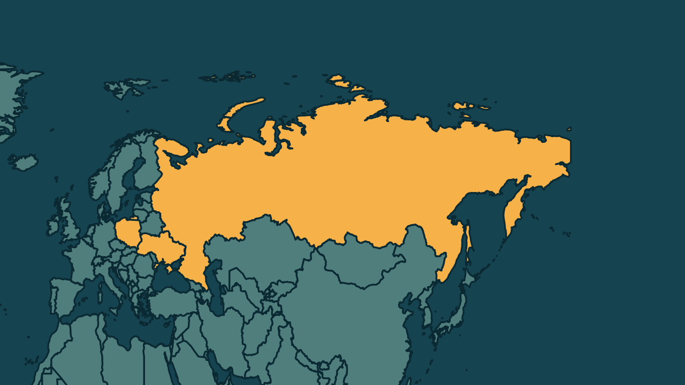

# Rússia mata oito na Ucrânia em ataque após ameaça de Putin

*Heimdall News, edição internacional. 20 de novembro de 2026*

## A notícia

A Rússia lançou mísseis e drones contra a Ucrânia na madrugada desta sexta-feira e matou pelo menos 8 pessoas: seis em Kiev e duas perto de Lviv. [1][2][3]

Autoridades ucranianas informaram mais de 80 mísseis e 400 drones. Três pontes de Kiev foram atingidas, e houve cortes de energia na capital e em outras dez regiões. [4][5][6]

Nesta semana, a Ucrânia lançou ataques contra a ponte que liga a Crimeia à Rússia, e Vladimir Putin prometeu resposta horas antes do bombardeio. O governo da Polônia informou que pelo menos um míssil caiu no país. [7][8][9]

## Quem se manifestou

- **Volodimir Zelensky, ucraniano, presidente:** afirmou que é um dos maiores ataques da guerra e que a Rússia tenta compensar com terror sua impotência militar. [10][11]
- **Vladimir Putin, russo, presidente:** disse na véspera, na China, que a Rússia responderia aos ataques à ponte. [12]
- **Forças Armadas da Rússia, Rússia:** afirmaram que os alvos foram o complexo militar-industrial e o transporte. [13]
- **Donald Tusk, polonês, primeiro-ministro:** chamou de provocação russa o míssil que caiu no país e defendeu que a Polônia participe das negociações. [14][15]

## Reação no Brasil

Nenhum posicionamento encontrado.

## Fontes

1. Folha de S.Paulo, [Rússia mata 8 em ataques à Ucrânia após Putin prometer retaliação por ponte da Crimeia](https://www1.folha.uol.com.br/mundo/2026/11/russia-mata-8-em-ataques-a-ucrania-apos-putin-prometer-retaliacao-por-ponte-da-crimeia.shtml): "durante a madrugada desta sexta (20), matando seis pessoas na capital, Kiev"
2. Folha de S.Paulo, [Rússia mata 8 em ataques à Ucrânia após Putin prometer retaliação por ponte da Crimeia](https://www1.folha.uol.com.br/mundo/2026/11/russia-mata-8-em-ataques-a-ucrania-apos-putin-prometer-retaliacao-por-ponte-da-crimeia.shtml): "Duas pessoas morreram em uma estação de trem suburbano nos arredores da cidade de Lviv"
3. CartaCapital, [Rússia lança mais de 110 mísseis contra Ucrânia após ameaças de Putin](https://www.cartacapital.com.br/mundo/russia-lanca-mais-de-110-misseis-contra-ucrania-apos-ameacas-de-putin/): "deixando pelo menos oito mortos"
4. Folha de S.Paulo, [Rússia mata 8 em ataques à Ucrânia após Putin prometer retaliação por ponte da Crimeia](https://www1.folha.uol.com.br/mundo/2026/11/russia-mata-8-em-ataques-a-ucrania-apos-putin-prometer-retaliacao-por-ponte-da-crimeia.shtml): "Autoridades ucranianas informaram que mais de 80 mísseis e 400 drones foram disparados."
5. Folha de S.Paulo, [Rússia mata 8 em ataques à Ucrânia após Putin prometer retaliação por ponte da Crimeia](https://www1.folha.uol.com.br/mundo/2026/11/russia-mata-8-em-ataques-a-ucrania-apos-putin-prometer-retaliacao-por-ponte-da-crimeia.shtml): "Três pontes que cruzam o rio Dnipro também foram atingidas"
6. Folha de S.Paulo, [Rússia mata 8 em ataques à Ucrânia após Putin prometer retaliação por ponte da Crimeia](https://www1.folha.uol.com.br/mundo/2026/11/russia-mata-8-em-ataques-a-ucrania-apos-putin-prometer-retaliacao-por-ponte-da-crimeia.shtml): "também foram registrados apagões em Kiev e em outras dez regiões"
7. Estadão, com AP, [Rússia ataca Kiev com mísseis e drones após promessa de retaliação de Putin](https://www.estadao.com.br/internacional/russia-ataca-kiev-com-misseis-e-drones-apos-promessa-de-retaliacao-de-putin-npr/): "Os ataques ocorreram horas depois de o presidente Vladimir Putin prometer retaliar a Ucrânia"
8. Folha de S.Paulo, [Rússia mata 8 em ataques à Ucrânia após Putin prometer retaliação por ponte da Crimeia](https://www1.folha.uol.com.br/mundo/2026/11/russia-mata-8-em-ataques-a-ucrania-apos-putin-prometer-retaliacao-por-ponte-da-crimeia.shtml): "aos ataques de Kiev à ponte da Crimeia nesta semana"
9. Folha de S.Paulo, [Rússia mata 8 em ataques à Ucrânia após Putin prometer retaliação por ponte da Crimeia](https://www1.folha.uol.com.br/mundo/2026/11/russia-mata-8-em-ataques-a-ucrania-apos-putin-prometer-retaliacao-por-ponte-da-crimeia.shtml): "Varsóvia informou que pelo menos um míssil atingiu o país membro da Otan"
10. CartaCapital, [Rússia lança mais de 110 mísseis contra Ucrânia após ameaças de Putin](https://www.cartacapital.com.br/mundo/russia-lanca-mais-de-110-misseis-contra-ucrania-apos-ameacas-de-putin/): "afirmou que este é um dos “maiores ataques” desde o início da guerra"
11. CartaCapital, [Rússia lança mais de 110 mísseis contra Ucrânia após ameaças de Putin](https://www.cartacapital.com.br/mundo/russia-lanca-mais-de-110-misseis-contra-ucrania-apos-ameacas-de-putin/): "a Rússia tenta compensar, justamente com esse tipo de terror, sua impotência militar e diplomática"
12. Estadão, com AP, [Rússia ataca Kiev com mísseis e drones após promessa de retaliação de Putin](https://www.estadao.com.br/internacional/russia-ataca-kiev-com-misseis-e-drones-apos-promessa-de-retaliacao-de-putin-npr/): "“Responderemos a esses ataques, e quero que todos entendam isso”, disse Putin a repórteres na quinta-feira na China"
13. Folha de S.Paulo, [Rússia mata 8 em ataques à Ucrânia após Putin prometer retaliação por ponte da Crimeia](https://www1.folha.uol.com.br/mundo/2026/11/russia-mata-8-em-ataques-a-ucrania-apos-putin-prometer-retaliacao-por-ponte-da-crimeia.shtml): "os alvos foram instalações do complexo militar-industrial e infraestrutura de transporte em várias regiões, incluindo pontes em Kiev"
14. Folha de S.Paulo, [Rússia mata 8 em ataques à Ucrânia após Putin prometer retaliação por ponte da Crimeia](https://www1.folha.uol.com.br/mundo/2026/11/russia-mata-8-em-ataques-a-ucrania-apos-putin-prometer-retaliacao-por-ponte-da-crimeia.shtml): "denunciou o que chamou de "provocação" russa"
15. Folha de S.Paulo, [Rússia mata 8 em ataques à Ucrânia após Putin prometer retaliação por ponte da Crimeia](https://www1.folha.uol.com.br/mundo/2026/11/russia-mata-8-em-ataques-a-ucrania-apos-putin-prometer-retaliacao-por-ponte-da-crimeia.shtml): "As invasões do espaço aéreo mostram claramente por que Varsóvia deve participar das negociações de paz"
