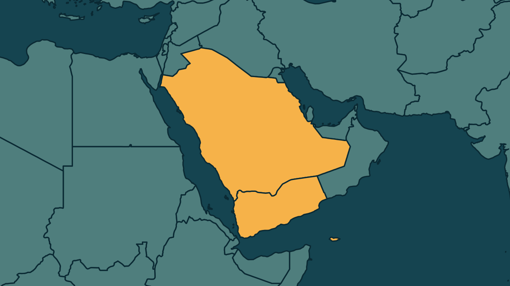

# Ataque dos houthis atinge torre do fundo soberano saudita em Riad

*Heimdall News, edição internacional. 20 de novembro de 2026*

## A notícia

Um ataque dos houthis, do Iêmen, atingiu na quinta-feira o prédio mais alto da Arábia Saudita, em Riad, sede do fundo soberano do país. A torre tem 80 andares. Segundo a Defesa Civil saudita, houve danos em vários andares e em prédios vizinhos, sem vítimas. [1][2][3]

Foi o segundo prédio do distrito financeiro de Riad danificado neste mês: a sede da petroleira estatal Aramco foi atingida em 8 de novembro. [4]

Os combates entre os houthis e a coalizão liderada pela Arábia Saudita foram retomados em julho, em meio à guerra entre Estados Unidos e Irã. Segundo a Organização Mundial da Saúde, mais de 2.200 pessoas morreram nos últimos meses. [5][6]

## Quem se manifestou

- **Yahya Saree, iemenita, porta-voz militar dos houthis:** reivindicou o ataque e citou ações contra o aeroporto de Riad e a base aérea de Khamis Mushait. [7]
- **Ministério das Relações Exteriores, Arábia Saudita:** afirmou que o país se reserva o direito de adotar todas as medidas necessárias para defender sua soberania. [8]
- **Turki al-Maliki, saudita, porta-voz da coalizão:** disse nesta sexta-feira que a coalizão mirou no porto iemenita de Hodeidah estruturas do contrabando de armas, numa operação que inclui Sanaa e Taiz. [9][10]

## Reação no Brasil

Nenhum posicionamento encontrado.

## Fontes

1. G1, [Prédio mais alto da Arábia Saudita é atingido em ataque dos houthis à sede de fundo soberano do país](https://g1.globo.com/mundo/noticia/2026/11/20/predio-mais-alto-da-arabia-saudita-e-atingido-em-ataque-dos-houthis-a-sede-de-fundo-soberano-do-pais.ghtml): "O arranha-céu mais alto da Arábia Saudita, que abriga a sede do fundo soberano do país, foi atingido nesta quinta-feira (19) em um ataque dos houthis."
2. Metrópoles, [Prédio mais alto da Arábia Saudita é atingido em ataque dos houthis](https://www.metropoles.com/mundo/predio-mais-alto-da-arabia-saudita-e-atingido-em-ataque-dos-houthis): "Com 80 andares e cerca de 385 metros de altura, a PIF Tower é um dos principais marcos arquitetônicos de Riad."
3. Estadão, com AFP, [Arranha-céu mais alto de Riad, na Arábia Saudita, é danificado por bombardeio dos houthis do Iêmen](https://www.estadao.com.br/internacional/arranha-ceu-mais-alto-riad-arabia-saudita-danificado-bombardeio-houthis-iemen-npr/): "O ataque causou danos materiais em vários andares da torre e em dois edifícios vizinhos, mas não houve vítimas"
4. G1, [Prédio mais alto da Arábia Saudita é atingido em ataque dos houthis à sede de fundo soberano do país](https://g1.globo.com/mundo/noticia/2026/11/20/predio-mais-alto-da-arabia-saudita-e-atingido-em-ataque-dos-houthis-a-sede-de-fundo-soberano-do-pais.ghtml): "A sede da estatal petrolífera Aramco foi atingida em um ataque em 8 de novembro."
5. CNN Brasil, [Houthis ameaçam atingir portos da Arábia Saudita no Mar Vermelho](https://www.cnnbrasil.com.br/internacional/houthis-ameacam-atingir-portos-da-arabia-saudita-no-mar-vermelho/): "Os combates entre os houthis e a coalizão liderada pela Arábia Saudita foram retomados em julho, em meio à guerra entre Estados Unidos e Irã"
6. Folha de S.Paulo, [Prédio do fundo soberano da Arábia Saudita é bombardeado por houthis](https://www1.folha.uol.com.br/mundo/2026/11/predio-do-fundo-soberano-da-arabia-saudita-e-bombardeado-por-houthis.shtml): "Mais de 2.200 pessoas morreram nos combates dos últimos meses e quase 350 mil foram deslocadas, segundo a Organização Mundial da Saúde (OMS)."
7. Estadão, com AFP, [Arranha-céu mais alto de Riad, na Arábia Saudita, é danificado por bombardeio dos houthis do Iêmen](https://www.estadao.com.br/internacional/arranha-ceu-mais-alto-riad-arabia-saudita-danificado-bombardeio-houthis-iemen-npr/): "O porta-voz militar dos houthis, Yahya Saree, reivindicou a autoria do ataque pelo Telegram e mencionou também outras ações contra o aeroporto de Riad e a base aérea de Khamis Mushait"
8. G1, [Prédio mais alto da Arábia Saudita é atingido em ataque dos houthis à sede de fundo soberano do país](https://g1.globo.com/mundo/noticia/2026/11/20/predio-mais-alto-da-arabia-saudita-e-atingido-em-ataque-dos-houthis-a-sede-de-fundo-soberano-do-pais.ghtml): "O Ministério das Relações Exteriores saudita afirmou que o país se reserva o direito de adotar "todas as medidas necessárias" para defender sua soberania"
9. CNN Brasil, [Houthis ameaçam atingir portos da Arábia Saudita no Mar Vermelho](https://www.cnnbrasil.com.br/internacional/houthis-ameacam-atingir-portos-da-arabia-saudita-no-mar-vermelho/): "Atacamos capacidades operacionais no porto de Hodeidah que contribuíam para o contrabando e o transporte de armas e mísseis balísticos"
10. CNN Brasil, [Houthis ameaçam atingir portos da Arábia Saudita no Mar Vermelho](https://www.cnnbrasil.com.br/internacional/houthis-ameacam-atingir-portos-da-arabia-saudita-no-mar-vermelho/): "a operação está em andamento e também tem como alvo estruturas nas cidades de Sanaa e Taiz"
