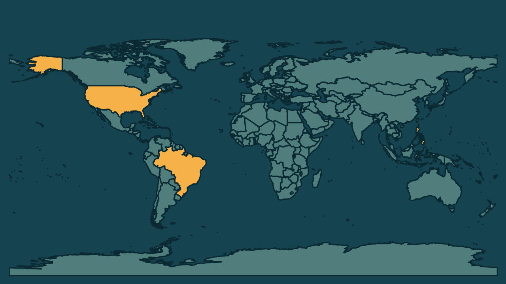

# Trump diz ter exigido que Filipinas deixem de comprar agro do Brasil

*Heimdall News, edição internacional. 20 de novembro de 2026*

## A notícia

O presidente dos Estados Unidos, Donald Trump, afirmou nesta sexta-feira, na Casa Branca, que exigiu que as Filipinas comprem 100% dos produtos agrícolas dos Estados Unidos a partir de 1º de janeiro, no lugar de fornecedores como o Brasil. [1][2][3]

O comunicado da Casa Branca da quarta-feira prevê mais compras filipinas de produtos agrícolas e de energia americanos, mas não cita o Brasil nem exige exclusividade. [4][5]

Em 2025, o Brasil vendeu 1,84 bilhão de dólares em produtos agropecuários às Filipinas, principal destino da carne suína brasileira. Lula assinou em Manila, no dia 14, um memorando de cooperação agropecuária com o país. [6][7][8][9]

## Quem se manifestou

- **Donald Trump, americano, presidente:** afirmou que as Filipinas compravam muito mais do Brasil. Disse achar que o Brasil não as ajudaria num conflito com a China. [10][11]
- **Ferdinand Marcos Jr., filipino, presidente:** afirmou que as negociações continuam e citou comprar mais soja e trigo americanos, sem confirmar a saída do Brasil. [12][13][14]
- **Departamento de Agricultura das Filipinas, Filipinas:** indicou no dia 17 que pretendia preservar e ampliar o comércio agrícola com o Brasil. [15][16]

## Reação no Brasil

Nenhum posicionamento encontrado.

## Fontes

1. Folha de S.Paulo, [Trump diz ter exigido que Filipinas comprem produtos agrícolas dos EUA e cancelem negócios com Brasil](https://c-level.folha.uol.com.br/agro/2026/11/trump-diz-ter-exigido-que-filipinas-comprem-produtos-agricolas-dos-eua-e-cancelem-negocios-com-brasil.shtml): "afirmou nesta sexta-feira (20) ter exigido que as Filipinas deixassem de comprar produtos agrícolas de países como o Brasil"
2. Folha de S.Paulo, [Trump diz ter exigido que Filipinas comprem produtos agrícolas dos EUA e cancelem negócios com Brasil](https://c-level.folha.uol.com.br/agro/2026/11/trump-diz-ter-exigido-que-filipinas-comprem-produtos-agricolas-dos-eua-e-cancelem-negocios-com-brasil.shtml): "passassem a adquirir exclusivamente mercadorias americanas a partir de 1º de janeiro"
3. Folha de S.Paulo, [Trump diz ter exigido que Filipinas comprem produtos agrícolas dos EUA e cancelem negócios com Brasil](https://c-level.folha.uol.com.br/agro/2026/11/trump-diz-ter-exigido-que-filipinas-comprem-produtos-agricolas-dos-eua-e-cancelem-negocios-com-brasil.shtml): "afirmou em entrevista coletiva na Casa Branca"
4. Folha de S.Paulo, [Trump diz ter exigido que Filipinas comprem produtos agrícolas dos EUA e cancelem negócios com Brasil](https://c-level.folha.uol.com.br/agro/2026/11/trump-diz-ter-exigido-que-filipinas-comprem-produtos-agricolas-dos-eua-e-cancelem-negocios-com-brasil.shtml): "Em documento divulgado na quarta-feira (18), a Casa Branca afirmou que os dois países pretendem reduzir o déficit comercial americano"
5. Gazeta do Povo, [Trump diz que Filipinas deixarão de comprar produtos agrícolas do Brasil após acordo com os EUA](https://www.gazetadopovo.com.br/mundo/trump-diz-que-filipinas-deixarao-de-comprar-produtos-agricolas-do-brasil-apos-acordo-com-os-eua/): "não menciona a suspensão das compras de produtos brasileiros pelas Filipinas nem estabelece uma obrigação de adquirir 100% dos produtos agrícolas dos EUA"
6. Gazeta do Povo, [Trump diz que Filipinas deixarão de comprar produtos agrícolas do Brasil após acordo com os EUA](https://www.gazetadopovo.com.br/mundo/trump-diz-que-filipinas-deixarao-de-comprar-produtos-agricolas-do-brasil-apos-acordo-com-os-eua/): "o Brasil exportou US$ 1,84 bilhão em produtos agropecuários e agroindustriais para as Filipinas em 2025"
7. Gazeta do Povo, [Trump diz que Filipinas deixarão de comprar produtos agrícolas do Brasil após acordo com os EUA](https://www.gazetadopovo.com.br/mundo/trump-diz-que-filipinas-deixarao-de-comprar-produtos-agricolas-do-brasil-apos-acordo-com-os-eua/): "As Filipinas também foram o principal destino das exportações brasileiras de carne suína no ano passado"
8. Gazeta do Povo, [Trump diz que Filipinas deixarão de comprar produtos agrícolas do Brasil após acordo com os EUA](https://www.gazetadopovo.com.br/mundo/trump-diz-que-filipinas-deixarao-de-comprar-produtos-agricolas-do-brasil-apos-acordo-com-os-eua/): "O documento foi firmado no dia 14, durante uma visita do presidente Lula (PT) a Manila."
9. Gazeta do Povo, [Trump diz que Filipinas deixarão de comprar produtos agrícolas do Brasil após acordo com os EUA](https://www.gazetadopovo.com.br/mundo/trump-diz-que-filipinas-deixarao-de-comprar-produtos-agricolas-do-brasil-apos-acordo-com-os-eua/): "Brasil e Filipinas assinarem um memorando de entendimento para ampliar a cooperação agropecuária"
10. Folha de S.Paulo, [Trump diz ter exigido que Filipinas comprem produtos agrícolas dos EUA e cancelem negócios com Brasil](https://c-level.folha.uol.com.br/agro/2026/11/trump-diz-ter-exigido-que-filipinas-comprem-produtos-agricolas-dos-eua-e-cancelem-negocios-com-brasil.shtml): "As Filipinas estavam comprando muitos produtos agrícolas de outros países, incluindo o Brasil, muito mais do que de nós"
11. Folha de S.Paulo, [Trump diz ter exigido que Filipinas comprem produtos agrícolas dos EUA e cancelem negócios com Brasil](https://c-level.folha.uol.com.br/agro/2026/11/trump-diz-ter-exigido-que-filipinas-comprem-produtos-agricolas-dos-eua-e-cancelem-negocios-com-brasil.shtml): "O Brasil vai ajudá-los caso entrem em algum pequeno conflito com a China? Acho que não"
12. Folha de S.Paulo, [Trump diz ter exigido que Filipinas comprem produtos agrícolas dos EUA e cancelem negócios com Brasil](https://c-level.folha.uol.com.br/agro/2026/11/trump-diz-ter-exigido-que-filipinas-comprem-produtos-agricolas-dos-eua-e-cancelem-negocios-com-brasil.shtml): "Marcos Jr. afirmou que as negociações comerciais com Washington continuam em andamento"
13. Folha de S.Paulo, [Trump diz ter exigido que Filipinas comprem produtos agrícolas dos EUA e cancelem negócios com Brasil](https://c-level.folha.uol.com.br/agro/2026/11/trump-diz-ter-exigido-que-filipinas-comprem-produtos-agricolas-dos-eua-e-cancelem-negocios-com-brasil.shtml): "mencionou a possibilidade de ampliar as importações de produtos agrícolas americanos, como soja e trigo"
14. Folha de S.Paulo, [Trump diz ter exigido que Filipinas comprem produtos agrícolas dos EUA e cancelem negócios com Brasil](https://c-level.folha.uol.com.br/agro/2026/11/trump-diz-ter-exigido-que-filipinas-comprem-produtos-agricolas-dos-eua-e-cancelem-negocios-com-brasil.shtml): "mas não confirmou qualquer compromisso de abandonar fornecedores brasileiros"
15. Metrópoles, [Trump diz que exigiu das Filipinas fim de compras agrícolas do Brasil](https://www.metropoles.com/mundo/trump-diz-que-exigiu-das-filipinas-fim-de-compras-agricolas-do-brasil): "um dia antes da reunião entre Donald Trump e Bongbong Marcos, o governo das Filipinas indicou que pretendia preservar e ampliar o comércio agrícola com o Brasil"
16. Metrópoles, [Trump diz que exigiu das Filipinas fim de compras agrícolas do Brasil](https://www.metropoles.com/mundo/trump-diz-que-exigiu-das-filipinas-fim-de-compras-agricolas-do-brasil): "O Departamento de Agricultura das Filipinas afirmou que o Brasil era um dos principais fornecedores"
