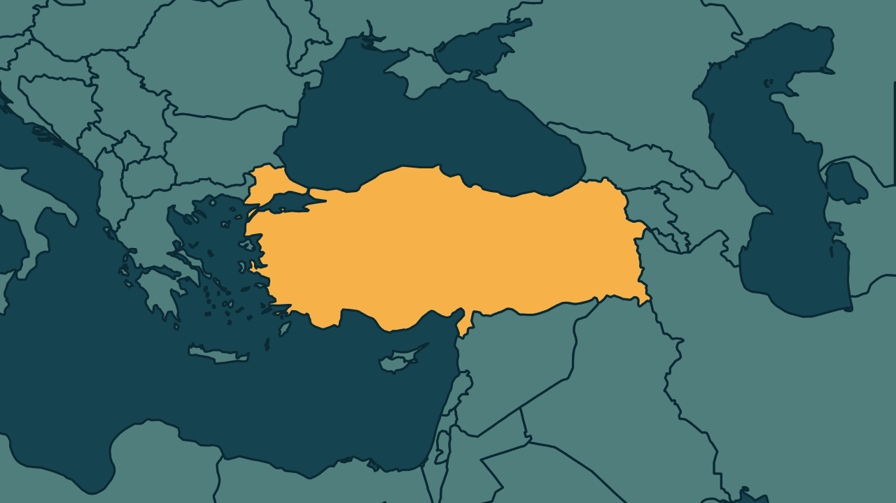

# Conferência do clima termina sem acordo pela primeira vez desde 2009

*Heimdall News, edição internacional. 23 de novembro de 2026*

## A notícia

A conferência do clima da Organização das Nações Unidas terminou no domingo em Antália, na Turquia, sem declaração final. É a primeira vez desde 2009 que isso acontece. [1][2]

A União Europeia, o Panamá e outros países rejeitaram o texto das presidências da Turquia e da Austrália, que não citava o abandono do carvão, do petróleo e do gás. Produtores de petróleo, liderados pela Arábia Saudita, resistiram a esse compromisso. [3][4][5][6]

Uma meta de 120 bilhões de dólares por ano para a adaptação dos países em desenvolvimento saiu do texto. Com quase dois dias de prorrogação, foi a conferência mais longa da história. [7][8][9]

## Quem se manifestou

- **Darragh O’Brien, irlandês, ministro do Clima:** afirmou que a União Europeia não aprovaria uma decisão sem os combustíveis fósseis e que a cúpula foi sequestrada pelos Estados petrolíferos. [10][11][12]
- **Mohamad Ayub, saudita, negociador:** afirmou que a mudança climática exige todas as soluções sobre a mesa, escolhidas por cada país conforme suas circunstâncias. [13]
- **António Guterres, português, secretário-geral das Nações Unidas:** afirmou que quem lucra com a destruição do planeta não pode ditar os termos da luta para salvá-lo. [14]

## Reação no Brasil

- **Delegação do Brasil, Brasil:** lamentou a falta de consenso e de ambição e criticou a menção à captura de carbono. [15][16]
- **Stela Herschmann, brasileira, especialista em Política Climática:** afirmou que as próximas conferências serão julgadas por como tratam os combustíveis fósseis. [17]
- **Natalie Unterstell, brasileira, presidente do Instituto Talanoa:** disse que a conferência será lembrada pela involução da diplomacia climática. [18]

## Fontes

1. Metrópoles, [Sem relatório final, COP31 fracassa após impasse sobre combustíveis fósseis](https://www.metropoles.com/mundo/sem-relatorio-final-cop31-fracassa-apos-impasse-sobre-combustiveis-fosseis): "realizada em Antália, na Turquia, terminou sem a aprovação de uma declaração final conjunta"
2. Metrópoles, [Sem relatório final, COP31 fracassa após impasse sobre combustíveis fósseis](https://www.metropoles.com/mundo/sem-relatorio-final-cop31-fracassa-apos-impasse-sobre-combustiveis-fosseis): "representa a primeira vez desde 2009 que uma cúpula climática da ONU é encerrada sem um acordo consensual"
3. Estadão, com AFP, [COP-31 termina sem consenso sobre acordo que não mencionava combustíveis: ‘profunda frustração’](https://www.estadao.com.br/internacional/presidente-da-cop-31-reconhece-que-nao-ha-consenso-sobre-documento-final-ue-diz-que-nao-vai-assinar-npr/): "após a União Europeia (UE) e países como o Panamá recusarem apoiar um texto controverso que não mencionava o abandono dos combustíveis fósseis"
4. Metrópoles, [ONU lamenta ausência de acordo na COP31 após impasse sobre combustíveis](https://www.metropoles.com/mundo/onu-lamenta-ausencia-de-acordo-na-cop31-apos-impasse-sobre-combustiveis): "A proposta apresentada pelas presidências da Turquia e da Austrália não mencionava explicitamente a necessidade de abandonar gradualmente o carvão, o petróleo e o gás natural"
5. Metrópoles, [ONU lamenta ausência de acordo na COP31 após impasse sobre combustíveis](https://www.metropoles.com/mundo/onu-lamenta-ausencia-de-acordo-na-cop31-apos-impasse-sobre-combustiveis): "Países produtores de petróleo, liderados pela Arábia Saudita, resistiram à inclusão de compromissos mais claros"
6. Gazeta do Povo, [Cúpula do clima fracassa e termina sem acordo final](https://www.gazetadopovo.com.br/mundo/cupula-clima-fracassa-termina-sem-acordo/): "Sem menção explícita a essa questão, União Europeia, Ilhas Marshall e Panamá rejeitaram o rascunho final."
7. Metrópoles, [Sem relatório final, COP31 fracassa após impasse sobre combustíveis fósseis](https://www.metropoles.com/mundo/sem-relatorio-final-cop31-fracassa-apos-impasse-sobre-combustiveis-fosseis): "Uma meta de US$ 120 bilhões anuais, discutida em versões anteriores do documento, acabou retirada da redação final"
8. Metrópoles, [Sem relatório final, COP31 fracassa após impasse sobre combustíveis fósseis](https://www.metropoles.com/mundo/sem-relatorio-final-cop31-fracassa-apos-impasse-sobre-combustiveis-fosseis): "As negociações se prolongaram por quase dois dias além do prazo oficial de encerramento"
9. Metrópoles, [Sem relatório final, COP31 fracassa após impasse sobre combustíveis fósseis](https://www.metropoles.com/mundo/sem-relatorio-final-cop31-fracassa-apos-impasse-sobre-combustiveis-fosseis): "tornou-se a mais longa cúpula climática da ONU já realizada"
10. CartaCapital, [COP31 termina sem acordo após divergências sobre combustíveis fósseis](https://www.cartacapital.com.br/mundo/cop31-termina-sem-acordo-apos-divergencias-sobre-combustiveis-fosseis/): "Não aprovaremos uma decisão (…) que sequer mencione os combustíveis fósseis, principal motor das mudanças climáticas"
11. Estadão, com AFP, [COP-31 termina sem consenso sobre acordo que não mencionava combustíveis: ‘profunda frustração’](https://www.estadao.com.br/internacional/presidente-da-cop-31-reconhece-que-nao-ha-consenso-sobre-documento-final-ue-diz-que-nao-vai-assinar-npr/): "cujo país exerce a presidência rotativa da UE"
12. Estadão, com AFP, [COP-31 termina sem consenso sobre acordo que não mencionava combustíveis: ‘profunda frustração’](https://www.estadao.com.br/internacional/presidente-da-cop-31-reconhece-que-nao-ha-consenso-sobre-documento-final-ue-diz-que-nao-vai-assinar-npr/): "que disse que a cúpula foi “sequestrada pelos Estados Petrolíferos”"
13. CartaCapital, [COP31 termina sem acordo após divergências sobre combustíveis fósseis](https://www.cartacapital.com.br/mundo/cop31-termina-sem-acordo-apos-divergencias-sobre-combustiveis-fosseis/): "Acreditamos que a mudança climática exige que todas as soluções estejam sobre a mesa e que os países escolham aquelas mais adequadas às suas circunstâncias"
14. Estadão, com AFP, [COP-31 termina sem consenso sobre acordo que não mencionava combustíveis: ‘profunda frustração’](https://www.estadao.com.br/internacional/presidente-da-cop-31-reconhece-que-nao-ha-consenso-sobre-documento-final-ue-diz-que-nao-vai-assinar-npr/): "Aqueles que lucram com a destruição do nosso planeta jamais podem ditar os termos da luta para salvá-lo"
15. G1, [Falta de 'ambição': Delegação brasileira critica resultado final da COP31; veja falas das autoridades](https://g1.globo.com/meio-ambiente/noticia/2026/11/22/cop31-fracasso-brasil-turquia.ghtml): "lamentou a falta de consenso entre os países e de ambição para combater as mudanças climáticas"
16. Estadão, [Fracasso da COP-31 traz desafios do multilateralismo e mostra que incluir fósseis é ‘incontornável’](https://www.estadao.com.br/internacional/fracasso-da-cop-31-traz-desafios-do-multilateralismo-e-mostra-que-incluir-fosseis-e-incontornavel/): "Um dos pontos criticados pelo Brasil foi a menção a tecnologias de captura de carbono"
17. Estadão, [Fracasso da COP-31 traz desafios do multilateralismo e mostra que incluir fósseis é ‘incontornável’](https://www.estadao.com.br/internacional/fracasso-da-cop-31-traz-desafios-do-multilateralismo-e-mostra-que-incluir-fosseis-e-incontornavel/): "todas as COPs daqui em diante serão julgadas sobre como elas tratam os combustíveis fósseis"
18. Estadão, [Fracasso da COP-31 traz desafios do multilateralismo e mostra que incluir fósseis é ‘incontornável’](https://www.estadao.com.br/internacional/fracasso-da-cop-31-traz-desafios-do-multilateralismo-e-mostra-que-incluir-fosseis-e-incontornavel/): "será lembrada pela involução da diplomacia climática"
