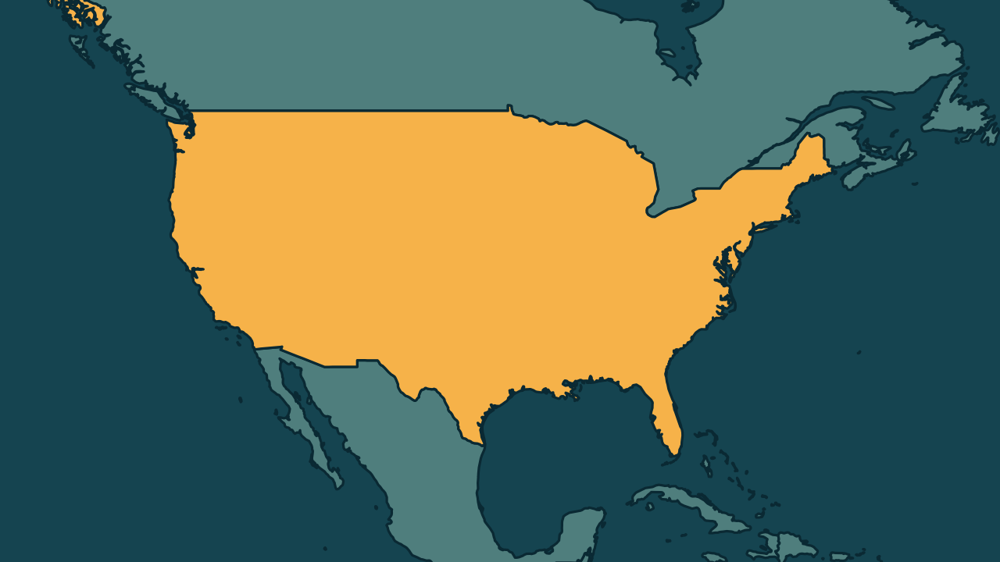

# Democratas têm maior bancada na Câmara dos Estados Unidos desde 1992

*Heimdall News, edição internacional. 23 de novembro de 2026*

## A notícia

Os democratas chegaram no domingo a 258 das 435 cadeiras da Câmara dos Representantes dos Estados Unidos, a maior bancada desde 1992. A marca veio com a vitória de Chuck Hubbard sobre a republicana Virginia Foxx, na Carolina do Norte, após uma recontagem. [1][2][3][4][5]

Os republicanos terão pelo menos 173 cadeiras, e quatro disputas seguem abertas. No Senado, os democratas têm 56 das 100 cadeiras: a partir de janeiro, Trump terá um governo dividido. [6][7][8][9][10]

Os democratas planejam investigar como Trump e a família enriqueceram desde a volta ao poder e reverter cortes no Medicaid, o programa de saúde voltado à população de baixa renda. [11][12][13]

## Quem se manifestou

- **Hakeem Jeffries, americano, líder democrata da Câmara:** afirmou que os eleitores deram ao partido uma maioria histórica e não descartou abrir um terceiro processo de impeachment contra Trump. [14][15]
- **Mike Johnson, americano, presidente da Câmara:** afirmou que o partido deixou tudo em campo e acusou os democratas de sofrerem de síndrome de desarranjo por Trump. [16][17]
- **Casa Branca, Estados Unidos:** alertou os democratas de que as investigações planejadas contra o governo poderiam constituir criminalidade flagrante. [18][19]

## Reação no Brasil

Nenhum posicionamento encontrado.

## Fontes

1. Folha de S.Paulo, [Democratas garantem 258 cadeiras na Câmara dos EUA, melhor resultado desde 1992](https://www1.folha.uol.com.br/mundo/2026/11/democratas-garantem-258-cadeiras-na-camara-melhor-resultado-desde-1992.shtml): "conquistando pelo menos 258 cadeiras na Casa"
2. CartaCapital, [EUA: Democratas conquistam maior bancada na Câmara dos Representantes desde 1992](https://www.cartacapital.com.br/mundo/eua-democratas-conquistam-maior-bancada-na-camara-dos-representantes-desde-1992/): "garantindo aos democratas a 258ª cadeira na Câmara de 435 representantes do Congresso"
3. Folha de S.Paulo, [Democratas garantem 258 cadeiras na Câmara dos EUA, melhor resultado desde 1992](https://www1.folha.uol.com.br/mundo/2026/11/democratas-garantem-258-cadeiras-na-camara-melhor-resultado-desde-1992.shtml): "Nenhum dos partidos havia conquistado tantas cadeiras em uma eleição nacional desde 1992"
4. Estadão, com AP, [EUA: democratas conquistam maioria histórica de 258 cadeiras na Câmara](https://www.estadao.com.br/internacional/eua-democratas-conquistam-maioria-historica-camara/): "depois que o democrata Chuck Hubbard derrotou a deputada republicana Virginia Foxx na Carolina do Norte"
5. Folha de S.Paulo, [Democratas garantem 258 cadeiras na Câmara dos EUA, melhor resultado desde 1992](https://www1.folha.uol.com.br/mundo/2026/11/democratas-garantem-258-cadeiras-na-camara-melhor-resultado-desde-1992.shtml): "depois que as autoridades eleitorais concluíram uma recontagem no dia anterior"
6. Estadão, com AP, [EUA: democratas conquistam maioria histórica de 258 cadeiras na Câmara](https://www.estadao.com.br/internacional/eua-democratas-conquistam-maioria-historica-camara/): "Os republicanos terão pelo menos 173 cadeiras, ficando na minoria."
7. Estadão, com AP, [EUA: democratas conquistam maioria histórica de 258 cadeiras na Câmara](https://www.estadao.com.br/internacional/eua-democratas-conquistam-maioria-historica-camara/): "Outras quatro disputas pela Câmara ainda não foram definidas"
8. G1, [Bancada democrata na Câmara dos EUA atinge marca histórica e é a maior em 34 anos](https://g1.globo.com/mundo/noticia/2026/11/22/bancada-democrata-na-camara-dos-eua-atinge-marca-historica.ghtml): "No Senado, o partido conquistou uma maioria de 56 das 100 cadeiras"
9. Estadão, com AP, [EUA: democratas conquistam maioria histórica de 258 cadeiras na Câmara](https://www.estadao.com.br/internacional/eua-democratas-conquistam-maioria-historica-camara/): "estabelece um cenário de governo dividido, com o Senado também sob controle democrata e um presidente republicano"
10. G1, [Bancada democrata na Câmara dos EUA atinge marca histórica e é a maior em 34 anos](https://g1.globo.com/mundo/noticia/2026/11/22/bancada-democrata-na-camara-dos-eua-atinge-marca-historica.ghtml): "Ao assumirem o controle da Câmara e do Senado em janeiro"
11. Estadão, com AP, [EUA: democratas conquistam maioria histórica de 258 cadeiras na Câmara](https://www.estadao.com.br/internacional/eua-democratas-conquistam-maioria-historica-camara/): "Isso inclui planos para investigar como Trump e sua família enriqueceram desde que ele voltou ao poder."
12. G1, [Bancada democrata na Câmara dos EUA atinge marca histórica e é a maior em 34 anos](https://g1.globo.com/mundo/noticia/2026/11/22/bancada-democrata-na-camara-dos-eua-atinge-marca-historica.ghtml): "os democratas planejam realizar votações rápidas para reverter os cortes promovidos pelos republicanos no Medicaid"
13. G1, [Bancada democrata na Câmara dos EUA atinge marca histórica e é a maior em 34 anos](https://g1.globo.com/mundo/noticia/2026/11/22/bancada-democrata-na-camara-dos-eua-atinge-marca-historica.ghtml): "programa de assistência médica destinado principalmente à população de baixa renda"
14. Folha de S.Paulo, [Democratas garantem 258 cadeiras na Câmara dos EUA, melhor resultado desde 1992](https://www1.folha.uol.com.br/mundo/2026/11/democratas-garantem-258-cadeiras-na-camara-melhor-resultado-desde-1992.shtml): "deu aos democratas da Câmara uma maioria histórica"
15. Estadão, com AP, [EUA: democratas conquistam maioria histórica de 258 cadeiras na Câmara](https://www.estadao.com.br/internacional/eua-democratas-conquistam-maioria-historica-camara/): "não descartou tentar abrir um processo de impeachment contra Trump pela terceira vez"
16. Folha de S.Paulo, [Democratas garantem 258 cadeiras na Câmara dos EUA, melhor resultado desde 1992](https://www1.folha.uol.com.br/mundo/2026/11/democratas-garantem-258-cadeiras-na-camara-melhor-resultado-desde-1992.shtml): "deixou tudo em campo"
17. Folha de S.Paulo, [Democratas garantem 258 cadeiras na Câmara dos EUA, melhor resultado desde 1992](https://www1.folha.uol.com.br/mundo/2026/11/democratas-garantem-258-cadeiras-na-camara-melhor-resultado-desde-1992.shtml): "síndrome de desarranjo por Trump"
18. G1, [Bancada democrata na Câmara dos EUA atinge marca histórica e é a maior em 34 anos](https://g1.globo.com/mundo/noticia/2026/11/22/bancada-democrata-na-camara-dos-eua-atinge-marca-historica.ghtml): "A Casa Branca já fez um alerta aos democratas sobre as investigações planejadas contra o governo"
19. G1, [Bancada democrata na Câmara dos EUA atinge marca histórica e é a maior em 34 anos](https://g1.globo.com/mundo/noticia/2026/11/22/bancada-democrata-na-camara-dos-eua-atinge-marca-historica.ghtml): "criminalidade flagrante"
