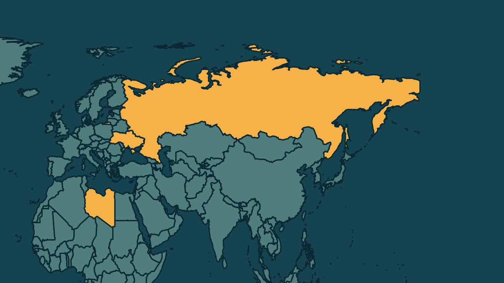

# Ucrânia diz ter afundado navio de guerra russo em porto da Líbia

*Heimdall News, edição internacional. 23 de novembro de 2026*

## A notícia

A Ucrânia afirmou ter afundado no domingo a corveta russa Merkury com 7 drones marítimos, no porto de Benghazi, no leste da Líbia. Um cargueiro russo também foi atingido. Autoridades líbias confirmaram danos graves, mas não o afundamento. [1][2][3][4]

A Líbia tem dois governos rivais. O de Trípoli é apoiado pela Organização das Nações Unidas. O do leste é aliado da Rússia, que fornece armas a Khalifa Haftar, comandante do Exército Nacional Líbio. [5][6]

É o primeiro ataque com drones marítimos no Mediterrâneo. No sábado, um cargueiro russo foi atingido por drones no Mar Báltico, perto da Finlândia. A Rússia não comentou o ataque na Líbia. [7][8][9]

## Quem se manifestou

- **Volodymyr Zelensky, ucraniano, presidente:** afirmou que foi uma operação exemplar em resposta à guerra da Rússia. [10]
- **Osama Hamad, líbio, primeiro-ministro do leste:** disse suspeitar que os drones saíram de Trípoli e pediu investigação das Nações Unidas. [11]
- **Governo de Estabilidade Nacional, Líbia:** declarou que não é parte da guerra. [12]
- **Governo de Unidade Nacional, Líbia:** lamentou tentativas de transformar a Líbia em palco de conflitos internacionais. [13]
- **Missão das Nações Unidas na Líbia:** pediu uma investigação imediata, independente e transparente. [14]

## Reação no Brasil

Nenhum posicionamento encontrado.

## Fontes

1. CNN Brasil, [Drones ucranianos afundam navio de guerra russo no norte da África](https://www.cnnbrasil.com.br/internacional/drones-ucranianos-afundam-navio-de-guerra-russo-no-norte-da-africa/): "foi atacado com sete drones marítimos, que afundaram a embarcação"
2. CNN Brasil, [Drones ucranianos afundam navio de guerra russo no norte da África](https://www.cnnbrasil.com.br/internacional/drones-ucranianos-afundam-navio-de-guerra-russo-no-norte-da-africa/): "enquanto estava atracado no porto de Benghazi, no leste da Líbia"
3. CartaCapital, [Ucrânia atacou dois navios russos na costa da Líbia, diz Zelensky](https://www.cartacapital.com.br/mundo/ucrania-atacou-dois-navios-russos-na-costa-da-libia-diz-zelensky/): "Nosso segundo alvo foi o navio cargueiro russo MV ANGARA"
4. Estadão, com AP, [Zelenski reivindica ataque que atingiu corveta e cargueiro russos na costa da Líbia](https://www.estadao.com.br/internacional/zelenski-reivindica-ataque-que-atingiu-corveta-e-cargueiro-russos-na-costa-da-libia-npr/): "informaram que o navio sofreu danos graves durante o ataque à base naval de Benghazi mas não confirmaram o afundamento"
5. CNN Brasil, [Drones ucranianos afundam navio de guerra russo no norte da África](https://www.cnnbrasil.com.br/internacional/drones-ucranianos-afundam-navio-de-guerra-russo-no-norte-da-africa/): "o Governo de Unidade Nacional (GNU), apoiado pela ONU e sediado em Trípoli, no oeste do país, e o GNS, no leste"
6. Estadão, [Por que a Ucrânia está atacando navios de guerra russos na Líbia?](https://www.estadao.com.br/internacional/por-que-a-ucrania-esta-atacando-navios-de-guerra-russos-na-libia-npr/): "O governo em Benghazi é aliado da Rússia, um dos principais fornecedores de armas do homem forte Khalifa Hifter"
7. Folha de S.Paulo, [Ucrânia afunda navio de guerra russo de R$ 1 bi na Líbia; veja vídeo](https://www1.folha.uol.com.br/mundo/2026/11/ucrania-afunda-navio-de-guerra-russo-de-r-1-bi-na-libia-veja-video.shtml): "O ataque no Mediterrâneo é o primeiro com drones marítimos naquela região"
8. CartaCapital, [Ucrânia atacou dois navios russos na costa da Líbia, diz Zelensky](https://www.cartacapital.com.br/mundo/ucrania-atacou-dois-navios-russos-na-costa-da-libia-diz-zelensky/): "um drone atingiu um cargueiro russo no Mar Báltico no sábado, perto das águas da Finlândia"
9. Gazeta do Povo, [Guerra mundial? Conflito na Ucrânia se espalha para o norte da África](https://www.gazetadopovo.com.br/mundo/conflito-ucrania-espalha-norte-africa/): "A Rússia ainda não se manifestou sobre esses ataques no Mar Mediterrâneo"
10. Metrópoles, [Ucrânia: Zelensky reivindica ataques a navios da Rússia na Líbia](https://www.metropoles.com/mundo/ucrania-zelensky-reivindica-ataques-a-navios-da-russia-na-libia): "Uma operação exemplar da Ucrânia em resposta à guerra da Rússia"
11. Folha de S.Paulo, [Ucrânia afunda navio de guerra russo de R$ 1 bi na Líbia; veja vídeo](https://www1.folha.uol.com.br/mundo/2026/11/ucrania-afunda-navio-de-guerra-russo-de-r-1-bi-na-libia-veja-video.shtml): "disse suspeitar que os drones tenham saído de portos de seus rivais, baseados em Trípoli. Ele pediu uma investigação da ONU sobre o caso."
12. CNN Brasil, [Drones ucranianos afundam navio de guerra russo no norte da África](https://www.cnnbrasil.com.br/internacional/drones-ucranianos-afundam-navio-de-guerra-russo-no-norte-da-africa/): "O governo declarou que não é parte da guerra entre Rússia e Ucrânia e que não permitirá que seu território seja transformado em uma “arena para acertos de contas”"
13. Metrópoles, [Ucrânia: Zelensky reivindica ataques a navios da Rússia na Líbia](https://www.metropoles.com/mundo/ucrania-zelensky-reivindica-ataques-a-navios-da-russia-na-libia): "lamentou qualquer tentativa de transformar a Líbia em um “palco de conflitos internacionais e de acertos de contas entre potências estrangeiras”"
14. CartaCapital, [Ucrânia atacou dois navios russos na costa da Líbia, diz Zelensky](https://www.cartacapital.com.br/mundo/ucrania-atacou-dois-navios-russos-na-costa-da-libia-diz-zelensky/): "investigação imediata, independente e transparente"
