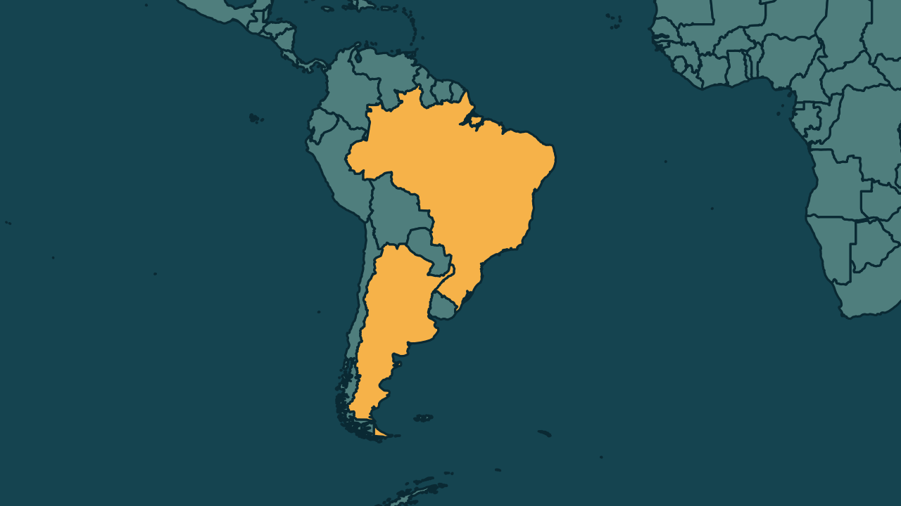

# Chanceler da Argentina põe em dúvida a reeleição de Lula

*Heimdall News, edição internacional. 23 de novembro de 2026*

## A notícia

O ministro das Relações Exteriores da Argentina, Pablo Quirno, disse no sábado que situações no processo eleitoral brasileiro deste ano colocaram em dúvida o resultado. Ele não apresentou provas. A fala foi numa entrevista à emissora argentina Eltrece. [1][2]

Lula venceu Flávio Bolsonaro no segundo turno, no fim de outubro. O governo de Javier Milei não cumprimentou o presidente brasileiro pela vitória. [3][4]

As relações entre os dois países estão rebaixadas desde agosto, quando o Brasil deixou de ter embaixador em Buenos Aires depois de ataques de Milei a Lula. O Itamaraty não respondeu sobre a entrevista. [5][6][7]

## Quem se manifestou

- **Pablo Quirno, argentino, chanceler:** afirmou que situações no processo eleitoral colocaram em dúvida o cenário, mas que quem reconhece o resultado é o tribunal eleitoral brasileiro. Chamou de unilateral o rebaixamento das relações. [8][9][10]
- **Javier Milei, argentino, presidente:** disse, dias antes do segundo turno, esperar que a campanha de Lula não incluísse roubar a eleição. [11][12]
- **Adrián Ravier, argentino, porta-voz da Presidência:** afirmou, no mês passado, que o governo tomou nota do resultado e que Lula não cumprimentou Milei em 2023. [13][14][15]

## Reação no Brasil

Nenhum posicionamento encontrado.

## Fontes

1. Folha de S.Paulo, [Chanceler argentino repete Milei e, sem provas, coloca em dúvida vitória de Lula](https://www1.folha.uol.com.br/mundo/2026/11/chanceler-argentino-repete-milei-e-sem-provas-coloca-em-duvida-vitoria-de-lula.shtml): "disse, neste sábado (21), sem nenhuma evidência, que "situações" colocaram em dúvida o processo eleitoral brasileiro deste ano"
2. Folha de S.Paulo, [Chanceler argentino repete Milei e, sem provas, coloca em dúvida vitória de Lula](https://www1.folha.uol.com.br/mundo/2026/11/chanceler-argentino-repete-milei-e-sem-provas-coloca-em-duvida-vitoria-de-lula.shtml): "programa de televisão da emissora argentina Eltrece"
3. Gazeta do Povo, [Chanceler da Argentina questiona reeleição de Lula: “Situações que colocaram em dúvida”](https://www.gazetadopovo.com.br/mundo/chanceler-argentina-questiona-reeleicao-lula/): "venceu no final de outubro em segundo turno o senador Flávio Bolsonaro"
4. Folha de S.Paulo, [Chanceler argentino repete Milei e, sem provas, coloca em dúvida vitória de Lula](https://www1.folha.uol.com.br/mundo/2026/11/chanceler-argentino-repete-milei-e-sem-provas-coloca-em-duvida-vitoria-de-lula.shtml): "o motivo de o presidente Javier Milei não ter cumprimentado Luiz Inácio Lula da Silva (PT) por sua reeleição"
5. CNN Brasil, [Chanceler da Argentina minimiza ataques de Milei a Lula](https://www.cnnbrasil.com.br/internacional/chanceler-da-argentina-minimiza-ataques-de-milei-a-lula/): "Em agosto, o Itamaraty decidiu rebaixar o nível das relações diplomáticas entre os dois países para encarregados de negócios"
6. CNN Brasil, [Chanceler da Argentina minimiza ataques de Milei a Lula](https://www.cnnbrasil.com.br/internacional/chanceler-da-argentina-minimiza-ataques-de-milei-a-lula/): "Bitelli não voltaria a Buenos Aires enquanto continuassem os ataques"
7. CNN Brasil, [Chanceler da Argentina minimiza ataques de Milei a Lula](https://www.cnnbrasil.com.br/internacional/chanceler-da-argentina-minimiza-ataques-de-milei-a-lula/): "A CNN Brasil entrou em contato com o Itamaraty para comentar as novas declarações do chanceler argentino, mas ainda não obteve resposta"
8. Folha de S.Paulo, [Chanceler argentino repete Milei e, sem provas, coloca em dúvida vitória de Lula](https://www1.folha.uol.com.br/mundo/2026/11/chanceler-argentino-repete-milei-e-sem-provas-coloca-em-duvida-vitoria-de-lula.shtml): "basicamente porque houve situações, dentro do processo eleitoral que, de certa forma, colocaram em dúvida todo o cenário"
9. Folha de S.Paulo, [Chanceler argentino repete Milei e, sem provas, coloca em dúvida vitória de Lula](https://www1.folha.uol.com.br/mundo/2026/11/chanceler-argentino-repete-milei-e-sem-provas-coloca-em-duvida-vitoria-de-lula.shtml): "Quem reconhece o resultado da eleição é o próprio Tribunal Eleitoral brasileiro"
10. CNN Brasil, [Chanceler da Argentina minimiza ataques de Milei a Lula](https://www.cnnbrasil.com.br/internacional/chanceler-da-argentina-minimiza-ataques-de-milei-a-lula/): "foi uma decisão “unilateral” do governo brasileiro"
11. Gazeta do Povo, [Chanceler da Argentina questiona reeleição de Lula: “Situações que colocaram em dúvida”](https://www.gazetadopovo.com.br/mundo/chanceler-argentina-questiona-reeleicao-lula/): "Poucos dias antes do segundo turno, o presidente argentino já havia sugerido irregularidades"
12. Gazeta do Povo, [Chanceler da Argentina questiona reeleição de Lula: “Situações que colocaram em dúvida”](https://www.gazetadopovo.com.br/mundo/chanceler-argentina-questiona-reeleicao-lula/): "Espero que o último truque da campanha suja deles não inclua roubar a eleição"
13. Folha de S.Paulo, [Chanceler argentino repete Milei e, sem provas, coloca em dúvida vitória de Lula](https://www1.folha.uol.com.br/mundo/2026/11/chanceler-argentino-repete-milei-e-sem-provas-coloca-em-duvida-vitoria-de-lula.shtml): "O porta-voz de Milei, Adrian Ravier, afirmou a jornalistas, no mês passado"
14. Folha de S.Paulo, [Chanceler argentino repete Milei e, sem provas, coloca em dúvida vitória de Lula](https://www1.folha.uol.com.br/mundo/2026/11/chanceler-argentino-repete-milei-e-sem-provas-coloca-em-duvida-vitoria-de-lula.shtml): "Tomou-se nota do resultado eleitoral no Brasil"
15. Folha de S.Paulo, [Chanceler argentino repete Milei e, sem provas, coloca em dúvida vitória de Lula](https://www1.folha.uol.com.br/mundo/2026/11/chanceler-argentino-repete-milei-e-sem-provas-coloca-em-duvida-vitoria-de-lula.shtml): "Em 2023, quando Javier Milei foi eleito presidente, não houve qualquer gesto do presidente Lula para cumprimentá-lo pessoalmente"
