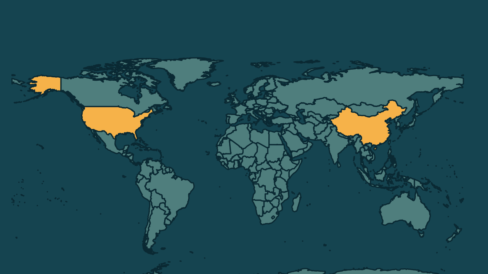

# Nvidia devolve comando a Jensen Huang após pressão de Trump

*Heimdall News, edição internacional. 23 de novembro de 2026*

## A notícia

O conselho da Nvidia devolveu nesta segunda-feira, por unanimidade, o comando a Jensen Huang, 11 dias depois da renúncia. Ele saiu após vir à tona um caso com Alice Huang, que agências americanas suspeitam ser informante da inteligência chinesa. A China nega. [1][2][3][4]

O conselho disse ter ouvido o alto escalão do governo e não ver risco à segurança nacional. Na véspera, o presidente Donald Trump tinha pedido a recontratação. As ações subiram 31,5 por cento, um ganho de 953 bilhões de dólares em valor de mercado. [5][6][7][8]

No mesmo dia, o governo restringiu as vendas de tecnologia americana à Megaspeed, empresa de Singapura que Alice Huang comandava. [9][10][11][12]

## Quem se manifestou

- **Donald Trump, americano, presidente:** afirmou que o conselho tomou a decisão correta e que o governo não tem motivos para ver risco à segurança nacional. [13][14]
- **Jensen Huang, americano, cofundador da Nvidia:** disse estar honrado por voltar e que assume a responsabilidade com humildade. [15][16]
- **Hakeem Jeffries, americano, futuro líder da bancada:** chamou a decisão de indefensável, irresponsável e incompreensível. [17]
- **Kevin Cramer, americano, senador:** afirmou que o risco à segurança nacional passa para o Exército e para os cidadãos americanos. [18]

## Reação no Brasil

- **Marcelo Prates, brasileiro, professor:** afirmou, à época da renúncia, que pode haver preocupação com a instabilidade da Nvidia e do mercado de inteligência artificial sem Huang, mas que o setor também quer depender menos da empresa. [19][20][21]

## Fontes

1. Folha de S.Paulo, [Huang é recebido com aplausos ao retornar à sede da Nvidia; veja vídeo](https://c-level.folha.uol.com.br/negocios/2026/11/huang-e-recebido-com-aplausos-ao-retornar-a-sede-da-nvidia-veja-video.shtml): "O retorno de Huang foi aprovado por unanimidade pelo conselho de administração da fabricante de chips, 11 dias após sua renúncia"
2. Poder360, [Trump posta Huang segurando sutiã para celebrar volta à Nvidia](https://www.poder360.com.br/poder-china/trump-posta-huang-segurando-sutia-para-celebrar-volta-a-nvidia/): "agências de inteligência dos EUA suspeitam que Alice Huang"
3. Poder360, [Trump posta Huang segurando sutiã para celebrar volta à Nvidia](https://www.poder360.com.br/poder-china/trump-posta-huang-segurando-sutia-para-celebrar-volta-a-nvidia/): "seja informante do serviço de inteligência chinês"
4. Folha de S.Paulo, [EUA impõe restrições à Megaspeed, empresa ligada a escândalo da Nvidia](https://c-level.folha.uol.com.br/negocios/2026/11/eua-impoe-restricoes-a-megaspeed-empresa-ligada-a-escandalo-da-nvidia.shtml): "A China afirma que as acusações são "infundadas"."
5. Estadão, [Trump enfrenta tempestade política após pressionar por retorno de Huang ao comando da Nvidia](https://www.estadao.com.br/internacional/trump-enfrenta-tempestade-politica-apos-pressionar-por-retorno-de-huang-ao-comando-da-nvidia-npr/): "o conselho recebeu informações de altos escalões do governo dos EUA"
6. Estadão, [Trump enfrenta tempestade política após pressionar por retorno de Huang ao comando da Nvidia](https://www.estadao.com.br/internacional/trump-enfrenta-tempestade-politica-apos-pressionar-por-retorno-de-huang-ao-comando-da-nvidia-npr/): "a recondução de Huang não representa nenhum risco à segurança nacional"
7. Poder360, [Trump posta Huang segurando sutiã para celebrar volta à Nvidia](https://www.poder360.com.br/poder-china/trump-posta-huang-segurando-sutia-para-celebrar-volta-a-nvidia/): "No domingo (22.nov), pediu no Truth Social que a Nvidia recontratasse Huang."
8. G1, [Nvidia recupera US$ 953 bilhões em um dia com volta de CEO, valor maior que o de toda a B3](https://g1.globo.com/economia/noticia/2026/11/23/nvidia-recupera-us-953-bilhoes-em-um-dia-com-volta-de-ceo-valor-maior-que-o-de-toda-a-b3.ghtml): "A Nvidia recuperou US$ 953 bilhões (R$ 5, 6 trilhões) em valor de mercado em um único pregão, uma alta de 31,5%"
9. Folha de S.Paulo, [EUA impõe restrições à Megaspeed, empresa ligada a escândalo da Nvidia](https://c-level.folha.uol.com.br/negocios/2026/11/eua-impoe-restricoes-a-megaspeed-empresa-ligada-a-escandalo-da-nvidia.shtml): "Os Estados Unidos acrescentaram nesta segunda-feira (23) a Megaspeed à sua lista de restrições comerciais."
10. Estadão, [EUA incluem Megaspeed, empresa envolvida em escândalo da Nvidia, em lista de controle de exportações](https://www.estadao.com.br/economia/eua-incluem-megaspeed-nvidia-lista-controle-exportacoes-npr/): "O Departamento de Comércio adicionou a Megaspeed a uma lista de entidades que não podem receber tecnologia americana"
11. Folha de S.Paulo, [EUA impõe restrições à Megaspeed, empresa ligada a escândalo da Nvidia](https://c-level.folha.uol.com.br/negocios/2026/11/eua-impoe-restricoes-a-megaspeed-empresa-ligada-a-escandalo-da-nvidia.shtml): "A empresa, sediada em Singapura"
12. Folha de S.Paulo, [EUA impõe restrições à Megaspeed, empresa ligada a escândalo da Nvidia](https://c-level.folha.uol.com.br/negocios/2026/11/eua-impoe-restricoes-a-megaspeed-empresa-ligada-a-escandalo-da-nvidia.shtml): "Alice Huang comandava a Megaspeed"
13. CartaCapital, [Com ‘aval’ de Trump, CEO da Nvidia é reconduzido ao cargo](https://www.cartacapital.com.br/mundo/com-aval-de-trump-ceo-da-nvidia-e-reconduzido-ao-cargo/): "O Conselho de Administração da NVIDIA tomou a decisão correta e adequada de reconduzir Jensen Huang ao cargo de CEO."
14. CartaCapital, [Com ‘aval’ de Trump, CEO da Nvidia é reconduzido ao cargo](https://www.cartacapital.com.br/mundo/com-aval-de-trump-ceo-da-nvidia-e-reconduzido-ao-cargo/): "O governo dos Estados Unidos não tem motivos para acreditar que o retorno de Jensen à NVIDIA represente qualquer risco à segurança nacional."
15. Folha de S.Paulo, [Huang é recebido com aplausos ao retornar à sede da Nvidia; veja vídeo](https://c-level.folha.uol.com.br/negocios/2026/11/huang-e-recebido-com-aplausos-ao-retornar-a-sede-da-nvidia-veja-video.shtml): "Huang disse estar "honrado por retornar à Nvidia""
16. Folha de S.Paulo, [Huang é recebido com aplausos ao retornar à sede da Nvidia; veja vídeo](https://c-level.folha.uol.com.br/negocios/2026/11/huang-e-recebido-com-aplausos-ao-retornar-a-sede-da-nvidia-veja-video.shtml): ""Assumo esta responsabilidade com a maior humildade e um compromisso renovado", declarou."
17. Estadão, [Trump enfrenta tempestade política após pressionar por retorno de Huang ao comando da Nvidia](https://www.estadao.com.br/internacional/trump-enfrenta-tempestade-politica-apos-pressionar-por-retorno-de-huang-ao-comando-da-nvidia-npr/): "que considerou “indefensável, irresponsável e incompreensível”"
18. Estadão, [Trump enfrenta tempestade política após pressionar por retorno de Huang ao comando da Nvidia](https://www.estadao.com.br/internacional/trump-enfrenta-tempestade-politica-apos-pressionar-por-retorno-de-huang-ao-comando-da-nvidia-npr/): "mas o risco para a segurança nacional é transferido para o Exército e para os cidadãos americanos"
19. CartaCapital, [Com ‘aval’ de Trump, CEO da Nvidia é reconduzido ao cargo](https://www.cartacapital.com.br/mundo/com-aval-de-trump-ceo-da-nvidia-e-reconduzido-ao-cargo/): "afirmou à época da renúncia"
20. CartaCapital, [Com ‘aval’ de Trump, CEO da Nvidia é reconduzido ao cargo](https://www.cartacapital.com.br/mundo/com-aval-de-trump-ceo-da-nvidia-e-reconduzido-ao-cargo/): "Pode existir uma preocupação com a instabilidade à qual a Nvidia e, por consequência, todo o mercado de IA podem estar submetidos"
21. CartaCapital, [Com ‘aval’ de Trump, CEO da Nvidia é reconduzido ao cargo](https://www.cartacapital.com.br/mundo/com-aval-de-trump-ceo-da-nvidia-e-reconduzido-ao-cargo/): "também existe um interesse dentro do mercado de IA em reduzir um pouco o grau de dependência que ele atualmente tem da Nvidia"
