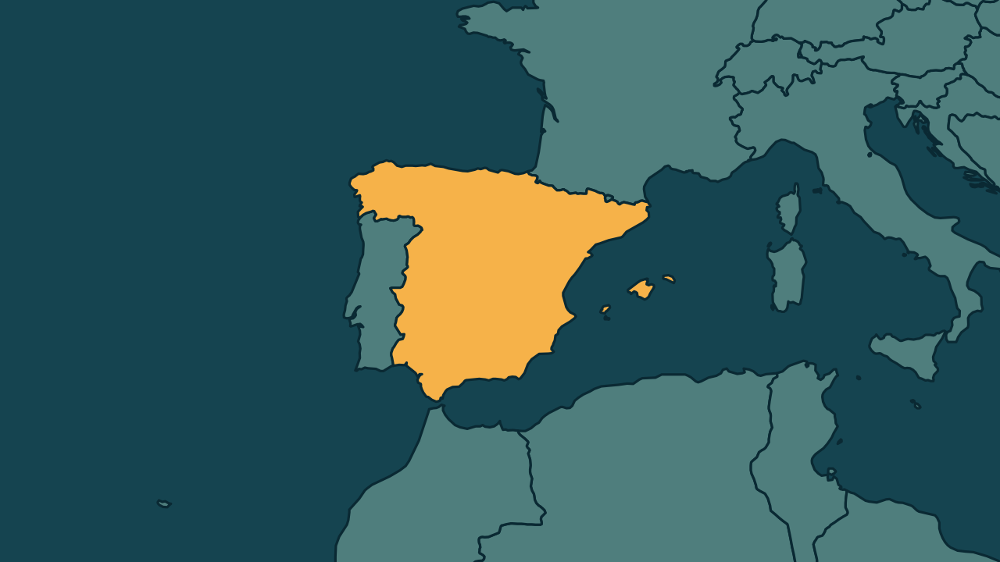

# Supremo da Espanha anistia Puigdemont a seis dias das eleições

*Heimdall News, edição internacional. 24 de novembro de 2026*

## A notícia

O Supremo Tribunal da Espanha aplicou a lei de anistia ao separatista catalão Carles Puigdemont e arquivou de vez o processo pela tentativa de independência da Catalunha, em 2017. A decisão saiu na segunda-feira, a 6 dias das eleições gerais de 29 de novembro. [1][2][3][4]

A lei foi aprovada em 2024, em troca do apoio do partido de Puigdemont, o Junts per Catalunya, para Pedro Sánchez seguir como primeiro-ministro. O Supremo a excluía do desvio de recursos públicos, mas o Tribunal Constitucional a validou em outubro. [5][6][7][8]

Puigdemont fugiu para a Bélgica em 2017 e disse que não volta antes das eleições. As pesquisas apontam vitória do Partido Popular sem maioria. [9][10][11]

## Quem se manifestou

- **Alberto Núñez Feijóo, espanhol, líder do Partido Popular:** prometeu revogar a lei de anistia se chegar ao governo e a chamou de compromisso político. [12][13]
- **Carles Puigdemont, espanhol:** disse ao jornal El Mundo, na semana passada, que explorou o desejo de Sánchez pelo poder para obter a anistia e chamou o primeiro-ministro de amoral. [14][15][16]
- **Vox, Espanha:** foi a única parte a pedir que o processo seguisse aberto até uma decisão do Tribunal de Justiça da União Europeia. O Supremo negou. [17][18][19]

## Reação no Brasil

Nenhum posicionamento encontrado.

## Fontes

1. Folha de S.Paulo, [Justiça da Espanha anistia líder separatista catalão a uma semana das eleições](https://www1.folha.uol.com.br/mundo/2026/11/justica-da-espanha-anistia-lider-separatista-catalao-a-uma-semana-das-eleicoes.shtml): "O Supremo Tribunal da Espanha deu anistia nesta segunda feira (23) ao líder separatista catalão Carles Puigdemont"
2. elDiario.es, [El Supremo aplica la amnistía a Puigdemont y archiva la causa del procés](https://www.eldiario.es/catalunya/supremo-aplica-amnistia-puigdemont-archiva-causa-proces_1_13676267.html): "El Tribunal Supremo ha archivado de forma definitiva la causa del procés contra Carles Puigdemont tras aplicar la ley de amnistía"
3. Folha de S.Paulo, [Justiça da Espanha anistia líder separatista catalão a uma semana das eleições](https://www1.folha.uol.com.br/mundo/2026/11/justica-da-espanha-anistia-lider-separatista-catalao-a-uma-semana-das-eleicoes.shtml): "encerrando o processo criminal contra ele por seu suposto papel na tentativa fracassada de independência da região em 2017"
4. Estrella Digital, [Feijóo promete derogar la amnistía el mismo día en que el Supremo da carpetazo a la causa de Puigdemont](https://www.estrelladigital.es/espana/tribunales/feijoo-derogar-amnistia-supremo-archiva-causa-puigdemont/20261123160513453797.html): "a seis días de las elecciones generales del 29 de noviembre"
5. Folha de S.Paulo, [Justiça da Espanha anistia líder separatista catalão a uma semana das eleições](https://www1.folha.uol.com.br/mundo/2026/11/justica-da-espanha-anistia-lider-separatista-catalao-a-uma-semana-das-eleicoes.shtml): "marca a etapa final da implementação da lei de anistia, aprovada em 2024"
6. Folha de S.Paulo, [Justiça da Espanha anistia líder separatista catalão a uma semana das eleições](https://www1.folha.uol.com.br/mundo/2026/11/justica-da-espanha-anistia-lider-separatista-catalao-a-uma-semana-das-eleicoes.shtml): "para garantir o apoio de partidos separatistas catalães, incluindo o Junts per Catalunya, de Puigdemont"
7. Estadão, [Justiça da Espanha concede anistia definitiva a líder separatista catalão Carles Puigdemont](https://www.estadao.com.br/internacional/justica-da-espanha-concede-anistia-definitiva-a-lider-separatista-catalao-carles-puigdemont-npr/): "o Supremo Tribunal decidiu que a medida não se aplicava aos investigados pelo crime de desvio de recursos públicos"
8. Estadão, [Justiça da Espanha concede anistia definitiva a líder separatista catalão Carles Puigdemont](https://www.estadao.com.br/internacional/justica-da-espanha-concede-anistia-definitiva-a-lider-separatista-catalao-carles-puigdemont-npr/): "o Tribunal Constitucional, ao qual os envolvidos haviam recorrido, validou a aplicação da lei em outubro"
9. Folha de S.Paulo, [Justiça da Espanha anistia líder separatista catalão a uma semana das eleições](https://www1.folha.uol.com.br/mundo/2026/11/justica-da-espanha-anistia-lider-separatista-catalao-a-uma-semana-das-eleicoes.shtml): "Ele fugiu para a Bélgica para evitar ser detido após a tentativa fracassada de secessão"
10. Folha de S.Paulo, [Justiça da Espanha anistia líder separatista catalão a uma semana das eleições](https://www1.folha.uol.com.br/mundo/2026/11/justica-da-espanha-anistia-lider-separatista-catalao-a-uma-semana-das-eleicoes.shtml): "Ele afirmou que não retornará à Espanha antes das eleições gerais do domingo."
11. Folha de S.Paulo, [Justiça da Espanha anistia líder separatista catalão a uma semana das eleições](https://www1.folha.uol.com.br/mundo/2026/11/justica-da-espanha-anistia-lider-separatista-catalao-a-uma-semana-das-eleicoes.shtml): "A maioria das pesquisas indica que o PP conquistará o maior número de cadeiras nas eleições do domingo, mas não alcançará a maioria absoluta"
12. Estrella Digital, [Feijóo promete derogar la amnistía el mismo día en que el Supremo da carpetazo a la causa de Puigdemont](https://www.estrelladigital.es/espana/tribunales/feijoo-derogar-amnistia-supremo-archiva-causa-puigdemont/20261123160513453797.html): "que derogará la ley de amnistía si llega al Palacio de la Moncloa"
13. Estrella Digital, [Feijóo promete derogar la amnistía el mismo día en que el Supremo da carpetazo a la causa de Puigdemont](https://www.estrelladigital.es/espana/tribunales/feijoo-derogar-amnistia-supremo-archiva-causa-puigdemont/20261123160513453797.html): "Lo presentó como "un compromiso político""
14. Folha de S.Paulo, [Justiça da Espanha anistia líder separatista catalão a uma semana das eleições](https://www1.folha.uol.com.br/mundo/2026/11/justica-da-espanha-anistia-lider-separatista-catalao-a-uma-semana-das-eleicoes.shtml): "Em uma entrevista ao jornal El Mundo na semana passada"
15. Folha de S.Paulo, [Justiça da Espanha anistia líder separatista catalão a uma semana das eleições](https://www1.folha.uol.com.br/mundo/2026/11/justica-da-espanha-anistia-lider-separatista-catalao-a-uma-semana-das-eleicoes.shtml): "Puigdemont disse ter explorado o desejo de Sánchez pelo poder para obter a anistia"
16. Folha de S.Paulo, [Justiça da Espanha anistia líder separatista catalão a uma semana das eleições](https://www1.folha.uol.com.br/mundo/2026/11/justica-da-espanha-anistia-lider-separatista-catalao-a-uma-semana-das-eleicoes.shtml): "uma pessoa amoral, com uma sede excessiva de poder"
17. Estrella Digital, [Feijóo promete derogar la amnistía el mismo día en que el Supremo da carpetazo a la causa de Puigdemont](https://www.estrelladigital.es/espana/tribunales/feijoo-derogar-amnistia-supremo-archiva-causa-puigdemont/20261123160513453797.html): "Vox, que ejerce la acusación popular, fue la única parte que pidió mantener la causa abierta"
18. Estrella Digital, [Feijóo promete derogar la amnistía el mismo día en que el Supremo da carpetazo a la causa de Puigdemont](https://www.estrelladigital.es/espana/tribunales/feijoo-derogar-amnistia-supremo-archiva-causa-puigdemont/20261123160513453797.html): "hasta que el Tribunal de Justicia de la Unión Europea resuelva una cuestión planteada desde Cataluña"
19. Estrella Digital, [Feijóo promete derogar la amnistía el mismo día en que el Supremo da carpetazo a la causa de Puigdemont](https://www.estrelladigital.es/espana/tribunales/feijoo-derogar-amnistia-supremo-archiva-causa-puigdemont/20261123160513453797.html): "La Sala rechazó las dos peticiones."
