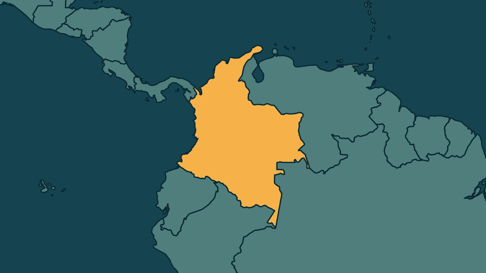

# Carro-bomba fere 23 na Colômbia na véspera dos 10 anos da paz

*Heimdall News, edição internacional. 24 de novembro de 2026*

## A notícia

Um carro-bomba explodiu na noite de segunda-feira em frente à sede do governo do departamento de Meta, em Villavicencio, no centro da Colômbia. Deixou pelo menos 23 feridos, segundo a polícia, e não houve mortes. [1][2][3]

Nenhum grupo assumiu o ataque. As autoridades investigam dissidências das Forças Armadas Revolucionárias da Colômbia, a guerrilha que entregou as armas no acordo de paz de 2016, que faz 10 anos nesta terça-feira. [4][5][6][7]

O presidente Abelardo de la Espriella, no poder desde agosto, conduz com apoio dos Estados Unidos uma ofensiva militar contra grupos armados financiados pelo tráfico de cocaína. O país vive a pior onda de violência em uma década. [8][9][10]

## Quem se manifestou

- **Abelardo de la Espriella, colombiano, presidente:** atribuiu o ataque a narcoterroristas e disse que ele não ficará impune. Antes da explosão, chamou o acordo de paz de falsa paz. [11][12][13]
- **Rafaela Cortés, colombiana, governadora do departamento de Meta:** afirmou que os autores serão perseguidos, capturados e julgados. [14]
- **Alexander Baquero, colombiano, prefeito de Villavicencio:** informou que mais de 85 imóveis foram danificados e pediu apoio ao governo nacional. [15][16]
- **Iris Marín, colombiana, defensora do Povo:** chamou o ataque de inadmissível e doloroso. [17]

## Reação no Brasil

Nenhum posicionamento encontrado.

## Fontes

1. CNN Brasil, [Vídeo: Carro-bomba explode na Colômbia e deixa ao menos 23 feridos](https://www.cnnbrasil.com.br/internacional/video-carro-bomba-explode-na-colombia/): "Um carro-bomba explodiu na noite de segunda-feira (23) em frente à sede do governo do departamento de Meta, na cidade colombiana de Villavicencio."
2. CNN Brasil, [Vídeo: Carro-bomba explode na Colômbia e deixa ao menos 23 feridos](https://www.cnnbrasil.com.br/internacional/video-carro-bomba-explode-na-colombia/): "A detonação deixou pelo menos 23 pessoas feridas, segundo a polícia"
3. Gazeta do Povo, [Explosão de carro-bomba deixa mais de 20 feridos na Colômbia](https://www.gazetadopovo.com.br/mundo/explosao-de-carro-bomba-deixa-mais-de-20-feridos-na-colombia/): "Não houve registro de mortes."
4. Folha de S.Paulo, [Atentado com carro-bomba fere 25 e aumenta tensão na Colômbia após ofensiva militar com apoio dos EUA](https://www1.folha.uol.com.br/mundo/2026/11/atentado-com-carro-bomba-fere-25-e-aumenta-tensao-na-colombia-apos-ofensiva-militar-com-apoio-dos-eua.shtml): "Nenhuma organização havia reivindicado a autoria do atentado até a manhã desta terça-feira (24)"
5. Gazeta do Povo, [Explosão de carro-bomba deixa mais de 20 feridos na Colômbia](https://www.gazetadopovo.com.br/mundo/explosao-de-carro-bomba-deixa-mais-de-20-feridos-na-colombia/): "As autoridades investigam a participação de dissidências das Forças Armadas Revolucionárias da Colômbia (Farc) no atentado."
6. Folha de S.Paulo, [Atentado com carro-bomba fere 25 e aumenta tensão na Colômbia após ofensiva militar com apoio dos EUA](https://www1.folha.uol.com.br/mundo/2026/11/atentado-com-carro-bomba-fere-25-e-aumenta-tensao-na-colombia-apos-ofensiva-militar-com-apoio-dos-eua.shtml): "guerrilha que entregou as armas após o acordo de paz firmado com o governo em 2016"
7. CNN Brasil, [Colômbia completa dez anos do acordo de paz com as Farc](https://www.cnnbrasil.com.br/internacional/colombia-completa-dez-anos-do-acordo-de-paz-com-as-farc/): "A Colômbia marcará nesta terça-feira (24) o décimo aniversário do processo de paz"
8. G1, [Carro-bomba deixa 20 feridos na Colômbia às vésperas dos dez anos do acordo de paz](https://g1.globo.com/mundo/noticia/2026/11/24/carro-bomba-deixa-20-feridos-na-colombia-as-vesperas-dos-dez-anos-do-acordo-de-paz.ghtml): "o presidente Abelardo de la Espriella, no poder desde 7 de agosto, conduz uma ofensiva militar, com apoio dos Estados Unidos"
9. G1, [Carro-bomba deixa 20 feridos na Colômbia às vésperas dos dez anos do acordo de paz](https://g1.globo.com/mundo/noticia/2026/11/24/carro-bomba-deixa-20-feridos-na-colombia-as-vesperas-dos-dez-anos-do-acordo-de-paz.ghtml): "contra grupos armados que financiam suas atividades com receitas do tráfico de cocaína"
10. G1, [Carro-bomba deixa 20 feridos na Colômbia às vésperas dos dez anos do acordo de paz](https://g1.globo.com/mundo/noticia/2026/11/24/carro-bomba-deixa-20-feridos-na-colombia-as-vesperas-dos-dez-anos-do-acordo-de-paz.ghtml): "O país enfrenta a pior onda de violência em uma década."
11. Gazeta do Povo, [Explosão de carro-bomba deixa mais de 20 feridos na Colômbia](https://www.gazetadopovo.com.br/mundo/explosao-de-carro-bomba-deixa-mais-de-20-feridos-na-colombia/): "classificou o ataque como uma ação de “narcoterroristas”"
12. Gazeta do Povo, [Explosão de carro-bomba deixa mais de 20 feridos na Colômbia](https://www.gazetadopovo.com.br/mundo/explosao-de-carro-bomba-deixa-mais-de-20-feridos-na-colombia/): "Este atentado não ficará impune."
13. Folha de S.Paulo, [Atentado com carro-bomba fere 25 e aumenta tensão na Colômbia após ofensiva militar com apoio dos EUA](https://www1.folha.uol.com.br/mundo/2026/11/atentado-com-carro-bomba-fere-25-e-aumenta-tensao-na-colombia-apos-ofensiva-militar-com-apoio-dos-eua.shtml): "Minutos antes da explosão, De la Espriella havia criticado o acordo, descrito por ele como uma "falsa paz"."
14. Gazeta do Povo, [Explosão de carro-bomba deixa mais de 20 feridos na Colômbia](https://www.gazetadopovo.com.br/mundo/explosao-de-carro-bomba-deixa-mais-de-20-feridos-na-colombia/): "vamos persegui-los, capturá-los e fazer com que respondam perante a Justiça."
15. Metrópoles, [Atentado a carro-bomba destrói prédios e deixa 23 feridos na Colômbia](https://www.metropoles.com/mundo/atentado-a-carro-bomba-destroi-predios-e-deixa-23-feridos-na-colombia): "solicitou apoio ao governo federal colombiano e das forças de segurança"
16. Gazeta do Povo, [Explosão de carro-bomba deixa mais de 20 feridos na Colômbia](https://www.gazetadopovo.com.br/mundo/explosao-de-carro-bomba-deixa-mais-de-20-feridos-na-colombia/): "informou que mais de 85 imóveis e terrenos sofreram danos"
17. Folha de S.Paulo, [Atentado com carro-bomba fere 25 e aumenta tensão na Colômbia após ofensiva militar com apoio dos EUA](https://www1.folha.uol.com.br/mundo/2026/11/atentado-com-carro-bomba-fere-25-e-aumenta-tensao-na-colombia-apos-ofensiva-militar-com-apoio-dos-eua.shtml): "Inadmissível e doloroso. Até onde querem nos levar?"
