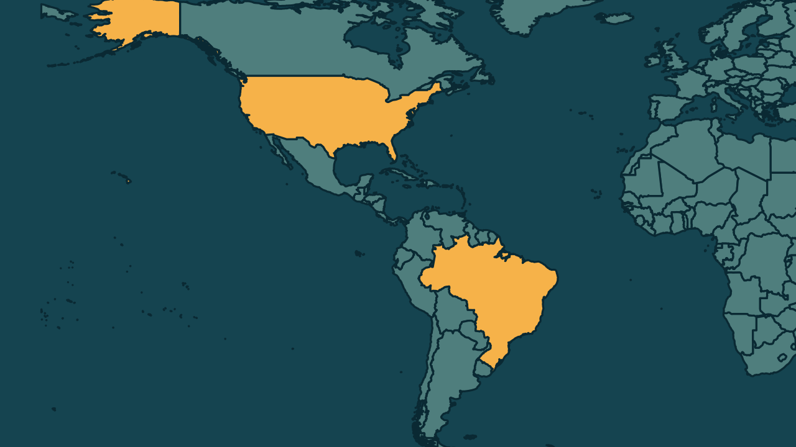

# Estados Unidos barram na OMC pedido do Brasil contra o tarifaço

*Heimdall News, edição internacional. 24 de novembro de 2026*

## A notícia

Os Estados Unidos barraram nesta terça-feira, na Organização Mundial do Comércio, o pedido do Brasil para abrir um painel contra as tarifas impostas por Donald Trump a produtos brasileiros. A decisão foi tomada em Genebra, na Suíça. [1][2][3]

O Brasil questiona sobretaxas de 25% e de 12,5%, que somadas podem chegar a 37,5%. O país acionou a organização em julho, e uma rodada de consultas em setembro terminou sem acordo. [4][5][6][7]

Pelas regras, o país questionado pode bloquear só o primeiro pedido. O Brasil deve apresentá-lo de novo em 17 de dezembro, quando o painel só pode ser barrado por consenso dos membros. A abertura do painel não suspende as tarifas. [8][9][10][11]

## Quem se manifestou

- **Governo dos Estados Unidos, Estados Unidos:** se posicionou contra a criação do painel e defendeu as tarifas. Afirmou que elas respondem a problemas antigos na relação comercial com o Brasil, entre eles o Pix, a propriedade intelectual e o desmatamento, e sinalizou disposição para negociar. [12][13][14][15]

## Reação no Brasil

- **Ministério das Relações Exteriores, Brasil:** afirmou que as tarifas são discriminatórias, ultrapassam os limites negociados na Organização Mundial do Comércio e favorecem produtos de outros países. [16]
- **Luiz Inácio Lula da Silva, brasileiro, presidente:** tem dito que os Estados Unidos têm superávit com o Brasil e que não há prática desleal que justifique as sobretaxas. [17]

## Fontes

1. Gazeta do Povo, [EUA barram Brasil na OMC contra tarifaço de Trump](https://www.gazetadopovo.com.br/mundo/eua-barram-brasil-omc-contra-tarifaco-trump/): "Os Estados Unidos barraram a tentativa do governo do presidente Luiz Inácio Lula da Silva (PT), nesta terça-feira (24)"
2. Gazeta do Povo, [EUA barram Brasil na OMC contra tarifaço de Trump](https://www.gazetadopovo.com.br/mundo/eua-barram-brasil-omc-contra-tarifaco-trump/): "contra as tarifas adicionais impostas pelo presidente Donald Trump a produtos brasileiros"
3. Gazeta do Povo, [EUA barram Brasil na OMC contra tarifaço de Trump](https://www.gazetadopovo.com.br/mundo/eua-barram-brasil-omc-contra-tarifaco-trump/): "A decisão foi tomada na sede do órgão em Genebra, na Suíça"
4. Metrópoles, [EUA barra queixa do Brasil contra tarifaço na OMC](https://www.metropoles.com/mundo/eua-barram-queixa-do-brasil-contra-tarifaco-na-omc): "questionar as tarifas de 25% e 12,5% aplicadas pelos Estados Unidos"
5. Metrópoles, [Para ganhar tempo, EUA pode barrar pedido do Brasil sobre tarifaço na OMC](https://www.metropoles.com/mundo/para-ganhar-tempo-eua-pode-barrar-pedido-do-brasil-sobre-tarifaco-na-omc): "que somadas podem chegar a 37,5%"
6. Metrópoles, [Para ganhar tempo, EUA pode barrar pedido do Brasil sobre tarifaço na OMC](https://www.metropoles.com/mundo/para-ganhar-tempo-eua-pode-barrar-pedido-do-brasil-sobre-tarifaco-na-omc): "O Brasil acionou a OMC oficialmente em julho"
7. G1, [EUA barram pedido do Brasil para discutir tarifas comerciais na OMC, diz agência](https://g1.globo.com/economia/noticia/2026/11/24/eua-bloqueia-pedido-do-brasil-para-um-painel-de-disputas-tarifarias-diz-um-funcionario-comercial.ghtml): "Representantes dos dois governos se reuniram em 25 de setembro, em Genebra, na Suíça, mas não chegaram a um acordo"
8. Gazeta do Povo, [EUA barram Brasil na OMC contra tarifaço de Trump](https://www.gazetadopovo.com.br/mundo/eua-barram-brasil-omc-contra-tarifaco-trump/): "o país questionado pode bloquear a primeira tentativa de abertura de um painel, mas não as seguintes"
9. Gazeta do Povo, [EUA barram Brasil na OMC contra tarifaço de Trump](https://www.gazetadopovo.com.br/mundo/eua-barram-brasil-omc-contra-tarifaco-trump/): "O Brasil pretende apresentar novamente o pedido na próxima reunião, marcada para 17 de dezembro"
10. G1, [EUA barram pedido do Brasil para discutir tarifas comerciais na OMC, diz agência](https://g1.globo.com/economia/noticia/2026/11/24/eua-bloqueia-pedido-do-brasil-para-um-painel-de-disputas-tarifarias-diz-um-funcionario-comercial.ghtml): "ela só pode ser impedida se houver consenso entre os membros da organização"
11. Metrópoles, [EUA barra queixa do Brasil contra tarifaço na OMC](https://www.metropoles.com/mundo/eua-barram-queixa-do-brasil-contra-tarifaco-na-omc): "A abertura de um painel pela OMC não determina a suspensão das tarifas"
12. Gazeta do Povo, [EUA barram Brasil na OMC contra tarifaço de Trump](https://www.gazetadopovo.com.br/mundo/eua-barram-brasil-omc-contra-tarifaco-trump/): "A delegação americana se posicionou contra a criação de um painel de especialistas e defendeu as medidas comerciais adotadas por Washington"
13. Gazeta do Povo, [EUA barram Brasil na OMC contra tarifaço de Trump](https://www.gazetadopovo.com.br/mundo/eua-barram-brasil-omc-contra-tarifaco-trump/): "Os Estados Unidos afirmaram que as tarifas respondem a problemas antigos nas relações comerciais com o Brasil, mas também sinalizaram disposição para negociar"
14. Gazeta do Povo, [EUA barram Brasil na OMC contra tarifaço de Trump](https://www.gazetadopovo.com.br/mundo/eua-barram-brasil-omc-contra-tarifaco-trump/): "Entre os pontos questionados pelo governo Trump estão o funcionamento do Pix"
15. Gazeta do Povo, [EUA barram Brasil na OMC contra tarifaço de Trump](https://www.gazetadopovo.com.br/mundo/eua-barram-brasil-omc-contra-tarifaco-trump/): "proteção à propriedade intelectual e medidas relacionadas ao desmatamento"
16. Gazeta do Povo, [EUA barram Brasil na OMC contra tarifaço de Trump](https://www.gazetadopovo.com.br/mundo/eua-barram-brasil-omc-contra-tarifaco-trump/): "as tarifas são discriminatórias, ultrapassam os limites negociados na OMC e favorecem produtos de outros países em relação aos brasileiros"
17. Gazeta do Povo, [EUA barram Brasil na OMC contra tarifaço de Trump](https://www.gazetadopovo.com.br/mundo/eua-barram-brasil-omc-contra-tarifaco-trump/): "Lula afirma que os Estados Unidos têm superávit com o Brasil e que não há “prática desleal” ou déficit comercial que justifique as sobretaxas americanas"
