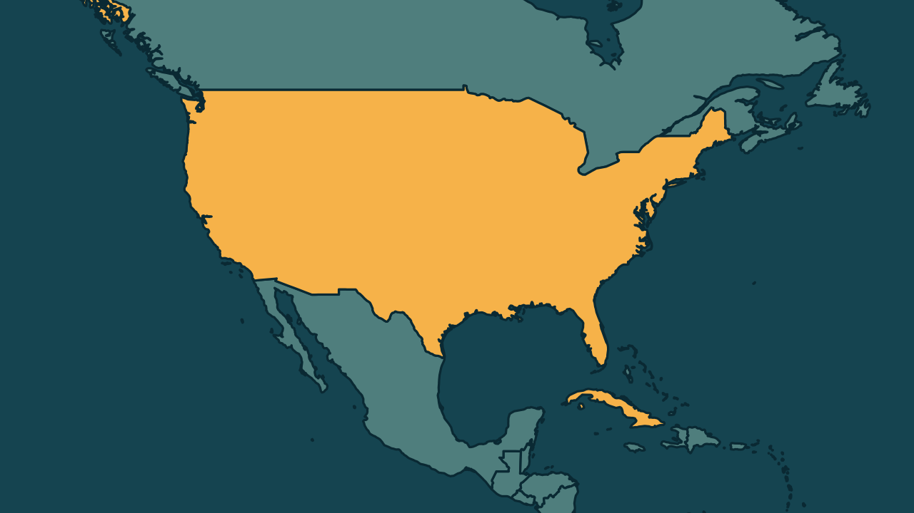

# Expectativa de vida em Cuba cai pela primeira vez desde 1950, diz OMS

*Heimdall News, edição internacional. 24 de novembro de 2026*

## A notícia

A expectativa de vida em Cuba caiu pela primeira vez desde o início dos registros, em 1950. Passou de 78,8 anos em 2020 para 74,4 anos em 2025. O dado foi informado nesta terça-feira, em Havana, pelo diretor-geral da Organização Mundial da Saúde, ao fim de uma visita à ilha. [1][2][3]

Segundo ele, a mortalidade infantil passou de 4 para 9,9 mortes por mil nascidos vivos. A organização anunciou 2 milhões de dólares para vacinação infantil e materiais médicos. [4][5]

A crise econômica da ilha se aprofundou com o bloqueio de combustível imposto pelos Estados Unidos desde janeiro, além de sanções contra autoridades e estatais cubanas. [6][7]

## Quem se manifestou

- **Tedros Adhanom Ghebreyesus, etíope, diretor-geral:** pediu o fim imediato do bloqueio de combustível e disse que as sanções causam danos diretos ao povo cubano, inclusive a crianças. Também disse ser bom o governo reconhecer problemas internos. [8][9][10][11]
- **Governo dos Estados Unidos, Estados Unidos:** argumenta que o bloqueio visa pressionar por mudança política, e que alimentos e medicamentos têm isenções. [12][13]
- **Governo de Cuba, Cuba:** afirma que as sanções causaram cortes de energia de 20 horas ou mais e falta de medicamentos. [14][15]

## Reação no Brasil

Nenhum posicionamento encontrado.

## Fontes

1. Estadão, [Expectativa de vida em Cuba cai pela 1ª vez em quase 80 anos, alerta OMS](https://www.estadao.com.br/internacional/expectativa-de-vida-em-cuba-cai-pela-1-vez-em-quase-80-anos-alerta-oms-npr/): "a expectativa de vida em Cuba diminuiu pela primeira vez desde o início dos registros, em 1950, passando de 78,8 anos em 2020 para 74,4 anos em 2025"
2. Estadão, [Expectativa de vida em Cuba cai pela 1ª vez em quase 80 anos, alerta OMS](https://www.estadao.com.br/internacional/expectativa-de-vida-em-cuba-cai-pela-1-vez-em-quase-80-anos-alerta-oms-npr/): "informou nesta terça-feira, 24, em Havana, o diretor-geral da Organização Mundial da Saúde (OMS)"
3. CartaCapital, [Expectativa de vida em Cuba cai pela primeira vez em quase 80 anos](https://www.cartacapital.com.br/mundo/expectativa-de-vida-em-cuba-cai-pela-primeira-vez-em-quase-80-anos/): "ao fim de uma visita de três dias à ilha"
4. CartaCapital, [Expectativa de vida em Cuba cai pela primeira vez em quase 80 anos](https://www.cartacapital.com.br/mundo/expectativa-de-vida-em-cuba-cai-pela-primeira-vez-em-quase-80-anos/): "passando de quatro mortes por mil nascidos vivos em 2020 para 9,9 em 2025"
5. Estadão, [Expectativa de vida em Cuba cai pela 1ª vez em quase 80 anos, alerta OMS](https://www.estadao.com.br/internacional/expectativa-de-vida-em-cuba-cai-pela-1-vez-em-quase-80-anos-alerta-oms-npr/): "anunciou uma ajuda de 2 milhões de dólares (cerca de R$ 11,7 milhões) para apoiar campanhas de vacinação infantil e a compra de materiais médicos essenciais"
6. Estadão, [Expectativa de vida em Cuba cai pela 1ª vez em quase 80 anos, alerta OMS](https://www.estadao.com.br/internacional/expectativa-de-vida-em-cuba-cai-pela-1-vez-em-quase-80-anos-alerta-oms-npr/): "enfrenta há algum tempo uma grave crise econômica, que se aprofundou com o bloqueio energético imposto pelos Estados Unidos no início deste ano"
7. CNN Brasil, [OMS pede para EUA suspenderem bloqueio ao petróleo contra Cuba](https://www.cnnbrasil.com.br/internacional/oms-pede-para-eua-suspenderem-bloqueio-ao-petroleo-contra-cuba/): "aumentou a pressão sobre Cuba a partir de janeiro, impondo um bloqueio de combustível à ilha e sanções severas contra diversas autoridades cubanas e entidades estatais"
8. CNN Brasil, [OMS pede para EUA suspenderem bloqueio ao petróleo contra Cuba](https://www.cnnbrasil.com.br/internacional/oms-pede-para-eua-suspenderem-bloqueio-ao-petroleo-contra-cuba/): "pediu, na terça-feira, o fim imediato do bloqueio de combustível imposto pelos Estados Unidos a Cuba"
9. CNN Brasil, [OMS pede para EUA suspenderem bloqueio ao petróleo contra Cuba](https://www.cnnbrasil.com.br/internacional/oms-pede-para-eua-suspenderem-bloqueio-ao-petroleo-contra-cuba/): "A intensificação das restrições ao combustível e das sanções está causando danos diretos ao povo cubano"
10. CNN Brasil, [OMS pede para EUA suspenderem bloqueio ao petróleo contra Cuba](https://www.cnnbrasil.com.br/internacional/oms-pede-para-eua-suspenderem-bloqueio-ao-petroleo-contra-cuba/): "Isso está colocando suas vidas em perigo, inclusive a vida de crianças."
11. Estadão, [Expectativa de vida em Cuba cai pela 1ª vez em quase 80 anos, alerta OMS](https://www.estadao.com.br/internacional/expectativa-de-vida-em-cuba-cai-pela-1-vez-em-quase-80-anos-alerta-oms-npr/): "é bom que o governo reconheça que também há problemas internos"
12. CNN Brasil, [OMS pede para EUA suspenderem bloqueio ao petróleo contra Cuba](https://www.cnnbrasil.com.br/internacional/oms-pede-para-eua-suspenderem-bloqueio-ao-petroleo-contra-cuba/): "Washington argumenta que o bloqueio energético visa pressionar por uma mudança política na ilha"
13. CNN Brasil, [OMS pede para EUA suspenderem bloqueio ao petróleo contra Cuba](https://www.cnnbrasil.com.br/internacional/oms-pede-para-eua-suspenderem-bloqueio-ao-petroleo-contra-cuba/): "ressaltando que as exportações de alimentos e medicamentos estão sujeitas a isenções legais"
14. CNN Brasil, [OMS pede para EUA suspenderem bloqueio ao petróleo contra Cuba](https://www.cnnbrasil.com.br/internacional/oms-pede-para-eua-suspenderem-bloqueio-ao-petroleo-contra-cuba/): "O governo cubano afirma que as sanções dos EUA resultaram em cortes diários de energia com duração de 20 horas ou mais"
15. CNN Brasil, [OMS pede para EUA suspenderem bloqueio ao petróleo contra Cuba](https://www.cnnbrasil.com.br/internacional/oms-pede-para-eua-suspenderem-bloqueio-ao-petroleo-contra-cuba/): "escassez crítica de medicamentos e insumos cirúrgicos"
