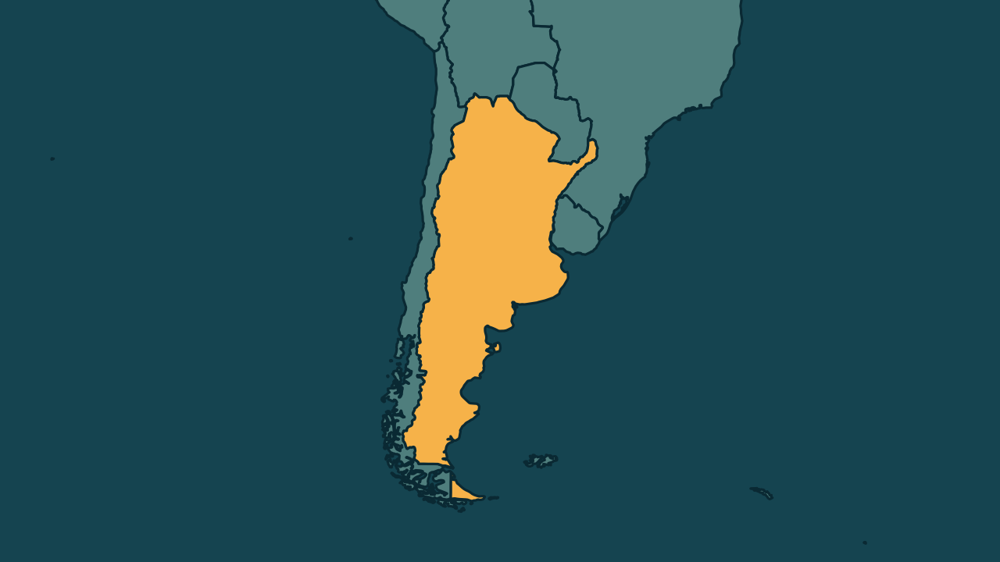

# Atividade da Argentina cai e indica recessão técnica sob Milei

*Heimdall News, edição internacional. 25 de novembro de 2026*

## A notícia

O instituto de estatística da Argentina divulgou na terça-feira que a atividade econômica do país caiu 1,2% em setembro, na comparação com o mesmo mês do ano passado. Analistas esperavam queda de 0,8%. [1][2]

Depois de cair 0,6% no segundo trimestre, a economia encolheu 1,8% no terceiro, segundo estimativas de economistas. Dois trimestres seguidos de queda caracterizam a recessão técnica, que só será confirmada com os dados do Produto Interno Bruto, em 16 de dezembro. [3][4][5][6]

Em setembro, a extração de minerais e petróleo cresceu 11,1%, enquanto a indústria caiu 1,8%. Ao todo, 10 dos 15 setores medidos tiveram queda. [7][8][9]

## Quem se manifestou

- **Adrián Ravier, argentino, porta-voz presidencial:** disse que é preciso esperar dezembro para confirmar a recessão técnica, mas que, pela definição de dois trimestres negativos, são dois trimestres de queda. Afirmou que o indicador subestima a economia informal. [10][11][12]
- **Sebastián Menescaldi, argentino, diretor da consultoria Eco Go:** afirmou que a economia não cresce de forma significativa desde o início de 2025 e que, sem o efeito da safra, há estagnação. Disse que as empresas contiveram salários e cortaram pessoal. [13][14][15]

## Reação no Brasil

Nenhum posicionamento encontrado.

## Fontes

1. CNN Brasil, [Atividade econômica da Argentina cai 1,2% em setembro, diz governo](https://www.cnnbrasil.com.br/economia/money/macroeconomia/atividade-economica-da-argentina-cai-12-em-setembro-diz-governo/): "recuou 1,2% em setembro em relação ao mesmo período do ano passado, informou nesta terça-feira (24) o Indec"
2. G1, com Reuters, [Economia da Argentina encolhe e entra em recessão técnica, apontam dados preliminares](https://g1.globo.com/economia/noticia/2026/11/24/economia-da-argentina-encolhe-e-entra-em-recessao-tecnica-apontam-dados-preliminares.ghtml): "Uma pesquisa da Reuters apontava para uma retração de 0,8% na atividade econômica"
3. Metrópoles, [Após dois trimestres de queda, economia argentina entra em recessão técnica](https://www.metropoles.com/mundo/trimestres-queda-economia-argentina-recessao-tecnica): "economistas estimam que a atividade recuou 1,8% entre julho e setembro"
4. Metrópoles, [Após dois trimestres de queda, economia argentina entra em recessão técnica](https://www.metropoles.com/mundo/trimestres-queda-economia-argentina-recessao-tecnica): "Após uma queda de 0,6% no segundo trimestre"
5. G1, com Reuters, [Economia da Argentina encolhe e entra em recessão técnica, apontam dados preliminares](https://g1.globo.com/economia/noticia/2026/11/24/economia-da-argentina-encolhe-e-entra-em-recessao-tecnica-apontam-dados-preliminares.ghtml): "caracterizada por dois trimestres consecutivos de contração da economia"
6. CartaCapital, [Argentina de Milei entra em recessão técnica após dois trimestres de retração](https://www.cartacapital.com.br/mundo/argentina-de-milei-entra-em-recessao-tecnica-apos-dois-trimestres-de-retracao/): "é preciso aguardar os dados oficiais do PIB, que serão divulgados em 16 de dezembro"
7. Metrópoles, [Após dois trimestres de queda, economia argentina entra em recessão técnica](https://www.metropoles.com/mundo/trimestres-queda-economia-argentina-recessao-tecnica): "a extração de minerais e petróleo cresceu 11,1% na comparação anual"
8. Metrópoles, [Após dois trimestres de queda, economia argentina entra em recessão técnica](https://www.metropoles.com/mundo/trimestres-queda-economia-argentina-recessao-tecnica): "a indústria manufatureira teve retração de 1,8%"
9. Metrópoles, [Após dois trimestres de queda, economia argentina entra em recessão técnica](https://www.metropoles.com/mundo/trimestres-queda-economia-argentina-recessao-tecnica): "dez dos 15 setores acompanhados pelo instituto registraram resultados negativos"
10. Poder360, [Argentina entra em recessão técnica com queda no PIB em setembro](https://www.poder360.com.br/poder-economia/argentina-entra-em-recessao-tecnica-com-queda-no-pib-em-setembro/): "Teremos que esperar até dezembro para saber se isso se confirma ou não"
11. CNN Brasil, [Atividade econômica da Argentina cai 1,2% em setembro, diz governo](https://www.cnnbrasil.com.br/economia/money/macroeconomia/atividade-economica-da-argentina-cai-12-em-setembro-diz-governo/): "essa de dois trimestres negativos não é a única; mas, se considerarmos essa definição, são dois trimestres de queda do PIB"
12. Poder360, [Argentina entra em recessão técnica com queda no PIB em setembro](https://www.poder360.com.br/poder-economia/argentina-entra-em-recessao-tecnica-com-queda-no-pib-em-setembro/): "o indicador divulgado “subestima a economia informal”"
13. Folha de S.Paulo, [Atividade econômica da Argentina cai pelo segundo trimestre consecutivo](https://www1.folha.uol.com.br/mercado/2026/11/argentina-entra-em-recessao-tecnica-apos-resultados-do-terceiro-trimestre.shtml): "A verdade é que a economia argentina não cresce de forma significativa desde o início de 2025"
14. Folha de S.Paulo, [Atividade econômica da Argentina cai pelo segundo trimestre consecutivo](https://www1.folha.uol.com.br/mercado/2026/11/argentina-entra-em-recessao-tecnica-apos-resultados-do-terceiro-trimestre.shtml): "Se retirarmos o efeito da safra do ano passado, o que se vê é estagnação."
15. Folha de S.Paulo, [Atividade econômica da Argentina cai pelo segundo trimestre consecutivo](https://www1.folha.uol.com.br/mercado/2026/11/argentina-entra-em-recessao-tecnica-apos-resultados-do-terceiro-trimestre.shtml): "as empresas contiveram os aumentos salariais e cortaram pessoal, disse Menescaldi"
