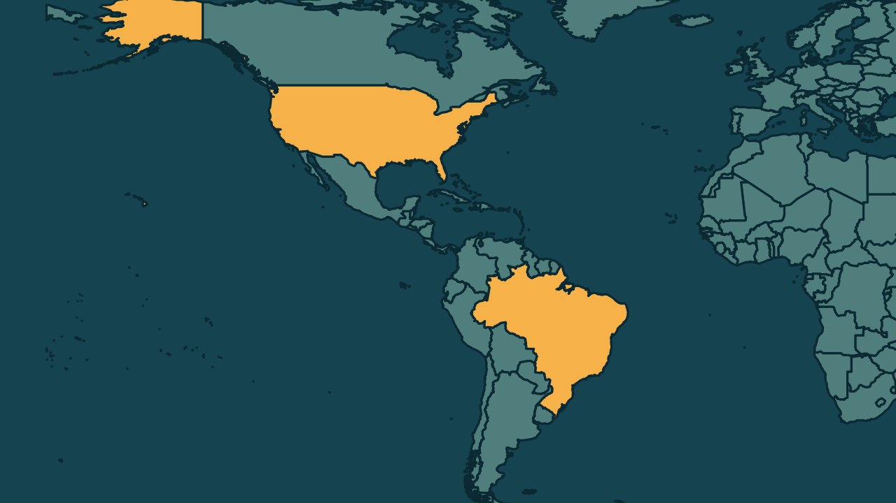

# Estados Unidos propõem tarifar aviões e açúcar do Brasil

*Heimdall News, edição internacional. 25 de novembro de 2026*

## A notícia

O governo dos Estados Unidos propôs nesta quarta-feira uma tarifa de 10% sobre aviões prontos fabricados no Brasil e uma nova taxa sobre o açúcar que entra no país acima das cotas. [1][2]

Até outubro, o Brasil vendeu 2,23 bilhões de dólares em itens de aviação que podem ser taxados. A medida pode atingir a Embraer. [3][4][5]

A proposta ainda não está em vigor: a consulta pública vai até 30 de dezembro, e a audiência é em 14 de janeiro. O anúncio veio um dia depois de os Estados Unidos barrarem, na Organização Mundial do Comércio, o pedido do Brasil contra o tarifaço. [6][7][8][9]

## Quem se manifestou

- **Jamieson Greer, americano, representante comercial:** afirmou que, após mais de um ano de negociações, o Brasil não fez progresso significativo e que as tarifas buscam levar o país à mesa de negociações. Disse que os Estados Unidos seguem abertos a negociar. [10][11][12]
- **Brooke Rollins, americana, secretária de Agricultura:** afirmou que as tarifas buscam proteger os agricultores americanos contra o excesso de importações e que são uma resposta às práticas comerciais do Brasil, que ela chamou de desleais. [13][14]

## Reação no Brasil

- **Governo do Brasil, Brasil:** expressou indignação, disse que a proposta busca pressionar por mudanças ligadas ao Pix e que o Brasil não cederá, sem descartar medidas de reciprocidade. [15][16][17][18]
- **Embraer, Brasil:** defendeu a tarifa zero para a indústria aeroespacial mundial, em vigor desde a década de 1980. [19]
- **Câmara Americana de Comércio no Brasil, Brasil:** defendeu mais negociação entre os dois governos. [20]

## Fontes

1. Folha de S.Paulo, [EUA propõem elevar tarifas sobre importações do Brasil, incluindo taxa de 10% sobre aviões](https://www1.folha.uol.com.br/mercado/2026/11/eua-realizara-audiencia-em-janeiro-sobre-proposta-de-alteracao-das-tarifas-aplicadas-ao-brasil.shtml): "propuseram nesta quarta-feira (25) a aplicação de novas tarifas sobre produtos importados do Brasil, incluindo açúcar, e uma alíquota de 10% sobre aeronaves prontas"
2. Folha de S.Paulo, [EUA propõem elevar tarifas sobre importações do Brasil, incluindo taxa de 10% sobre aviões](https://www1.folha.uol.com.br/mercado/2026/11/eua-realizara-audiencia-em-janeiro-sobre-proposta-de-alteracao-das-tarifas-aplicadas-ao-brasil.shtml): "uma sobretaxa sobre o açúcar bruto e refinado que entra nos EUA fora das cotas"
3. Folha de S.Paulo, [EUA propõem elevar tarifas sobre importações do Brasil, incluindo taxa de 10% sobre aviões](https://www1.folha.uol.com.br/mercado/2026/11/eua-realizara-audiencia-em-janeiro-sobre-proposta-de-alteracao-das-tarifas-aplicadas-ao-brasil.shtml): "Até outubro deste ano, o Brasil vendeu US$ 2,23 bilhões"
4. Folha de S.Paulo, [EUA propõem elevar tarifas sobre importações do Brasil, incluindo taxa de 10% sobre aviões](https://www1.folha.uol.com.br/mercado/2026/11/eua-realizara-audiencia-em-janeiro-sobre-proposta-de-alteracao-das-tarifas-aplicadas-ao-brasil.shtml): "de itens ligados à aviação que eram isentos e poderão ser taxados em 10%"
5. Folha de S.Paulo, [EUA propõem elevar tarifas sobre importações do Brasil, incluindo taxa de 10% sobre aviões](https://www1.folha.uol.com.br/mercado/2026/11/eua-realizara-audiencia-em-janeiro-sobre-proposta-de-alteracao-das-tarifas-aplicadas-ao-brasil.shtml): "A medida pode afetar especialmente a fabricante de aviões Embraer"
6. Folha de S.Paulo, [EUA propõem elevar tarifas sobre importações do Brasil, incluindo taxa de 10% sobre aviões](https://www1.folha.uol.com.br/mercado/2026/11/eua-realizara-audiencia-em-janeiro-sobre-proposta-de-alteracao-das-tarifas-aplicadas-ao-brasil.shtml): "A medida ainda não está em vigor"
7. Folha de S.Paulo, [EUA propõem elevar tarifas sobre importações do Brasil, incluindo taxa de 10% sobre aviões](https://www1.folha.uol.com.br/mercado/2026/11/eua-realizara-audiencia-em-janeiro-sobre-proposta-de-alteracao-das-tarifas-aplicadas-ao-brasil.shtml): "O período de comentários públicos começa na sexta-feira (27) e vai até 30 de dezembro"
8. Folha de S.Paulo, [EUA propõem elevar tarifas sobre importações do Brasil, incluindo taxa de 10% sobre aviões](https://www1.folha.uol.com.br/mercado/2026/11/eua-realizara-audiencia-em-janeiro-sobre-proposta-de-alteracao-das-tarifas-aplicadas-ao-brasil.shtml): "em 14 de janeiro de 2027"
9. Metrópoles, [Governo Trump ameaça ampliar tarifas sobre açúcar e aviões do Brasil](https://www.metropoles.com/mundo/governo-trump-ameaca-ampliar-tarifas-sobre-acucar-e-avioes-do-brasil): "O anúncio ocorre um dia depois de os Estados Unidos bloquearem uma tentativa do Brasil de abrir um painel contra o tarifaço"
10. Brasil de Fato, [Governo Trump propõe ampliar tarifas contra o Brasil em nova chantagem comercial; aviões e açúcar estão na mira](https://www.brasildefato.com.br/2026/11/25/governo-trump-propoe-ampliar-tarifas-contra-o-brasil-em-nova-chantagem-comercial-avioes-e-acucar-estao-na-mira/): "Após mais de um ano de negociações, o Brasil não fez nenhum progresso significativo"
11. Brasil de Fato, [Governo Trump propõe ampliar tarifas contra o Brasil em nova chantagem comercial; aviões e açúcar estão na mira](https://www.brasildefato.com.br/2026/11/25/governo-trump-propoe-ampliar-tarifas-contra-o-brasil-em-nova-chantagem-comercial-avioes-e-acucar-estao-na-mira/): "tem como objetivo levar o Brasil à mesa de negociações"
12. Metrópoles, [Governo Trump ameaça ampliar tarifas sobre açúcar e aviões do Brasil](https://www.metropoles.com/mundo/governo-trump-ameaca-ampliar-tarifas-sobre-acucar-e-avioes-do-brasil): "o representante disse que os Estados Unidos continuam abertos a negociar com o Brasil"
13. G1, [Secretária de Agricultura de Trump defende novas tarifas e acusa Brasil de 'práticas desleais' contra agricultores dos EUA](https://g1.globo.com/economia/agronegocios/noticia/2026/11/25/secretaria-de-agricultura-de-trump-defende-novas-tarifas-e-acusa-brasil-de-praticas-desleais-contra-agricultores-dos-eua.ghtml): "proteger os agricultores americanos contra o excesso de importações"
14. G1, [Tarifaço: açúcar brasileiro pode ter nova taxa para entrar nos EUA; veja o que pode mudar](https://g1.globo.com/economia/agronegocios/noticia/2026/11/25/eua-querem-mudar-taxacao-sobre-acucar-brasileiro-veja-como-pode-ficar.ghtml): "resposta às práticas comerciais desleais do Brasil"
15. G1, [Governo Lula diz estar indignado com nova proposta de tarifa dos EUA contra o Brasil e que não 'cederá a esse tipo de ameaça'](https://g1.globo.com/economia/noticia/2026/11/25/governo-lula-diz-estar-indignado-com-nova-proposta-de-tarifa-dos-eua-contra-o-brasil-e-que-nao-cedera-a-esse-tipo-de-ameaca.ghtml): "O governo brasileiro expressa indignação com a decisão do Escritório do Representante de Comércio dos Estados Unidos"
16. CNN Brasil, [Planalto diz que tarifa dos EUA mira pressão sobre o Pix e cobra negociação](https://www.cnnbrasil.com.br/economia/money/macroeconomia/planalto-diz-que-tarifa-dos-eua-mira-pressao-sobre-o-pix-e-cobra-negociacao/): "A decisão unilateral do USTR constitui uma ação inaceitável dentro do processo negociador bilateral em curso. O Brasil não cederá a esse tipo de ameaça"
17. CNN Brasil, [Planalto diz que tarifa dos EUA mira pressão sobre o Pix e cobra negociação](https://www.cnnbrasil.com.br/economia/money/macroeconomia/planalto-diz-que-tarifa-dos-eua-mira-pressao-sobre-o-pix-e-cobra-negociacao/): "pressionar o governo para que haja alterações em medidas regulatórias nacionais relacionadas ao sistema de pagamentos Pix"
18. CNN Brasil, [Planalto diz que tarifa dos EUA mira pressão sobre o Pix e cobra negociação](https://www.cnnbrasil.com.br/economia/money/macroeconomia/planalto-diz-que-tarifa-dos-eua-mira-pressao-sobre-o-pix-e-cobra-negociacao/): "não descarta adoção de medidas de reciprocidade frente às taxas"
19. Estadão, [EUA pegam o Brasil de surpresa com nova rodada de tarifas em vez de proposta para acordo](https://www.estadao.com.br/economia/eua-pegam-o-brasil-de-surpresa-com-nova-rodada-de-tarifas-em-vez-de-proposta-para-acordo/): "a manutenção do regime de tarifa zero para a indústria aeroespacial global, em vigor desde a década de 1980"
20. CNN Brasil, [Amcham defende intensificação de negociações entre Brasil e EUA](https://www.cnnbrasil.com.br/economia/money/macroeconomia/amcham-defende-intensificacao-de-negociacoes-entre-brasil-e-eua/): "defendeu a intensificação das negociações comerciais entre os dois países"
