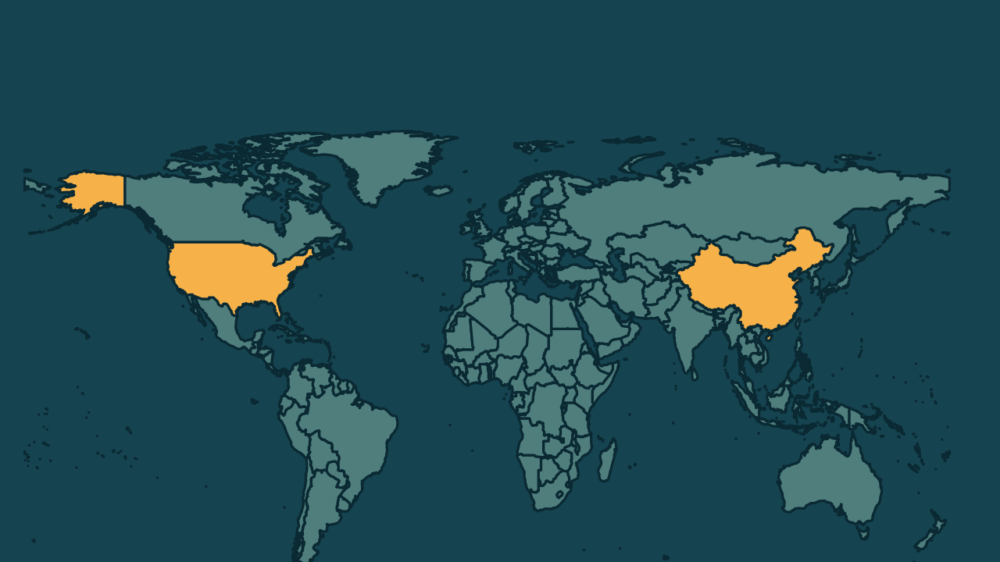

# China diz que pode reagir às novas tarifas dos Estados Unidos

*Heimdall News, edição internacional. 26 de novembro de 2026*

## A notícia

A China afirmou nesta quinta-feira que se reserva o direito de tomar as medidas necessárias contra as novas tarifas propostas pelos Estados Unidos. [1][2]

Na quarta-feira, o governo Trump propôs taxar 14 economias, acusadas de usar subsídios para produzir além da demanda. Para a China, a alíquota proposta é de 20% e pode subir para 40%. [3][4][5][6]

As tarifas ainda são uma proposta, aberta a comentários até 5 de janeiro. A trégua comercial entre os dois países vence em 10 de janeiro. [7][8][9]

## Quem se manifestou

- **He Yadong, chinês, porta-voz do Ministério do Comércio:** chamou o argumento de pretexto para o protecionismo e pediu a volta ao diálogo. [10][11]
- **Jamieson Greer, americano, representante comercial:** afirmou que a China entende que haverá algum nível de tarifas. [12]
- **Comissão Europeia:** rejeitou a acusação e disse que a Europa está entre as regiões mais expostas ao excesso de produção da China. [13][14]
- **Minoru Kihara, japonês, porta-voz do governo:** disse que o Japão não tem excesso estrutural de produção e lamentou a medida. [15][16]

## Reação no Brasil

Nenhum posicionamento encontrado.

## Fontes

1. CNN Brasil, [China ameaça retaliação após EUA proporem novas tarifas sobre produtos](https://www.cnnbrasil.com.br/economia/money/macroeconomia/china-ameaca-retaliar-apos-eua-proporem-novas-tarifas-sobre-produtos/): "A China afirmou nesta quinta-feira (26) que reserva o direito de tomar as medidas necessárias"
2. Estadão, com AFP, [China ameaça retaliar contra novas tarifas dos EUA e alerta para risco à trégua comercial](https://www.estadao.com.br/economia/china-ameaca-retaliar-contra-novas-tarifas-dos-eua-e-alerta-para-risco-a-tregua-comercial-npr/): "poderá adotar “medidas necessárias” em resposta às novas tarifas anunciadas pelos Estados Unidos"
3. G1, [Trump amplia ofensiva comercial e propõe novas tarifas contra Brasil, China e outros parceiros](https://g1.globo.com/economia/noticia/2026/11/25/trump-amplia-ofensiva-comercial.ghtml): "anunciaram uma proposta para taxar produtos de 14 parceiros comerciais"
4. G1, [Trump amplia ofensiva comercial e propõe novas tarifas contra Brasil, China e outros parceiros](https://g1.globo.com/economia/noticia/2026/11/25/trump-amplia-ofensiva-comercial.ghtml): "estimulam a indústria a produzir além da demanda"
5. Folha de S.Paulo, [Governo Trump propõe novas tarifas de até 20% sobre China, UE e mais 12 países](https://www1.folha.uol.com.br/mercado/2026/11/eua-anunciam-novas-tarifas-de-ate-20-sobre-china-ue-e-mais-14-paises.shtml): "A alegação é que os países adotaram subsídios nas indústrias"
6. Estadão, com AFP, [China ameaça retaliar contra novas tarifas dos EUA e alerta para risco à trégua comercial](https://www.estadao.com.br/economia/china-ameaca-retaliar-contra-novas-tarifas-dos-eua-e-alerta-para-risco-a-tregua-comercial-npr/): "Washington propôs alíquotas de 20% sobre produtos chineses, com possibilidade de elevação para 40%"
7. G1, [Trump amplia ofensiva comercial e propõe novas tarifas contra Brasil, China e outros parceiros](https://g1.globo.com/economia/noticia/2026/11/25/trump-amplia-ofensiva-comercial.ghtml): "Por enquanto, as tarifas são apenas uma proposta."
8. G1, [Trump amplia ofensiva comercial e propõe novas tarifas contra Brasil, China e outros parceiros](https://g1.globo.com/economia/noticia/2026/11/25/trump-amplia-ofensiva-comercial.ghtml): "Empresas e outros interessados podem enviar comentários por escrito até 5 de janeiro de 2027"
9. Estadão, com AFP, [China ameaça retaliar contra novas tarifas dos EUA e alerta para risco à trégua comercial](https://www.estadao.com.br/economia/china-ameaca-retaliar-contra-novas-tarifas-dos-eua-e-alerta-para-risco-a-tregua-comercial-npr/): "a frágil trégua comercial entre os países, prevista para expirar em 10 de janeiro"
10. CartaCapital, [Principais aliados comerciais dos Estados Unidos rejeitam novas tarifas](https://www.cartacapital.com.br/mundo/principais-aliados-comerciais-dos-estados-unidos-rejeitam-novas-tarifas/): "um pretexto para o protecionismo"
11. Estadão, com AFP, [China ameaça retaliar contra novas tarifas dos EUA e alerta para risco à trégua comercial](https://www.estadao.com.br/economia/china-ameaca-retaliar-contra-novas-tarifas-dos-eua-e-alerta-para-risco-a-tregua-comercial-npr/): "A China incita os Estados Unidos a corrigirem suas práticas errôneas e a retornarem ao caminho certo para a resolução de problemas por meio do diálogo e da consulta"
12. Estadão, com AFP, [China ameaça retaliar contra novas tarifas dos EUA e alerta para risco à trégua comercial](https://www.estadao.com.br/economia/china-ameaca-retaliar-contra-novas-tarifas-dos-eua-e-alerta-para-risco-a-tregua-comercial-npr/): "A China entende que teremos algum nível de tarifas. Isso está dentro desse entendimento"
13. CartaCapital, [UE rejeita justificativa para as novas tarifas propostas pelos EUA](https://www.cartacapital.com.br/economia/ue-rejeita-justificativa-para-as-novas-tarifas-propostas-pelos-eua/): "Rejeitamos veementemente essa ideia"
14. CartaCapital, [UE rejeita justificativa para as novas tarifas propostas pelos EUA](https://www.cartacapital.com.br/economia/ue-rejeita-justificativa-para-as-novas-tarifas-propostas-pelos-eua/): "a Europa é, na verdade, uma das regiões mais expostas à superprodução, especialmente a chinesa"
15. CartaCapital, [Principais aliados comerciais dos Estados Unidos rejeitam novas tarifas](https://www.cartacapital.com.br/mundo/principais-aliados-comerciais-dos-estados-unidos-rejeitam-novas-tarifas/): "O Japão não mantém práticas de política econômica alheias ao mercado, nem conta com uma capacidade estrutural de produção excessiva"
16. CartaCapital, [Principais aliados comerciais dos Estados Unidos rejeitam novas tarifas](https://www.cartacapital.com.br/mundo/principais-aliados-comerciais-dos-estados-unidos-rejeitam-novas-tarifas/): "É lamentável o anúncio de uma medida proposta direcionada contra o Japão"
