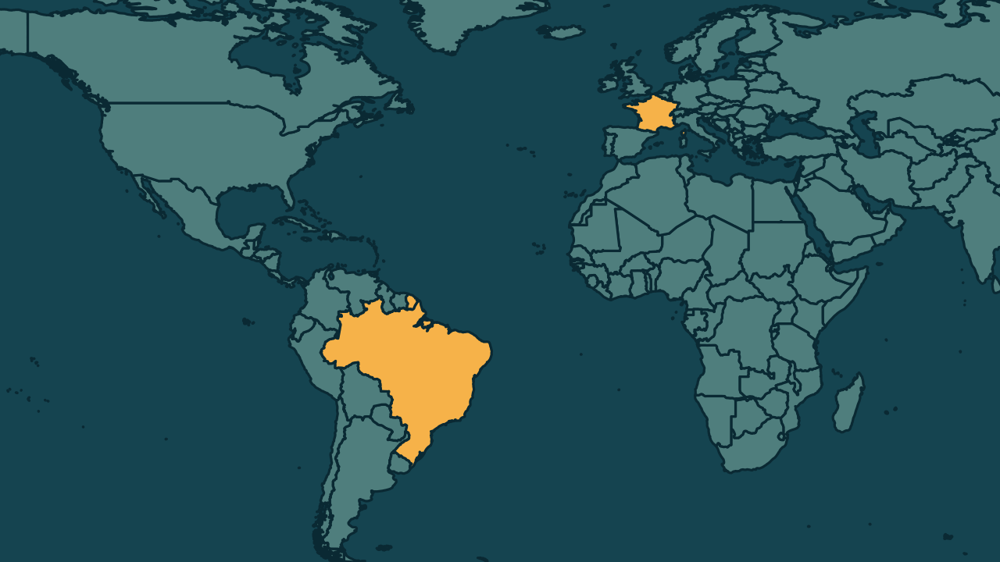

# Macron chama carne brasileira de dopada e exportadores reagem

*Heimdall News, edição internacional. 26 de novembro de 2026*

## A notícia

O presidente da França, Emmanuel Macron, chamou a carne brasileira de dopada e comemorou a suspensão das importações pela União Europeia. A fala foi na quarta-feira, numa reunião com representantes do setor agrícola francês no Palácio do Eliseu. [1][2][3]

As exportações brasileiras de produtos de origem animal ao bloco estão suspensas desde 3 de setembro. A União Europeia avaliou que os controles do Brasil sobre antimicrobianos eram insuficientes. [4][5]

Em setembro, a Comissão Europeia concluiu que o sistema brasileiro atendia às exigências para frango e mel. A volta do Brasil à lista desses produtos deve ser discutida em 7 e 8 de dezembro. [6][7]

## Quem se manifestou

- **Emmanuel Macron, francês, presidente:** chamou a disputa de concorrência desleal e disse que barrar a carne brasileira não é o fim do trabalho. Defendeu não abrir o mercado europeu a quem não cumpre as regras do bloco. [8][9][10]
- **Comissão Europeia:** informou que vários países do bloco pediram mais esclarecimentos sobre o sistema de controle adotado pelo Brasil, o que adiou a decisão sobre frango e mel. [11]

## Reação no Brasil

- **Associação Brasileira de Proteína Animal, Brasil:** disse ser grave e inaceitável que um chefe de Estado recorra a inverdades sem fundamento técnico, e pediu que ele reveja a fala. [12][13]
- **Associação Brasileira das Indústrias Exportadoras de Carnes, Brasil:** afirmou que a fala evidencia o caráter político e protecionista da suspensão, sem justificativa técnica ou científica. [14][15]

## Fontes

1. G1, [Macron diz que carne brasileira é 'dopada' e comemora bloqueio da UE ao produto](https://g1.globo.com/economia/agronegocios/noticia/2026/11/26/macron-diz-que-carne-brasileira-e-dopada-e-comemora-veto-da-ue-ao-produto.ghtml): "E a carne dopada, por assim dizer"
2. G1, [Macron diz que carne brasileira é 'dopada' e comemora bloqueio da UE ao produto](https://g1.globo.com/economia/agronegocios/noticia/2026/11/26/macron-diz-que-carne-brasileira-e-dopada-e-comemora-veto-da-ue-ao-produto.ghtml): "comemorou a suspensão das importações de produtos de origem animal do Brasil pela União Europeia"
3. G1, [Macron diz que carne brasileira é 'dopada' e comemora bloqueio da UE ao produto](https://g1.globo.com/economia/agronegocios/noticia/2026/11/26/macron-diz-que-carne-brasileira-e-dopada-e-comemora-veto-da-ue-ao-produto.ghtml): "durante uma reunião com representantes do setor agrícola francês no Palácio do Eliseu"
4. Estadão, [Macron chama carne brasileira de ‘dopada’ e fala em barrar produto; exportadores reagem](https://www.estadao.com.br/economia/agronegocios/macron-carne-brasileira-dopada-barrar-produto-exportadores-reagem/): "As exportações de carnes e produtos de origem animal do Brasil aos países europeus estão suspensas desde 3 de setembro"
5. G1, [Macron diz que carne brasileira é 'dopada' e comemora bloqueio da UE ao produto](https://g1.globo.com/economia/agronegocios/noticia/2026/11/26/macron-diz-que-carne-brasileira-e-dopada-e-comemora-veto-da-ue-ao-produto.ghtml): "pela avaliação de que os controles adotados pelo Brasil eram insuficientes"
6. G1, ['Carne dopada': exportadores brasileiros rebatem fala de Macron: 'grave e inaceitável um chefe de Estado recorrer a inverdades'](https://g1.globo.com/economia/agronegocios/noticia/2026/11/26/exportadores-de-carne-rebatem-fala-de-macron.ghtml): "Em 28 de setembro, a Comissão divulgou um relatório no qual concluiu que o sistema brasileiro atendia às exigências do bloco"
7. G1, ['Carne dopada': exportadores brasileiros rebatem fala de Macron: 'grave e inaceitável um chefe de Estado recorrer a inverdades'](https://g1.globo.com/economia/agronegocios/noticia/2026/11/26/exportadores-de-carne-rebatem-fala-de-macron.ghtml): "marcada para 7 e 8 de dezembro, que deve discutir a volta do Brasil à lista de países autorizados a exportar carne de frango e mel"
8. Estadão, [Macron chama carne brasileira de ‘dopada’ e fala em barrar produto; exportadores reagem](https://www.estadao.com.br/economia/agronegocios/macron-carne-brasileira-dopada-barrar-produto-exportadores-reagem/): "Trata-se da concorrência desleal."
9. Estadão, [Macron chama carne brasileira de ‘dopada’ e fala em barrar produto; exportadores reagem](https://www.estadao.com.br/economia/agronegocios/macron-carne-brasileira-dopada-barrar-produto-exportadores-reagem/): "Foi assim que conseguimos barrar a carne brasileira, mas esse não é o fim do trabalho"
10. Estadão, [Macron chama carne brasileira de ‘dopada’ e fala em barrar produto; exportadores reagem](https://www.estadao.com.br/economia/agronegocios/macron-carne-brasileira-dopada-barrar-produto-exportadores-reagem/): "abrir nossos mercados para pessoas que não as cumprem"
11. G1, ['Carne dopada': exportadores brasileiros rebatem fala de Macron: 'grave e inaceitável um chefe de Estado recorrer a inverdades'](https://g1.globo.com/economia/agronegocios/noticia/2026/11/26/exportadores-de-carne-rebatem-fala-de-macron.ghtml): "a Comissão Europeia informou que vários países do bloco pediram mais esclarecimentos sobre o sistema de controle adotado pelo Brasil"
12. Estadão, [Macron chama carne brasileira de ‘dopada’ e fala em barrar produto; exportadores reagem](https://www.estadao.com.br/economia/agronegocios/macron-carne-brasileira-dopada-barrar-produto-exportadores-reagem/): "que um chefe de Estado recorra a inverdades sem fundamento técnico"
13. CNN Brasil, [Macron chama carne brasileira de “dopada”; setor reage e critica declaração](https://www.cnnbrasil.com.br/agro/macron-chama-carne-brasileira-de-dopada-setor-reage-e-critica-declaracao/): "a ABPA pediu que o presidente reveja os termos da fala"
14. G1, [Macron diz que carne brasileira é 'dopada' e comemora bloqueio da UE ao produto](https://g1.globo.com/economia/agronegocios/noticia/2026/11/26/macron-diz-que-carne-brasileira-e-dopada-e-comemora-veto-da-ue-ao-produto.ghtml): "evidencia o caráter político e protecionista"
15. G1, ['Carne dopada': exportadores brasileiros rebatem fala de Macron: 'grave e inaceitável um chefe de Estado recorrer a inverdades'](https://g1.globo.com/economia/agronegocios/noticia/2026/11/26/exportadores-de-carne-rebatem-fala-de-macron.ghtml): "Não foi apresentada justificativa técnica ou científica para a exclusão do Brasil"
