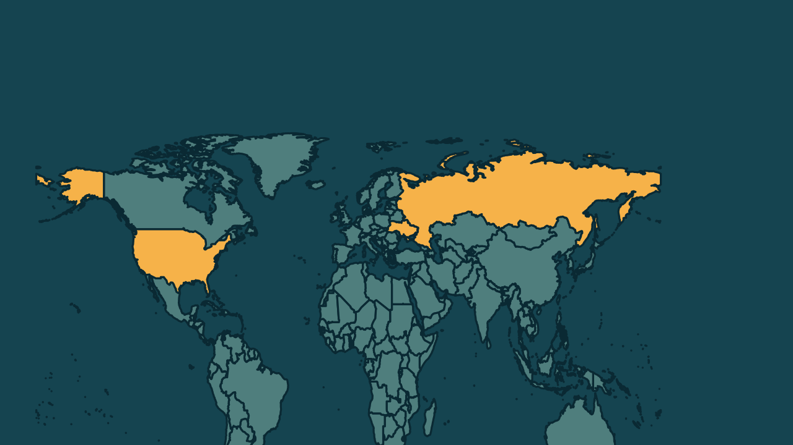

# Trump diz ter pedido a Putin que recue de agressões na Europa

*Heimdall News, edição internacional. 26 de novembro de 2026*

## A notícia

O presidente dos Estados Unidos, Donald Trump, afirmou nesta quinta-feira que pediu ao presidente da Rússia, Vladimir Putin, que recue de toda agressão militar contra territórios na Europa. [1][2]

Segundo Trump, o pedido foi feito na reunião com Putin e com o presidente da China, Xi Jinping, na semana passada. [3]

Na noite de quarta-feira, Trump recebeu na Flórida o secretário-geral da Organização do Tratado do Atlântico Norte, Mark Rutte. Os dois divulgaram uma declaração conjunta sobre evitar ações que ampliem a guerra na Ucrânia. [4][5][6]

Nos últimos dias, drones ucranianos atingiram 3 embarcações russas, entre elas um navio de guerra na costa da Líbia. [7][8]

## Quem se manifestou

- **Dmitry Peskov, russo, porta-voz do Kremlin:** afirmou que a Ucrânia busca expandir a guerra e chamou de muito perigosos os ataques na Líbia. [9][8]
- **Mark Rutte, holandês, secretário-geral da Otan:** afirmou que Trump está testando Putin e defendeu manter a pressão sobre a Rússia. [10][11]
- **Volodymyr Zelensky, ucraniano, presidente:** afirmou que a Europa precisa ser incluída nas negociações de paz. [12]
- **Friedrich Merz, alemão, premiê:** disse na quarta-feira que a Rússia não vai parar na Ucrânia. [13]

## Reação no Brasil

Nenhum posicionamento encontrado.

## Fontes

1. Folha de S.Paulo, [Trump agora pede para Putin recuar de agressões na Europa](https://www1.folha.uol.com.br/mundo/2026/11/trump-agora-pede-para-putin-recuar-de-agressoes-na-europa.shtml): "o presidente Donald Trump afirmou nesta quinta-feira (26) que gostaria que o russo recuasse"
2. G1, [Trump pede a Putin que recue com ataques 'por toda a Europa': 'É um banho de sangue'](https://g1.globo.com/mundo/noticia/2026/11/26/trump-pede-a-putin-que-pare-banho-de-sangue-com-ataques-pela-europa.ghtml): "pediu nesta quinta-feira (26) ao presidente da Rússia, Vladimir Putin, para que interrompa ataques na Ucrânia"
3. G1, [Trump pede a Putin que recue com ataques 'por toda a Europa': 'É um banho de sangue'](https://g1.globo.com/mundo/noticia/2026/11/26/trump-pede-a-putin-que-pare-banho-de-sangue-com-ataques-pela-europa.ghtml): "disse ter feito o pedido ao russo durante a reunião trilateral que manteve com ele e o presidente da China, Xi Jinping, na semana passada"
4. CNN Brasil, [Trump diz ter pedido que Putin pare com agressão militar contra a Europa](https://www.cnnbrasil.com.br/internacional/trump-diz-ter-pedido-que-putin-pare-com-agressao-militar-contra-a-europa/): "em sua residência em Mar-a-Lago, na Flórida, na noite de quarta-feira (25)"
5. Estadão, com AFP, [Trump e chefe da Otan pedem que Rússia evite ampliar guerra na Ucrânia](https://www.estadao.com.br/internacional/trump-e-chefe-da-otan-pedem-que-russia-evite-ampliar-guerra-na-ucrania-npr/): "pediram que a Rússia evite ações que possam ampliar a guerra na Ucrânia"
6. Folha de S.Paulo, [Trump agora pede para Putin recuar de agressões na Europa](https://www1.folha.uol.com.br/mundo/2026/11/trump-agora-pede-para-putin-recuar-de-agressoes-na-europa.shtml): "a importância de a Rússia e a da Ucrânia evitarem quaisquer ações que possam, intencionalmente ou não, expandir a guerra"
7. G1, [Após ter navio de guerra atingido na costa da África, Rússia acusa Ucrânia de tentar expandir conflito](https://g1.globo.com/mundo/ucrania-russia/noticia/2026/11/26/russia-acusa-ucrania-tentar-expandir-guerra-ataques-africa-mar-baltico.ghtml): "ataques de drones coordenados contra três embarcações russas, sendo um navio de guerra e dois navios de carga"
8. G1, [Após ter navio de guerra atingido na costa da África, Rússia acusa Ucrânia de tentar expandir conflito](https://g1.globo.com/mundo/ucrania-russia/noticia/2026/11/26/russia-acusa-ucrania-tentar-expandir-guerra-ataques-africa-mar-baltico.ghtml): "chamou de "muito perigosos" os ataques na costa da Líbia"
9. G1, [Após ter navio de guerra atingido na costa da África, Rússia acusa Ucrânia de tentar expandir conflito](https://g1.globo.com/mundo/ucrania-russia/noticia/2026/11/26/russia-acusa-ucrania-tentar-expandir-guerra-ataques-africa-mar-baltico.ghtml): "a Ucrânia está buscando expandir a guerra"
10. CNN Brasil, [“Vamos manter a pressão” sobre a Rússia, diz chefe da Otan](https://www.cnnbrasil.com.br/internacional/vamos-manter-a-pressao-sobre-a-russia-diz-chefe-da-otan/): "O que o presidente Trump está fazendo, inclusive no encontro em Shenzhen, é testar Putin"
11. Gazeta do Povo, [Otan diz que Trump está “testando” disposição de Putin para encerrar guerra na Ucrânia](https://www.gazetadopovo.com.br/mundo/otan-diz-que-trump-esta-testando-disposicao-de-putin-para-encerrar-guerra-na-ucrania/): "defendeu a manutenção da pressão sobre Moscou"
12. G1, [Trump pede a Putin que recue com ataques 'por toda a Europa': 'É um banho de sangue'](https://g1.globo.com/mundo/noticia/2026/11/26/trump-pede-a-putin-que-pare-banho-de-sangue-com-ataques-pela-europa.ghtml): "afirmou que a Europa precisa ser incluída nas negociações de paz"
13. Folha de S.Paulo, [Trump agora pede para Putin recuar de agressões na Europa](https://www1.folha.uol.com.br/mundo/2026/11/trump-agora-pede-para-putin-recuar-de-agressoes-na-europa.shtml): "a Rússia não vai parar na Ucrânia"
